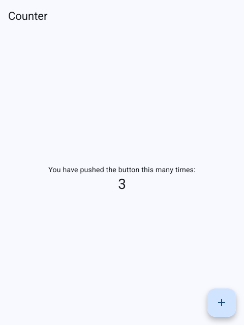
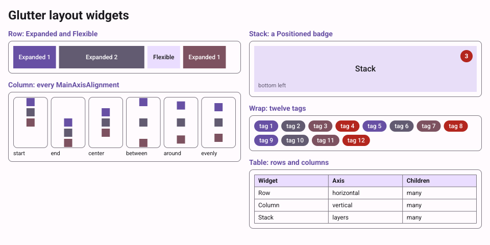
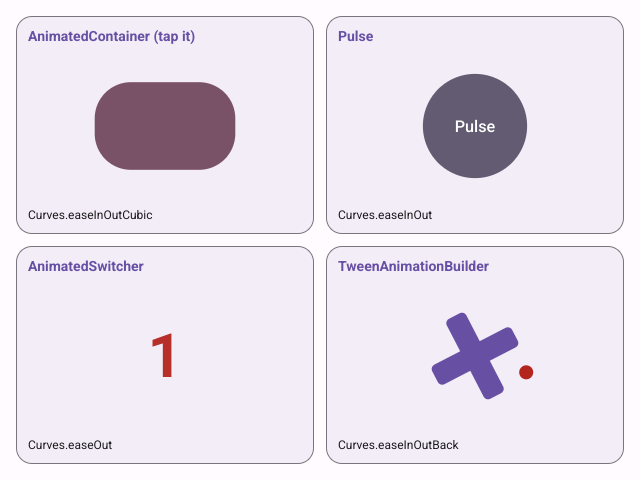
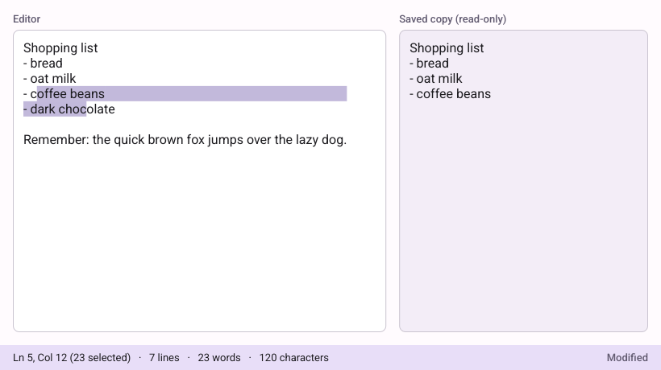
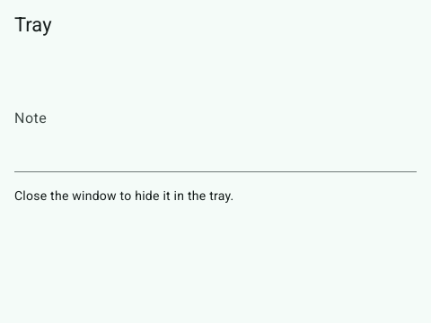
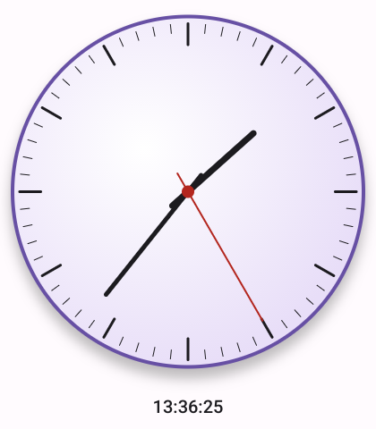

# Glutter

Glutter is a GUI toolkit for Go that has **Flutter's framework API**: widgets, rendering,
gestures, animation and Material 3. It runs on its own engine: a Wayland and X11 platform
layer and an OpenGL ES 3.0 renderer, with the system libraries called through
[purego](https://github.com/ebitengine/purego), and text layout on
[go-text](https://github.com/go-text/typesetting). **There is no cgo**: `CGO_ENABLED=0 go build`
makes the app, and Go is all you need to build it.

Linux desktop comes first. Every part that depends on the operating system or the GPU sits
behind an internal interface, so Windows, macOS, the web and mobile can be added later.

| | |
|---|---|
|  |  |
| `examples/counter` | `examples/gallery`, light and dark, every Material 3 component |

## Install

You need Go 1.27 or newer, and nothing else to build:

```
go get github.com/rm4n0s/glutter@latest
```

Apps import one package, the way Flutter's apps import `material.dart`:

```go
import m "github.com/rm4n0s/glutter/material"
```

Try the examples from a clone: `go run ./examples/counter`, `go run ./examples/gallery`.

## Quick start

This is [`examples/counter`](examples/counter/main.go), the app that `flutter create` makes:

```go
package main

import (
	"log"
	"strconv"

	m "github.com/rm4n0s/glutter/material"
)

func main() {
	err := m.RunApp(NewMyApp(), m.RunAppOpts{
		AppID:  "dev.glutter.counter",
		Window: m.WindowConfig{Title: "Counter", Size: m.Size{Width: 480, Height: 640}},
	})
	if err != nil {
		log.Fatal(err)
	}
}

type MyApp struct{ m.StatelessWidget }

func NewMyApp() *MyApp { return &MyApp{} }

func (a *MyApp) Build(bc m.BuildContext) m.Widget {
	return m.NewMaterialApp(m.MaterialAppOpts{
		Title:                      "Counter",
		Theme:                      m.NewThemeData(m.ThemeDataOpts{ColorSchemeSeed: m.Some(m.Colors.Blue.Primary)}),
		DebugShowCheckedModeBanner: m.Some(false),
		Home:                       NewCounterPage("Counter"),
	})
}

type CounterPage struct {
	m.StatefulWidget
	title string
}

func NewCounterPage(title string, opts ...m.WidgetOpts) *CounterPage {
	return &CounterPage{StatefulWidget: m.NewStatefulWidgetBase(opts...), title: title}
}

func (p *CounterPage) Title() string        { return p.title }
func (p *CounterPage) CreateState() m.State { return &counterPageState{} }

type counterPageState struct {
	m.StateOf[*CounterPage]
	count int
}

func (s *counterPageState) increment() { s.SetState(func() { s.count++ }) }

func (s *counterPageState) Build(bc m.BuildContext) m.Widget {
	return m.NewScaffold(m.ScaffoldOpts{
		AppBar: m.NewAppBar(m.AppBarOpts{Title: m.NewText(s.Widget().Title())}),
		Body: m.NewCenter(
			m.NewColumn([]m.Widget{
				m.NewText("You have pushed the button this many times:"),
				m.NewText(strconv.Itoa(s.count), m.TextOpts{Style: m.ThemeOf(bc).TextTheme.HeadlineMedium}),
			}, m.ColumnOpts{MainAxisAlignment: m.MainAxisAlignmentCenter}),
		),
		FloatingActionButton: m.NewFloatingActionButton(s.increment, m.NewIcon(m.Icons.Add()),
			m.FloatingActionButtonOpts{Tooltip: "Increment"}),
	})
}
```

Run it with `go run .`. The code reads like the Dart one: `SetState`, `Scaffold`, `AppBar`,
`FloatingActionButton`, `ThemeOf(bc).TextTheme.HeadlineMedium`.

## From Flutter to Glutter

| Flutter | Glutter |
|---|---|
| `Text('hi')` | `m.NewText("hi")` |
| `Padding(padding: EdgeInsets.all(8), child: c)` | `m.NewPadding(m.NewEdgeInsetsAll(8), c)` |
| `Container(width: 100, color: Colors.blue, child: c)` | `m.NewContainer(c, m.ContainerOpts{Width: m.Some(100.0), Color: m.Some(m.Colors.Blue.Primary)})` |
| `ListView.builder(itemBuilder: ...)` | `m.NewListViewBuilder(func(bc m.BuildContext, i int) m.Widget {...})` |
| `Theme.of(context)` | `m.ThemeOf(bc)` |
| `Navigator.push(context, route)` | `m.NavigatorPush(bc, route)`; the result comes from a channel |
| `MainAxisAlignment.center` | `m.MainAxisAlignmentCenter` |
| `Icons.add` | `m.Icons.Add()` |
| `setState(() {...})` | `s.SetState(func() {...})` |
| `Future`, `await` | `func(ctx context.Context) (T, error)`, goroutines, `State.Go` |

The required parameters are positional (`child` and `children` last), the optional ones are
fields of a trailing `XOpts` struct, a nullable parameter is `m.Some(v)`, and the zero value of
an enum, `XUnspecified`, means the widget's default. The rules are in
[SPEC §12](docs/SPEC.md#12-api-conventions-flutter--go), every difference from Flutter is in
§12.10, and [docs/GUIDE.md](docs/GUIDE.md) shows ten things side by side in Dart and Go.

## What runs where

**Required** at run time:

- a Wayland compositor with `xdg_wm_base`, or an X server
- an EGL driver with OpenGL ES 3.0 (Mesa 20 or newer, NVIDIA through glvnd, or llvmpipe)
- the libraries that every Linux desktop has (Wayland, xkbcommon, libdecor where the
  compositor draws no title bars, EGL); a missing one is reported as a tagged error

**Optional**: a D-Bus session bus (file dialogs, notifications, the tray, settings, opening
URLs), xdg-desktop-portal and a backend, a StatusNotifierItem host for the tray, and
at-spi2-core for accessibility (screen readers such as Orca). SPEC §16 has the list.

`GLUTTER_BACKEND=x11|wayland` chooses the backend; the default is Wayland when it is there.

## Examples

Each one uses only the public packages and has tests that run on a fake platform.

| Example | Shows | Screenshot |
|---|---|---|
| [`counter`](examples/counter) | the reference app of SPEC §12.12 |  |
| [`layout`](examples/layout) | Row, Column, Stack, Wrap, Flex |  |
| [`animations`](examples/animations) | implicit and explicit animations |  |
| [`scrolling`](examples/scrolling) | lists, grids and slivers |  |
| [`navigation`](examples/navigation) | Navigator, routes, Hero, the Pages API |  |
| [`editor`](examples/editor) | text editing, selection, clipboard, input methods |  |
| [`gallery`](examples/gallery) | every Material 3 component, light and dark |  |
| [`multiwindow`](examples/multiwindow) | several windows of one app |  |
| [`tray`](examples/tray) | system tray, notifications, file dialog (the window alone is shown: a tray needs a desktop) |  |
| [`custompaint`](examples/custompaint) | `CustomPaint` and the `Canvas` |  |

## Performance

On release builds (`-tags glutter_release`) an animation-only frame costs microseconds on the UI
thread, a full rebuild of the gallery page about 4 ms, and an idle app uses no CPU.
[docs/PERFORMANCE.md](docs/PERFORMANCE.md) has the numbers, the machine they were measured on and
the targets that are not met yet.

## Working on Glutter

Go 1.27 and a C compiler (only because `go test -race` needs cgo). `docs/SPEC.md` is the
source of truth, `docs/IMPLEMENTATION.md` the plan and `docs/IMPLEMENTED.md` the log of what is
done. [CLAUDE.md](CLAUDE.md) lists the commands:

```
go build ./...                  # CGO_ENABLED=0 go build ./... must always work
go test -race ./...
go vet ./... && golangci-lint run
go generate ./...
go run ./cmd/glutter-gen apicheck -allow cmd/glutter-gen/apicheck.allow
```

## License

BSD-3-Clause, see [LICENSE](LICENSE). Glutter is a derivative of the Flutter framework
(BSD-3-Clause, `third_party/flutter/LICENSE`); [NOTICE](NOTICE) lists the other components.
