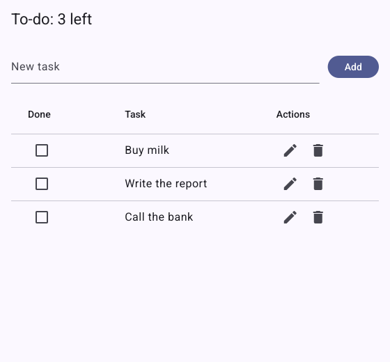

# Glutter

Glutter is a GUI toolkit for Go that has **Flutter's framework API**: widgets, rendering,
gestures, animation and Material 3. It runs on its own engine: a Wayland and X11 platform
layer and a Vulkan renderer with an OpenGL ES 3.0 fallback, with the system libraries called through
[purego](https://github.com/ebitengine/purego), and text layout on
[go-text](https://github.com/go-text/typesetting). **There is no cgo**: `CGO_ENABLED=0 go build`
makes the app, and Go is all you need to build it.

Linux desktop comes first, then the web (`GOOS=js GOARCH=wasm`) and Android. Every part that depends on the
operating system or the GPU sits behind an internal interface, so Windows, macOS and iOS can be added later.

| | |
|---|---|
|  |  |
| `examples/counter` | `examples/gallery`, light and dark, every Material 3 component |

## Install

You need Go 1.27 or newer, and nothing else to build:

```
go get github.com/rm4n0s/glutter@latest
```

Apps import one package, the way Flutter's apps import `material.dart`:

```go
import m "github.com/rm4n0s/glutter/material"
```

Try the examples from a clone: `go run ./examples/counter`, `go run ./examples/gallery`.

## Quick start

This is [`examples/counter`](examples/counter/main.go), the app that `flutter create` makes:

```go
package main

import (
	"log"
	"strconv"

	m "github.com/rm4n0s/glutter/material"
)

func main() {
	err := m.RunApp(NewMyApp(), m.RunAppOpts{
		AppID:  "dev.glutter.counter",
		Window: m.WindowConfig{Title: "Counter", Size: m.Size{Width: 480, Height: 640}},
	})
	if err != nil {
		log.Fatal(err)
	}
}

type MyApp struct{ m.StatelessWidget }

func NewMyApp() *MyApp { return &MyApp{} }

func (a *MyApp) Build(bc m.BuildContext) m.Widget {
	return m.NewMaterialApp(m.MaterialAppOpts{
		Title:                      "Counter",
		Theme:                      m.NewThemeData(m.ThemeDataOpts{ColorSchemeSeed: m.Some(m.Colors.Blue.Primary)}),
		DebugShowCheckedModeBanner: m.Some(false),
		Home:                       NewCounterPage("Counter"),
	})
}

type CounterPage struct {
	m.StatefulWidget
	title string
}

func NewCounterPage(title string, opts ...m.WidgetOpts) *CounterPage {
	return &CounterPage{StatefulWidget: m.NewStatefulWidgetBase(opts...), title: title}
}

func (p *CounterPage) Title() string        { return p.title }
func (p *CounterPage) CreateState() m.State { return &counterPageState{} }

type counterPageState struct {
	m.StateOf[*CounterPage]
	count int
}

func (s *counterPageState) increment() { s.SetState(func() { s.count++ }) }

func (s *counterPageState) Build(bc m.BuildContext) m.Widget {
	return m.NewScaffold(m.ScaffoldOpts{
		AppBar: m.NewAppBar(m.AppBarOpts{Title: m.NewText(s.Widget().Title())}),
		Body: m.NewCenter(
			m.NewColumn([]m.Widget{
				m.NewText("You have pushed the button this many times:"),
				m.NewText(strconv.Itoa(s.count), m.TextOpts{Style: m.ThemeOf(bc).TextTheme.HeadlineMedium}),
			}, m.ColumnOpts{MainAxisAlignment: m.MainAxisAlignmentCenter}),
		),
		FloatingActionButton: m.NewFloatingActionButton(s.increment, m.NewIcon(m.Icons.Add()),
			m.FloatingActionButtonOpts{Tooltip: "Increment"}),
	})
}
```

Run it with `go run .`. The code reads like the Dart one: `SetState`, `Scaffold`, `AppBar`,
`FloatingActionButton`, `ThemeOf(bc).TextTheme.HeadlineMedium`.

## Fonts

An app loads its own fonts, for example a monospace font for a code view, from bytes or from
its assets, and names them in `TextStyle.FontFamily` and `FontFamilyFallback`. The families of a
style are tried in order, and the system's default font comes last, so `monospace` as a fallback
reaches the user's monospace font. `services.FontLoader` and
`PlatformDispatcher.LoadFontFromList` load a font while the app runs, and
`gluttertest.Opts.Fonts` gives a widget test its fonts. [docs/GUIDE.md](docs/GUIDE.md) has the
details.

A code view also wants tab stops: `TextPainterOpts.TabSize` puts the stops that many spaces apart,
measured from the start of each line, as CSS's `tab-size` does (Flutter has none, so the default is
off). The text engine keeps the shaped runs of the lines it builds, so a line whose spans did not
change is built again several times faster than it was the first time.

```go
var editorStyle = m.NewTextStyle(m.TextStyleOpts{
	FontFamily:         "JetBrains Mono",
	FontFamilyFallback: []string{"monospace"},
})

func options(mono []byte) m.RunAppOpts {
	return m.RunAppOpts{Fonts: []m.FontSource{{Family: "JetBrains Mono", Data: mono}}}
}
```

An app that lives in the system tray closes its window to the tray: `SetHidden(true)` on the
window's controller takes it off the screen and the task bar while the app goes on, and
`SetHidden(false)` or `Activate()` brings it back as it was (Flutter has no counterpart;
[`examples/tray`](examples/tray) does it from `AppLifecycleListener.OnExitRequested`).

## From Flutter to Glutter

| Flutter | Glutter |
|---|---|
| `Text('hi')` | `m.NewText("hi")` |
| `Padding(padding: EdgeInsets.all(8), child: c)` | `m.NewPadding(m.NewEdgeInsetsAll(8), c)` |
| `Container(width: 100, color: Colors.blue, child: c)` | `m.NewContainer(c, m.ContainerOpts{Width: m.Some(100.0), Color: m.Some(m.Colors.Blue.Primary)})` |
| `ListView.builder(itemBuilder: ...)` | `m.NewListViewBuilder(func(bc m.BuildContext, i int) m.Widget {...})` |
| `Theme.of(context)` | `m.ThemeOf(bc)` |
| `Navigator.push(context, route)` | `m.NavigatorPush(bc, route)`; the result comes from a channel |
| `MainAxisAlignment.center` | `m.MainAxisAlignmentCenter` |
| `Icons.add` | `m.Icons.Add()` |
| `setState(() {...})` | `s.SetState(func() {...})` |
| `Future`, `await` | `func(ctx context.Context) (T, error)`, goroutines, `State.Go` |

The required parameters are positional (`child` and `children` last), the optional ones are
fields of a trailing `XOpts` struct, a nullable parameter is `m.Some(v)`, and the zero value of
an enum, `XUnspecified`, means the widget's default. The rules are in
[SPEC §12](docs/SPEC.md#12-api-conventions-flutter--go), every difference from Flutter is in
§12.10, and [docs/GUIDE.md](docs/GUIDE.md) shows eleven things side by side in Dart and Go.

## What runs where

**Required** at run time:

- a Wayland compositor with `xdg_wm_base`, or an X server
- a GPU driver: **either** Vulkan 1.3 (or 1.1 with dynamic rendering and synchronization 2;
  `libvulkan.so.1` and a driver such as Mesa's RADV, ANV or NVK, or NVIDIA's), **or** an EGL driver
  with OpenGL ES 3.0 (Mesa 20 or newer, NVIDIA through glvnd, or llvmpipe). Glutter uses Vulkan
  where it works and falls back to OpenGL ES where it does not, without being told
- the libraries that every Linux desktop has (Wayland, xkbcommon, libdecor where the
  compositor draws no title bars, EGL); a missing one is reported as a tagged error

**Optional**: a D-Bus session bus (file dialogs, notifications, the tray, settings, opening
URLs), xdg-desktop-portal and a backend, a StatusNotifierItem host for the tray, and
at-spi2-core for accessibility (screen readers such as Orca). SPEC §16 has the list.

`GLUTTER_BACKEND=x11|wayland` chooses the backend; the default is Wayland when it is there.
`GLUTTER_RENDERER=auto|vulkan|gles` chooses the renderer (`RunAppOpts.Renderer` does the same).
The default is `auto`: Vulkan first, then OpenGL ES when there is no Vulkan loader, no driver
that can present to the window, or only a software device (llvmpipe, lavapipe); each fallback is
logged once at Info level with its error. A name never falls back, and is the only way to use a
software Vulkan device. The log line `renderer chosen` names the renderer and the GPU. If the
GPU is lost, Glutter makes its resources again once and draws the frame again; a second loss
within ten seconds ends the app with `VulkanDeviceLost`. `GLUTTER_VULKAN_DEVICE=<index or part of
the name>` picks another Vulkan device, `GLUTTER_VULKAN_VALIDATION=1` turns on the validation layer,
and `GLUTTER_DAMAGE=0` and `GLUTTER_RASTER_CACHE=0` turn off the damage rectangles and the raster
cache of both renderers. What the GPU drivers compile (the program binaries of GLES, the pipeline cache of
Vulkan) is kept in `$XDG_CACHE_HOME/glutter/shaders` (`~/.cache/glutter/shaders`) so that a second start
compiles nothing; `GLUTTER_SHADER_CACHE=0` turns it off, and `GLUTTER_FRAME_STATS=1` logs the parts of the
start (the renderers tried, the GPU context, the shaders, the first frame).

## Web

Glutter runs in the browser too: `GOOS=js GOARCH=wasm` with the standard Go toolchain (no TinyGo).
Every example except `multiwindow` and `tray` builds and runs there (a page has no second window
and no tray).

```sh
go run ./cmd/glutter-web serve ./examples/gallery          # builds, serves at http://localhost:8080/
go run ./cmd/glutter-web build -release -o dist ./examples/counter   # a directory for any static server
go run ./cmd/glutter-web shot -browser firefox -o gallery.png ./examples/gallery
```

`build` writes `index.html` (the loader), `wasm_exec.js`, `app.wasm` and `app.wasm.gz`; `-release`
builds with `-tags glutter_release -ldflags=-s -w`. Serve the `.gz` with `Content-Encoding: gzip`
and `app.wasm` as `application/wasm`, which `glutter-web serve` does. The page needs no
configuration; `globalThis.glutterConfig.hostElement` (a CSS selector, set in `index.html`) puts the
view in an element instead of the whole page.

**Browsers.** Tried: Chromium 155 (WebGPU, WebGL 2) and Firefox 158 (WebGL 2; its WebGPU is off by
default on Linux), both on Fedora 44. Safari and other engines were not tried.

**Renderers.** The page tries WebGPU, then WebGL 2, then a software renderer on a 2D canvas, once, at the
first frame. `?GLUTTER_RENDERER=webgpu|webgl|soft` in the page's address (or `RunAppOpts.Renderer`)
chooses one; a name never falls back, and a browser that cannot give it shows the error in the page. Any
query parameter that starts with `GLUTTER_` is the program's environment variable of that name.

**What the web lacks** (SPEC §3, §23): accessibility (no ARIA tree in 1.1), a second window or view on a
page, system fonts (the text uses the bundled Roboto and Material Icons and the fonts an app loads),
drag and drop out of the app, file dialogs, the tray, `KeepScreenOn`, and closing the page from the
app. Opening a link and notifications (without buttons) work. An app asks `foundation.IsWeb` where it
must differ; [docs/GUIDE.md](docs/GUIDE.md) has a note for Flutter web developers.

A release build of the counter is 38 MB of WebAssembly and 8.8 MB gzipped, the gallery 58 MB and
11.9 MB; [docs/PERFORMANCE.md](docs/PERFORMANCE.md) has the web numbers and the targets that are not met.

## Android

Glutter runs on Android 8.0 (API 26) and later, on arm64 and x86_64 (Android is the one target that uses cgo, for the NDK and the Java embedding, in one package; `CGO_ENABLED=0 go build ./...` still builds the library). An app is the same Go program: `GOOS=android` is chosen by the tool, and the result is an APK.

**What to install:** Go 1.27, the Android SDK (`ANDROID_HOME`) with `build-tools`, a `platforms/android-<level>` and the NDK (`sdkmanager "ndk;30.0.16248370"`; `ANDROID_NDK_HOME` or the newest `ndk/` under the SDK is used), and a Java runtime for `apksigner`. A missing piece is an error that names the `sdkmanager` package. A phone needs USB debugging; an emulator needs a system image.

```sh
go run ./cmd/glutter-android run ./examples/gallery            # builds, installs, starts, streams the log
go run ./cmd/glutter-android build -release -key key.pk8 -cert cert.pem -o gallery.apk ./examples/gallery
go run ./cmd/glutter-android shot -screen -o gallery.png ./examples/gallery
scripts/perf-android.sh -m                                      # sizes, start, CPU, frames, memory
```

`build` makes one APK for both ABIs (`-abi arm64` for one); `-release` builds with `-tags glutter_release` and strips the program. `-env GLUTTER_X=v` (repeatable, on `run` and `shot`) reaches the app's environment as an intent extra, as the web's query parameters do. The app's `HOME` is its files directory, `slog` goes to `logcat` with the level as the priority (`adb logcat -s <app id>`), and `GLUTTER_RENDERER=vulkan|gles|soft` chooses the renderer (the default is Vulkan where the device's driver is good, then OpenGL ES, then the CPU).

**What works:** everything of the framework, Material 3, touch, stylus and mouse, the soft keyboard and input methods (composition, actions, the keyboard's height as `ViewInsets`), the clipboard, the back button and the predictive back gesture, the status and navigation bars, the system's fonts and emoji, TalkBack, system settings (dark mode, text size, languages, 24-hour clock, reduced motion), the overscroll glow and stretch, the text selection toolbar and magnifier, spell check, `desktop.OpenURI` and notifications.

**What Android lacks:** a second window or view (`multiwindow`), the tray (`tray`) and file dialogs, autofill, content that a keyboard inserts (stickers, GIFs), plugins and platform channels (call the NDK or Java through your own code, or use the standard library), and an Android App Bundle for Google Play (an APK only). SPEC §3 and §24 have the list and the reasons; [docs/GUIDE.md](docs/GUIDE.md) has a note for Flutter Android developers.

Every example except `multiwindow` and `tray` builds and runs on a phone (`examples/examples_test.go` builds them and a device test draws the first frame of each). The gallery keeps its list of pages in a drawer when the window is narrow. A release build of the counter is an APK of 26 MiB per ABI and the gallery 37 MiB; [docs/PERFORMANCE.md](docs/PERFORMANCE.md) has the numbers, the targets and what the emulator cannot measure.

## Examples

Each one uses only the public packages and has tests that run on a fake platform.

| Example | Shows | Screenshot |
|---|---|---|
| [`counter`](examples/counter) | the reference app of SPEC §12.12 |  |
| [`layout`](examples/layout) | Row, Column, Stack, Wrap, Flex |  |
| [`animations`](examples/animations) | implicit and explicit animations |  |
| [`scrolling`](examples/scrolling) | lists, grids and slivers |  |
| [`navigation`](examples/navigation) | Navigator, routes, Hero, the Pages API |  |
| [`editor`](examples/editor) | text editing, selection, clipboard, input methods |  |
| [`gallery`](examples/gallery) | every Material 3 component, light and dark |  |
| [`multiwindow`](examples/multiwindow) | several windows of one app |  |
| [`tray`](examples/tray) | system tray, notifications, file dialog (the window alone is shown: a tray needs a desktop) |  |
| [`custompaint`](examples/custompaint) | `CustomPaint` and the `Canvas` |  |
| [`todo`](examples/todo) | a `DataTable` of tasks; each row has a checkbox, an Edit button (a dialog) and a Delete button |  |

## Performance

On release builds (`-tags glutter_release`) an animation-only frame costs microseconds on the UI
thread, a full rebuild of the gallery page about 4 ms, and an idle app uses no CPU.
[docs/PERFORMANCE.md](docs/PERFORMANCE.md) has the numbers, the machine they were measured on and
the targets that are not met yet.

## Working on Glutter

Go 1.27 and a C compiler (only because `go test -race` needs cgo). `docs/SPEC.md` is the
source of truth, `docs/IMPLEMENTATION.md` the plan and `docs/IMPLEMENTED.md` the log of what is
done. [CLAUDE.md](CLAUDE.md) lists the commands:

```
go build ./...                  # CGO_ENABLED=0 go build ./... must always work
go test -race ./...
go vet ./... && golangci-lint run
go generate ./...
go run ./cmd/glutter-gen apicheck -allow cmd/glutter-gen/apicheck.allow
```

## License

BSD-3-Clause, see [LICENSE](LICENSE). Glutter is a derivative of the Flutter framework
(BSD-3-Clause, `third_party/flutter/LICENSE`); [NOTICE](NOTICE) lists the other components.
