# Glutter

<p align="center">
  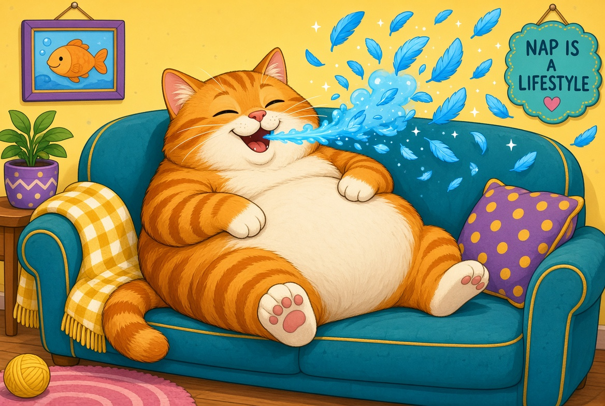
</p>

Glutter is a GUI toolkit for Go that has **Flutter's framework API**: widgets, rendering,
gestures, animation and Material 3. It runs on its own engine: a Wayland and X11 platform
layer and a Vulkan renderer with an OpenGL ES 3.0 fallback (on Windows, Win32 through the standard library and
Direct3D 12; on macOS, AppKit and Metal), with the system libraries called through
[purego](https://github.com/ebitengine/purego), and text layout on
[go-text](https://github.com/go-text/typesetting). **There is no cgo**: `CGO_ENABLED=0 go build`
makes the app, and Go is all you need to build it.

Linux desktop comes first, then the web (`GOOS=js GOARCH=wasm`), Android, Windows (`GOOS=windows`, Direct3D 12; version 1.8)
and macOS (`GOOS=darwin`, Metal; version 1.13).
Every part that depends on the operating system or the GPU sits behind an internal interface, so iOS can be
added later.

| | |
|---|---|
| 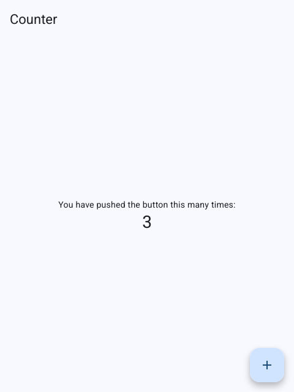 | 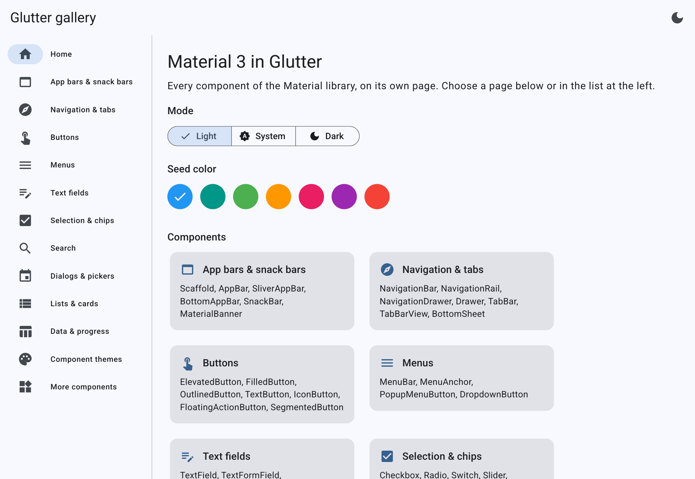 |
| `examples/counter` | `examples/gallery`, light and dark, every Material 3 component |

## Install

You need Go 1.27 or newer, and nothing else to build:

```
go get github.com/rm4n0s/glutter@latest
```

Apps import one package, the way Flutter's apps import `material.dart`:

```go
import m "github.com/rm4n0s/glutter/material"
```

Try the examples from a clone: `go run ./examples/counter`, `go run ./examples/gallery`.

## Quick start

This is [`examples/counter`](examples/counter/main.go), the app that `flutter create` makes:

```go
package main

import (
	"log"
	"strconv"

	m "github.com/rm4n0s/glutter/material"
)

func main() {
	err := m.RunApp(NewMyApp(), m.RunAppOpts{
		AppID:  "dev.glutter.counter",
		Window: m.WindowConfig{Title: "Counter", Size: m.Size{Width: 480, Height: 640}},
	})
	if err != nil {
		log.Fatal(err)
	}
}

type MyApp struct{ m.StatelessWidget }

func NewMyApp() *MyApp { return &MyApp{} }

func (a *MyApp) Build(bc m.BuildContext) m.Widget {
	return m.NewMaterialApp(m.MaterialAppOpts{
		Title:                      "Counter",
		Theme:                      m.NewThemeData(m.ThemeDataOpts{ColorSchemeSeed: m.Some(m.Colors.Blue.Primary)}),
		DebugShowCheckedModeBanner: m.Some(false),
		Home:                       NewCounterPage("Counter"),
	})
}

type CounterPage struct {
	m.StatefulWidget
	title string
}

func NewCounterPage(title string, opts ...m.WidgetOpts) *CounterPage {
	return &CounterPage{StatefulWidget: m.NewStatefulWidgetBase(opts...), title: title}
}

func (p *CounterPage) Title() string        { return p.title }
func (p *CounterPage) CreateState() m.State { return &counterPageState{} }

type counterPageState struct {
	m.StateOf[*CounterPage]
	count int
}

func (s *counterPageState) increment() { s.SetState(func() { s.count++ }) }

func (s *counterPageState) Build(bc m.BuildContext) m.Widget {
	return m.NewScaffold(m.ScaffoldOpts{
		AppBar: m.NewAppBar(m.AppBarOpts{Title: m.NewText(s.Widget().Title())}),
		Body: m.NewCenter(
			m.NewColumn([]m.Widget{
				m.NewText("You have pushed the button this many times:"),
				m.NewText(strconv.Itoa(s.count), m.TextOpts{Style: m.ThemeOf(bc).TextTheme.HeadlineMedium}),
			}, m.ColumnOpts{MainAxisAlignment: m.MainAxisAlignmentCenter}),
		),
		FloatingActionButton: m.NewFloatingActionButton(s.increment, m.NewIcon(m.Icons.Add()),
			m.FloatingActionButtonOpts{Tooltip: "Increment"}),
	})
}
```

Run it with `go run .`. The code reads like the Dart one: `SetState`, `Scaffold`, `AppBar`,
`FloatingActionButton`, `ThemeOf(bc).TextTheme.HeadlineMedium`.

## Fonts

An app loads its own fonts, for example a monospace font for a code view, from bytes or from
its assets, and names them in `TextStyle.FontFamily` and `FontFamilyFallback`. The families of a
style are tried in order, and the system's default font comes last, so `monospace` as a fallback
reaches the user's monospace font. `services.FontLoader` and
`PlatformDispatcher.LoadFontFromList` load a font while the app runs, and
`gluttertest.Opts.Fonts` gives a widget test its fonts. [docs/GUIDE.md](docs/GUIDE.md) has the
details.

A code view also wants tab stops: `TextPainterOpts.TabSize` puts the stops that many spaces apart,
measured from the start of each line, as CSS's `tab-size` does (Flutter has none, so the default is
off). The text engine keeps the shaped runs of the lines it builds, so a line whose spans did not
change is built again several times faster than it was the first time.

```go
var editorStyle = m.NewTextStyle(m.TextStyleOpts{
	FontFamily:         "JetBrains Mono",
	FontFamilyFallback: []string{"monospace"},
})

func options(mono []byte) m.RunAppOpts {
	return m.RunAppOpts{Fonts: []m.FontSource{{Family: "JetBrains Mono", Data: mono}}}
}
```

An app that lives in the system tray closes its window to the tray: `SetHidden(true)` on the
window's controller takes it off the screen and the task bar while the app goes on, and
`SetHidden(false)` or `Activate()` brings it back as it was (Flutter has no counterpart;
[`examples/tray`](examples/tray) does it from `AppLifecycleListener.OnExitRequested`).

The controller of a window (`WindowControllerOf(bc)`, or the one a `RegularWindow` is made with) sets its
title, activates it, minimizes it, maximizes it, makes it full screen, and takes the state a window opens
in; closing the first window can be an ordinary close that leaves other windows open
(`WindowingOwner().SetImplicitWindowDelegate`; [`examples/multiwindow`](examples/multiwindow) does it).
`MouseRegionOpts.HoldCursorWhilePressed` keeps a region's cursor while a button is held (a sash that the
pointer outruns), and `DraggableOpts.Slop`, `CancelOnEscape` and `DragTargetOpts.RepeatMove` make a draggable
row stay a click, cancel with Escape, and let a list scroll under a waiting drag.
`TreeSliverNode` has `SetChildren`, `InsertChild` and `RemoveChild`, lazy nodes (`HasChildren`) and
`TreeSliverOpts.NodeKey`; `RawTooltip` has a hover delay read on enter, callbacks and a controller.

**What is new in 1.8.** Windows (the "Windows" section below), and three more fixes for the application built on
Glutter that asked for 1.7's. The font fallback no longer parses a font to learn that it lacks a character: it asks the
font's character map first (fontconfig's, the scanner's, or the `cmap` table alone), and control characters such as the
tab go to the first face that loads, so a style with dozens of fonts costs one parse on its first layout instead of
dozens (an app that kept a `ControlsFont` workaround can remove it).
`TreeSliverNode.SetExpanded` sets a node's expansion whether it is shown or not, with no animation and no
`OnNodeToggle`, so a tree whose state lives in a model need not make its nodes again. In `WindowDecoration`, only the
title, the empty space around it and the gap before `Leading` move the window, maximize it on a double tap and open
its menu on a right click; the `Leading` and `Actions` widgets get their own gestures, and a tap on a button in
`Actions` arrives at once.

**What is new in 1.9.** SVG images. The package `svg` has `flutter_svg`'s widgets: `NewSvgPictureAsset`, `NewSvgPictureString`, `NewSvgPictureMemory`, `NewSvgPictureFile` and `NewSvgPictureNetwork`. Glutter's own parser and painter, in plain Go, draw:
- shapes, strokes and dashes;
- gradients and patterns;
- clip paths and masks;
- text, laid out by Glutter's text engine;
- markers and the common filters (blur, drop shadow, color matrix, compositing, blending, morphology).

The same pixels come out on every platform and every renderer. `examples/svg` shows it, and [the guide](docs/GUIDE.md#13-svg-images) compares it with `flutter_svg`.

```go
func logo() m.Widget {
	return svg.NewSvgPictureAsset("assets/logo.svg", svg.SvgPictureAssetOpts{
		SvgPictureOpts: svg.SvgPictureOpts{Width: m.Some(48.0)},
	})
}
```

**What is new in 1.9.1.** Drawing a view off screen, for an app that needs the pixels of a second view (a remote
view, a thumbnail, a preview). The package `offscreen` has:
- `NewRasterizer`, a `ui.Rasterizer` on the software renderer (for `Scene.ToImage`), safe on any goroutine;
- `NewDetacher`, which copies a scene on the UI thread into one that any goroutine can draw;
- `NewSurface`, the pixels of one view across frames, which redraws only the rectangles that changed;
- `NewView`, which runs a widget tree in a view of its own, on its own binding, at most 30 frames a second, and
  calls your function on a goroutine with the image and the damage of each frame ([the guide](docs/GUIDE.md#14-drawing-a-view-off-screen)).

The software renderer is also faster, with the same pixels: a full 1280x800 frame takes about 6 ms (16 ms full of text) where it took about 50.

```go
func startView(parent *m.WidgetsBinding, root m.Widget, send func(pixels []byte, width int)) (*offscreen.View, error) {
	return offscreen.NewView(parent, m.Size{Width: 1280, Height: 800}, root, func(f offscreen.Frame) {
		send(append([]byte(nil), f.Image.Pix...), f.Image.Rect.Dx()) // the image is valid only in this call
	})
}
```

**What is new in 1.13.** macOS.
- **macOS** (the "macOS" section below): AppKit and Metal through purego, no cgo, on Apple silicon and Intel, from macOS 12: windows and several windows, the mouse, trackpad and tablets, the keyboard and input methods, the pasteboard, menus, drag and drop, the tray, notifications, file dialogs, VoiceOver, gamepads, audio, the `gpu` package and the 3D view on Metal, and `glutter-macos`, which makes a signed `.app`. Every example draws on a Mac.

**What is new in 1.12.** Linux without a GPU.
- **The `soft` renderer on Linux.** `GLUTTER_RENDERER=soft` draws the app on the CPU into the window's shared memory (`wl_shm` on Wayland, MIT-SHM on X11, `XPutImage` over a remote display or with `GLUTTER_X11_NOSHM=1`) and rasterizes and sends only the rectangles that changed. In a virtual machine whose OpenGL is llvmpipe, OpenGL rasterizes the whole window for every frame.
- **`auto` chooses it when there is no GPU.** Vulkan first, then OpenGL ES, then `soft`; OpenGL ES gives up when its `GL_RENDERER` is llvmpipe, softpipe, swrast, a software rasterizer or SwiftShader, and the log says which string decided. A name (`GLUTTER_RENDERER=gles`) is never second-guessed. An X11 window made for `soft` never initializes EGL, so Mesa's `DRI3 error` line does not appear.
- **Speed.** An idle editor with a blinking caret takes about 4 ms of CPU for each second with `soft` on Wayland and X11, against 190 to 460 ms with OpenGL ES on llvmpipe (`docs/PERFORMANCE.md`).
- **Fixes.** The event loop of Linux no longer starves the display connection, the posted functions and the input when frames take longer than the display's interval (it ran the timers that a frame set for "at once" one after the other), which also helped OpenGL ES on a rasterizer on the CPU.

**What is new in 1.11.** Games.
- **The package `gamepad`.** `gamepad.Of(bc).Pads()` (or `AppendPads`, which allocates nothing) gives the connected pads, each with the same buttons and axes whatever it is (Xbox, PlayStation, Switch, generic), from SDL 3's table of mappings and your own lines; listeners and the state to poll; rumble, lights, battery, touchpads and sensors where the pad has them. Linux (evdev, hotplug, force feedback), Windows (XInput and Raw Input HID), browsers and Android. The pads also make key events (the D-pad is the arrows, A activates the focused widget, Start is `GameButtonStart`), so a Material menu works with a pad and no code of yours.
- **The package `audio`.** Playback and capture devices (PulseAudio and ALSA, WASAPI, AAudio, Web Audio) with streams of any rate, channel count and speed that are converted and mixed for you, callback streams, WAV files in `audio/wav`, and a device that follows the system's default. `sensors` gives a phone's or a pad's accelerometer and gyroscope; browsers vibrate for haptic feedback.
- **Models and materials.** `model/gltf` (`.gltf` and `.glb`, the common extensions, meshopt), `model/ply` and `model/threemf` load into `model.Model`; `viewport3d` draws PBR metallic-roughness materials with image-based lighting, a shadow, tone mapping, skins, morph targets and animations, and point clouds with colors.
- **`examples/game3d`.** Coin Run uses all of them: a skinned character in a glTF level, played with a pad, the keyboard, a locked mouse or touch, with music, effects, rumble and a pause menu. Its guide chapter is "A game, from the pieces".
- **Speed and memory.** A pad button reaches the app in the next frame; the output latency on PulseAudio is about 19 ms; the renderer draws the example's frame at 1920x1080 with 4x multisampling at about 700 frames a second on a Radeon RX 6800M; a steady frame of the 3D view, the pads and the audio allocates nothing; pads connected and removed 1,000 times, streams opened and closed 1,000 times and a level loaded 100 times leave the heap flat. **One target is not met:** in ten-minute recordings of a test tone the null sink's monitor had one or two glitches of 128 frames while the UI drew (`docs/PERFORMANCE.md`, "Games"); the cause is not found.
- **Fixes.** The loop of the Windows platform no longer starves when frames take longer than the display's interval (an app now ends when asked, even over a software rasterizer), and a pad's listeners are no longer copied for each event.

**What is new in 1.10.** The GPU and 3D.
- **The package `gpu`.** The device of the renderer (`gpu.DeviceOf`, `gpu.OnDevice`) with buffers, textures, samplers, shader modules (made from your WGSL by `glutter-gen gpushaders`), render and compute pipelines, bind groups, command encoders, indirect draws, copies and read-back, on Vulkan, Direct3D 12 and WebGPU. `gpu.NewView` is a widget with a render target of its own (depth, 4x multisampling, `RGBA16Float`) that your function draws into; it is shown in the widget tree with no copy and draws only when it changes. `examples/gpu-triangle` is a lit cube drawn this way.
- **A locked pointer** for a game or a 3D view: `widgets.PointerLock` on Linux (Wayland and X11), Windows, the web and Android.
- **`vecmath`, `viewport3d` and `model`.** A 3D view with a camera and its navigation (orbit, pan, zoom, the standard views; a mouse, touch, a trackpad, keys), meshes, materials, lines, points and the edges of a model, four display modes, section planes with caps, picking and selection, a grid, axes, a view cube and widgets anchored to points of the scene. Matrices are `float64` on the CPU and `float32` relative to the eye on the GPU, so a part 50 km from the origin keeps its 0.1 mm. `model/stl` and `model/obj` read STL and OBJ files (a million triangles in 137 ms and 0.64 s), and `viewport3d.Upload` makes a scene of them. `examples/cad` is a viewer that opens a file, cuts a section, picks a face and measures a distance.
- **Speed and memory.** A steady frame allocates nothing; a million triangles with edges draw at about 400 frames a second on a Radeon RX 6800M with 0.12 ms of CPU; 10,000 items of one mesh cost under a millisecond. 10,000 items that each have a mesh of their own cost about 20 ms (see `docs/PERFORMANCE.md`). A model opened and closed, a view resized and a device lost leave the heap flat.
- **A fix:** a `gpu.View` whose device was lost now draws again on the new one (its `OnDispose` for the lost device ran after the `OnInit` of the new one).

**What is new in 1.9.9.** A fix for Emetos: a `SliverVariedExtentList` (or a `ListView` with `ItemExtentBuilder`) and a `TreeSliver` remember the heights their builder gave, so a list of 100,000 rows of different heights jumps to its end in about a millisecond instead of 40 to 60, and lands on the last row. The builder must give the same heights until the list is rebuilt.

**What is new in 1.9.8.** A fix for Emetos: `RunAppContext(ctx, app)` (and `RunWidgetContext`) ends the app when the context ends, with the same clean exit as a closed window. With `signal.NotifyContext(context.Background(), os.Interrupt, syscall.SIGTERM)`, the app closes on Ctrl+C or when it is told to terminate.

**What is new in 1.9.7.** Four fixes for Emetos:
- **Input:** a frame that handles a key or a click no longer asks for a second frame that draws nothing, so a held key types at the full repeat rate.
- **Key repeat:** on Wayland a held key repeats at the compositor's rate; a slow frame no longer slows the repeats that follow.
- **Clipboard:** `services.ClipboardData` has an `HTML` field (`services.ClipboardKTextHTML`): copy formatted text next to the plain text, and a rich editor pastes it formatted. It works on Linux, Windows, the web and Android.
- **Text fields:** when the text of a scrolled field gets shorter, the field shows the end of the text at once instead of springing back over a second.

**What is new in 1.9.6.** A fix for Emetos: a button's `TextStyle` (from `FilledButtonStyleFrom`, `OutlinedButtonStyleFrom` or `TextButtonStyleFrom`, on the button or its theme) is merged with the default label style. A style that gives only a size or a weight keeps the theme's font and the foreground color; before, the label could vanish.

**What is new in 1.9.5.** Two more for Emetos:
- **Focus:** a focus node that leaves the tree while it has the focus tells its listeners, once, that it lost it. Give a `Focus` a `FocusNode` you own and listen to it to know when a focused widget went away.
- **Glyphs:** `PlatformDispatcher.FontMetrics(style)` measures a font (ascent, descent, line height, the width of "0") without a paragraph, and `offscreen.NewGlyphSheet` rasterizes glyphs into one image with each glyph's place and metrics, for a grid drawn with a single `DrawAtlas` (a terminal, for example).

**What is new in 1.9.4.** A fix for 1.9.3's faster UI-thread check: it could take a background goroutine for the UI thread once the goroutine that drove the UI had ended (a test's subtest, for example), and that goroutine's `SetState` then ran at once instead of being posted. The check now uses the goroutine's number, which is never reused, and still takes a few nanoseconds.

**What is new in 1.9.3.** Two more fixes for Emetos:
- **Keys:** the focus manager's early and late key handlers also see the keys that arrive while nothing has the focus, for example in the frames between a closed tab and the next one taking the focus. An app can claim a key before any focused widget with one early handler.
- **Faster debug builds:** the check that a call comes from the UI goroutine takes about 2 nanoseconds instead of 4 to 33 microseconds. Debug builds ran it each time something was marked for rebuild; it also ran in every `SetState`, in all builds.

**What is new in 1.9.2.** Fixes for an app built on Glutter (Emetos):
- **Lists:**
  - `MaintainVisibleContentPosition` in `ListViewOpts` (and the list slivers' options): rows inserted before the one the user reads no longer push it away, as in a chat or a live log. At the start, the list still follows the newest row.
  - `EstimateItemOffsets`: a jump far into a long list of items of different heights builds one window of items, not every item in between.
- **`offscreen.View`:** a view can have a clipboard of its own (`ViewOpts.Clipboard`), follows the app's platform configuration, and has a window (`ViewOpts.Window`, `View.SetWindow`). `SetSize` keeps the rest of its configuration.
- **Gestures:** a gesture arena no longer panics when a pointer goes down again before its arena is resolved, and it resolves in the order Flutter does. Each press on Linux gets a new pointer id.
- **Renderers:** they skip what lies outside the clip. A frame in which only the caret blinks allocates tens of kilobytes, not megabytes that grow with the text.
- **Text fields:** a field mounted again with the focus takes keys, and the caret of an obscured field sits on the right bullet.
- **Memory:** eight memory leaks fixed. The largest kept every frame an app had repainted alive, about 40 KB for each page pushed. Tests now check that the live heap stays flat while an app runs. The undo history of a text field keeps at most 1,000 steps and 16 MB of text.
- **Other:**
  - unplugging the last Wayland keyboard no longer logs an error;
  - programs no longer link the `testing` package.

**What is new in 1.8.1 to 1.8.3.**
- **1.8.1:** `ErrorBoundary`. When anything below it fails to build, it shows a fallback in place of its whole child,
  in the same frame. It is told about the error before the app's error reporter ([the guide](docs/GUIDE.md#12-a-widget-that-fails)).
- **1.8.2:** `WindowDecoration` lays out its `Actions` first, then its `Leading` widgets, which may take all the room that
  is left, and gives the title the rest. Tabs in the title bar no longer need the bar's sizes copied into the app.
- **1.8.3:** a line that ends with an ellipsis keeps every character that fits before it, as in Flutter. A long word
  with no place to break no longer leaves only the `…`.

## From Flutter to Glutter

| Flutter | Glutter |
|---|---|
| `Text('hi')` | `m.NewText("hi")` |
| `Padding(padding: EdgeInsets.all(8), child: c)` | `m.NewPadding(m.NewEdgeInsetsAll(8), c)` |
| `Container(width: 100, color: Colors.blue, child: c)` | `m.NewContainer(c, m.ContainerOpts{Width: m.Some(100.0), Color: m.Some(m.Colors.Blue.Primary)})` |
| `ListView.builder(itemBuilder: ...)` | `m.NewListViewBuilder(func(bc m.BuildContext, i int) m.Widget {...})` |
| `Theme.of(context)` | `m.ThemeOf(bc)` |
| `Navigator.push(context, route)` | `m.NavigatorPush(bc, route)`; the result comes from a channel |
| `MainAxisAlignment.center` | `m.MainAxisAlignmentCenter` |
| `Icons.add` | `m.Icons.Add()` |
| `setState(() {...})` | `s.SetState(func() {...})` |
| `Future`, `await` | `func(ctx context.Context) (T, error)`, goroutines, `State.Go` |

The required parameters are positional (`child` and `children` last), the optional ones are
fields of a trailing `XOpts` struct, a nullable parameter is `m.Some(v)`, and the zero value of
an enum, `XUnspecified`, means the widget's default. The rules are in
[SPEC §12](docs/SPEC.md#12-api-conventions-flutter--go), every difference from Flutter is in
§12.10, and [docs/GUIDE.md](docs/GUIDE.md) shows eleven things side by side in Dart and Go.

## What runs where

**Required** at run time:

- a Wayland compositor with `xdg_wm_base`, or an X server
- a GPU driver: **either** Vulkan 1.3 (or 1.1 with dynamic rendering and synchronization 2;
  `libvulkan.so.1` and a driver such as Mesa's RADV, ANV or NVK, or NVIDIA's), **or** an EGL driver
  with OpenGL ES 3.0 (Mesa 20 or newer, NVIDIA through glvnd, or llvmpipe). Glutter uses Vulkan
  where it works and falls back to OpenGL ES where it does not, without being told
- the libraries that every Linux desktop has (Wayland, xkbcommon, libdecor where the
  compositor draws no title bars, EGL); a missing one is reported as a tagged error

**Optional**: a D-Bus session bus (file dialogs, notifications, the tray, settings, opening
URLs), xdg-desktop-portal and a backend, a StatusNotifierItem host for the tray, and
at-spi2-core for accessibility (screen readers such as Orca). SPEC §16 has the list.

`GLUTTER_BACKEND=x11|wayland` chooses the backend; the default is Wayland when it is there.
`GLUTTER_RENDERER=auto|vulkan|gles|soft` chooses the renderer (`RunAppOpts.Renderer` does the same).
`soft` draws on the CPU into shared memory and redraws only what changed, which is the fast way on a
machine with no GPU (a virtual machine whose OpenGL is llvmpipe); on Wayland (`wl_shm`) and X11 (MIT-SHM,
or `XPutImage` on a remote display) it is there from 1.12. `GLUTTER_X11_NOSHM=1` turns MIT-SHM off, so
that the pixels go with `XPutImage`.
The default is `auto`: Vulkan first, then OpenGL ES when there is no Vulkan loader, no driver
that can present to the window, or only a software device (llvmpipe, lavapipe), and `soft` when
there is no GPU at all (the OpenGL ES context is Mesa's llvmpipe, softpipe or swrast, or there is no
OpenGL ES); each fallback is logged once at Info level with its error, and the error of OpenGL ES
names the string that decided. A name never falls back, and is the only way to use a
software Vulkan device. The log line `renderer chosen` names the renderer and the GPU. If the
GPU is lost, Glutter makes its resources again once and draws the frame again; a second loss
within ten seconds ends the app with `VulkanDeviceLost`. `GLUTTER_VULKAN_DEVICE=<index or part of
the name>` picks another Vulkan device, `GLUTTER_VULKAN_VALIDATION=1` turns on the validation layer,
and `GLUTTER_DAMAGE=0` and `GLUTTER_RASTER_CACHE=0` turn off the damage rectangles and the raster
cache of both renderers. What the GPU drivers compile (the program binaries of GLES, the pipeline cache of
Vulkan) is kept in `$XDG_CACHE_HOME/glutter/shaders` (`~/.cache/glutter/shaders`) so that a second start
compiles nothing; `GLUTTER_SHADER_CACHE=0` turns it off, and `GLUTTER_FRAME_STATS=1` logs the parts of the
start (the renderers tried, the GPU context, the shaders, the first frame).

## Web

Glutter runs in the browser too: `GOOS=js GOARCH=wasm` with the standard Go toolchain (no TinyGo).
Every example except `multiwindow` and `tray` builds and runs there (a page has no second window
and no tray).

```sh
go run ./cmd/glutter-web serve ./examples/gallery          # builds, serves at http://localhost:8080/
go run ./cmd/glutter-web build -release -o dist ./examples/counter   # a directory for any static server
go run ./cmd/glutter-web shot -browser firefox -o gallery.png ./examples/gallery
```

`build` writes `index.html` (the loader), `wasm_exec.js`, `app.wasm` and `app.wasm.gz`; `-release`
builds with `-tags glutter_release -ldflags=-s -w`. Serve the `.gz` with `Content-Encoding: gzip`
and `app.wasm` as `application/wasm`, which `glutter-web serve` does. The page needs no
configuration; `globalThis.glutterConfig.hostElement` (a CSS selector, set in `index.html`) puts the
view in an element instead of the whole page.

**Browsers.** Tried: Chromium 155 (WebGPU, WebGL 2) and Firefox 158 (WebGL 2; its WebGPU is off by
default on Linux), both on Fedora 44. Safari and other engines were not tried.

**Renderers.** The page tries WebGPU, then WebGL 2, then a software renderer on a 2D canvas, once, at the
first frame. `?GLUTTER_RENDERER=webgpu|webgl|soft` in the page's address (or `RunAppOpts.Renderer`)
chooses one; a name never falls back, and a browser that cannot give it shows the error in the page. Any
query parameter that starts with `GLUTTER_` is the program's environment variable of that name.

**What the web lacks** (SPEC §3, §23): accessibility (no ARIA tree in 1.1), a second window or view on a
page, system fonts (the text uses the bundled Roboto and Material Icons and the fonts an app loads),
drag and drop out of the app, file dialogs, the tray, `KeepScreenOn`, and closing the page from the
app. Opening a link and notifications (without buttons) work. An app asks `foundation.IsWeb` where it
must differ; [docs/GUIDE.md](docs/GUIDE.md) has a note for Flutter web developers.

A release build of the counter is 38 MB of WebAssembly and 8.8 MB gzipped, the gallery 58 MB and
11.9 MB; [docs/PERFORMANCE.md](docs/PERFORMANCE.md) has the web numbers and the targets that are not met.

## Android

Glutter runs on Android 8.0 (API 26) and later, on arm64 and x86_64 (Android is the one target that uses cgo, for the NDK and the Java embedding, in one package; `CGO_ENABLED=0 go build ./...` still builds the library). An app is the same Go program: `GOOS=android` is chosen by the tool, and the result is an APK.

**What to install:** Go 1.27, the Android SDK (`ANDROID_HOME`) with `build-tools`, a `platforms/android-<level>` and the NDK (`sdkmanager "ndk;30.0.16248370"`; `ANDROID_NDK_HOME` or the newest `ndk/` under the SDK is used), and a Java runtime for `apksigner`. A missing piece is an error that names the `sdkmanager` package. A phone needs USB debugging; an emulator needs a system image.

```sh
go run ./cmd/glutter-android run ./examples/gallery            # builds, installs, starts, streams the log
go run ./cmd/glutter-android build -release -key key.pk8 -cert cert.pem -o gallery.apk ./examples/gallery
go run ./cmd/glutter-android shot -screen -o gallery.png ./examples/gallery
scripts/perf-android.sh -m                                      # sizes, start, CPU, frames, memory
```

`build` makes one APK for both ABIs (`-abi arm64` for one); `-release` builds with `-tags glutter_release` and strips the program. `-env GLUTTER_X=v` (repeatable, on `run` and `shot`) reaches the app's environment as an intent extra, as the web's query parameters do. The app's `HOME` is its files directory, `slog` goes to `logcat` with the level as the priority (`adb logcat -s <app id>`), and `GLUTTER_RENDERER=vulkan|gles|soft` chooses the renderer (the default is Vulkan where the device's driver is good, then OpenGL ES, then the CPU).

**What works:** everything of the framework, Material 3, touch, stylus and mouse, the soft keyboard and input methods (composition, actions, the keyboard's height as `ViewInsets`), the clipboard, the back button and the predictive back gesture, the status and navigation bars, the system's fonts and emoji, TalkBack, system settings (dark mode, text size, languages, 24-hour clock, reduced motion), the overscroll glow and stretch, the text selection toolbar and magnifier, spell check, `desktop.OpenURI` and notifications.

**What Android lacks:** a second window or view (`multiwindow`), the tray (`tray`) and file dialogs, autofill, content that a keyboard inserts (stickers, GIFs), plugins and platform channels (call the NDK or Java through your own code, or use the standard library), and an Android App Bundle for Google Play (an APK only). SPEC §3 and §24 have the list and the reasons; [docs/GUIDE.md](docs/GUIDE.md) has a note for Flutter Android developers.

Every example except `multiwindow` and `tray` builds and runs on a phone (`examples/examples_test.go` builds them and a device test draws the first frame of each). The gallery keeps its list of pages in a drawer when the window is narrow. A release build of the counter is an APK of 26 MiB per ABI and the gallery 37 MiB; [docs/PERFORMANCE.md](docs/PERFORMANCE.md) has the numbers, the targets and what the emulator cannot measure.

## Windows

Glutter runs on Windows 10 (version 1809) and later, on amd64 and arm64, and it is the same Go program: `GOOS=windows CGO_ENABLED=0 go build` makes an `.exe` with no DLL next to it. Windows is called through the standard library's `syscall` (no cgo, no purego, no `golang.org/x/sys/windows`), frames are drawn with Direct3D 12 at feature level 11_0 (any GPU from about 2012, or WARP, which Windows has) and fall back to the software renderer drawn into the window with GDI, and the same shaders as the other targets are compiled to DXBC by Windows' own `d3dcompiler_47.dll`.

**What to install:** Go 1.27, and nothing else, on Windows or on any other OS (no C compiler, no SDK, no DLL to ship). To run on a PC an `.exe` needs nothing that Windows 10 or 11 does not have; a screen reader that uses UI Automation (Narrator, NVDA, JAWS) and an input method are optional. To try an app on **Linux**, install Wine (`sudo dnf install wine-core wine-cms`), a headless X server (`xorg-x11-server-Xvfb`) and Mesa's lavapipe (`mesa-vulkan-drivers`): Wine's Direct3D 12 is vkd3d on the host's Vulkan.

```sh
go run ./cmd/glutter-windows build -o gallery.exe ./examples/gallery          # an .exe with its manifest and icon
go run ./cmd/glutter-windows build -release -arch amd64,arm64 -o app.exe ./your/app   # app_amd64.exe and app_arm64.exe
go run ./cmd/glutter-windows run ./examples/gallery            # builds, then starts it (on Linux, under Wine)
go run ./cmd/glutter-windows shot -o gallery.png ./examples/gallery   # the frame the app draws
scripts/perf-windows.sh -m                                     # sizes, start, CPU, frames, memory (Wine's numbers)
```

**Running under Wine** (Linux): `run` and `shot` start Wine on your display, or on a headless X server with `-headless` (`shot` always does), with a private prefix in `.wine-test/prefix` of the checkout, so nothing of `~/.wine` is touched. The tests of the Windows code run there too: `scripts/test-windows.sh` and `go test -tags glutter_wine -p 1 ./examples` (every example draws its first frame with Direct3D 12). Wine is not Windows: its adapter is a made-up GeForce, its fonts are Liberation Sans, and it has no WARP, no debug layer, no real input methods and no DWM, so a PC is the last word (`docs/MANUAL-CHECKS.md`).

`build` puts the manifest (per-monitor DPI awareness v2, UTF-8, long paths, Common Controls 6), the icon (`-icon logo.png`) and the version information (`-version 1.2.3.4`, `-name`) into the `.exe`, in pure Go, and builds a GUI program (`-console` for a console one). `GLUTTER_RENDERER=auto|d3d12|soft` chooses the renderer, `GLUTTER_D3D12_ADAPTER=warp|<index>` the adapter, `GLUTTER_D3D12_DEBUG=1` the debug layer (Graphics Tools), and `GLUTTER_FRAME_STATS=1` logs the start and the frames. A GUI program has no console: start it from a terminal and its log shows there, otherwise it goes to `OutputDebugString`.

**What works:** everything of the framework, Material 3 with Segoe UI, the mouse, touch and pen, the keyboard (every layout, dead keys, AltGr), input methods through IMM32, the clipboard (text, files, images), the system's settings (dark mode, accent, text size, high contrast, reduced motion, caret blink), several windows, drag and drop (OLE), the tray, notifications, the common file dialogs, `desktop.OpenURI`, and screen readers through UI Automation.

**What Windows lacks:** notifications with buttons and a place in the notification center (a notification is a tray balloon with one action, a click: real toasts need a registered app identity), the snap layouts of the maximize button for an app that draws its own title bar (`WindowDecoration`; Aero Snap by dragging works), `DirectManipulation` (a precision touchpad scrolls by its wheel messages, without inertia of its own, and a pinch is Control plus wheel), TSF-only input (reconversion, the handwriting panel), the clipboard's primary selection, and plugins and platform channels (call Win32 through your own `syscall` code, or use the standard library). SPEC §25 has the list and the reasons; [docs/GUIDE.md](docs/GUIDE.md) has a note for Flutter Windows developers.

Every example builds for `windows/amd64` and `windows/arm64` and runs on Windows, `multiwindow` and `tray` included (`examples/examples_test.go` builds them, and a Wine test draws the first frame of each). A release build of the counter is an `.exe` of 25 MiB and the gallery 36 MiB (amd64); [docs/PERFORMANCE.md](docs/PERFORMANCE.md) has the numbers, which are Wine's and not a GPU's, and the targets that the owner still has to confirm on a PC.

## macOS

Glutter runs on macOS 12 (Monterey) and later, on Apple silicon and Intel, and it is the same Go program: `GOOS=darwin CGO_ENABLED=0 go build` makes a Mach-O file with no `.dylib` next to it. AppKit, Foundation, Core Foundation, Core Graphics, Core Text, QuartzCore, IOSurface, IOKit, Core Audio and Metal are called through purego and its `objc` package (no cgo, no Objective-C, no Xcode), frames are drawn with Metal (the same shaders as the other targets, compiled to Metal Shading Language by naga when Glutter is built) and fall back to the software renderer drawn into IOSurfaces.

**What to install:** Go 1.27, and nothing else, to build and run: `go run ./examples/counter` works on a Mac as it does on Linux. To make an app bundle, signed, you need the `codesign` that every Mac has; the Command Line Tools are enough, Xcode is not needed. To work on Glutter itself, `naga` 30.0.1 (`cargo install naga-cli --version 30.0.1`) makes the shaders again, and a clone of the repository runs the macOS checks of `docs/IMPLEMENTATION.md`.

```sh
go run ./cmd/glutter-macos build -o Gallery.app ./examples/gallery            # a signed bundle, with its plist and icon
go run ./cmd/glutter-macos build -release -universal -o App.app ./your/app    # one executable for arm64 and amd64
go run ./cmd/glutter-macos run ./examples/gallery                             # builds the bundle, starts it, shows its log
go run ./cmd/glutter-macos shot -bundle -o gallery.png ./examples/gallery     # the frame the app draws, with no screen recording
scripts/perf-macos.sh -m                                                      # size, start, CPU, frames, memory
```

`build` writes `<App>.app/Contents` with the `Info.plist` (the identifier from `-id`, the version, the minimum system, a high-resolution app, the microphone's usage string and any `-usage KEY=text`), the icon (`-icon logo.png`, a square PNG of at least 16 pixels, made into an `.icns`), and the executable (`-universal` writes one with two slices, in pure Go, no `lipo`), and signs the bundle ad hoc with `codesign`. `-hardened` turns the hardened runtime on, which a notarized app needs. **Signing with a Developer ID and notarization are yours**, not the tool's: [docs/GUIDE.md](docs/GUIDE.md) has the commands. An app that is only ad-hoc signed makes Gatekeeper warn about an unidentified developer when it was downloaded.

**What works:** everything of the framework, Material 3 with the system font, the mouse, the trackpad (scrolling with momentum, pinch, rotation) and tablets, the keyboard (every layout, dead keys, Cmd shortcuts), input methods (Chinese, Japanese and Korean), the pasteboard (text, HTML, files, images), the system's settings (dark mode, accent, text size, reduced motion), several windows, full screen, the menu bar, drag and drop with other apps, the tray (a status item), notifications from a bundle, file dialogs, VoiceOver (through `NSAccessibility`), gamepads (IOKit, with the HID drivers of PlayStation, Switch and Xbox pads), audio playback and capture (Core Audio), the `gpu` package and the 3D view on Metal.

**What macOS lacks:** the pointer lock (`widgets.PointerLock`; `examples/game3d` is played there with the keyboard, a pad or the mouse without it), the Dock icon's menu and badge, the rumble of a generic pad (only the pads that have a HID driver rumble), motion sensors (there are none on a Mac but a pad's), plugins and platform channels (call AppKit through your own `objc` code, or use the standard library), an installer or notarization, and the Mac App Store's sandbox (an app that is sandboxed needs entitlements that the tool does not write). SPEC §29 has the list and the reasons; [docs/GUIDE.md](docs/GUIDE.md) has a note for Flutter macOS developers.

Every example builds as a signed bundle and draws its first frame with Metal (`examples/macos_test.go`, `-tags glutter_display`), `multiwindow` and `tray` included. A release build of the counter is an executable of 24 MiB for arm64 and the gallery 35 MiB; on the Apple M6 of [docs/PERFORMANCE.md](docs/PERFORMANCE.md) a warm start takes about 150 ms to the first frame, the gallery animates at the display's 120 frames a second with about 40% of a core, and an idle app uses no CPU. The resident memory (193 MB for the counter) is above the target of the desktop and is an open question there.

## Examples

Each one uses only the public packages and has tests that run on a fake platform.

| Example | Shows | Screenshot |
|---|---|---|
| [`counter`](examples/counter) | the reference app of SPEC §12.12 |  |
| [`layout`](examples/layout) | Row, Column, Stack, Wrap, Flex | 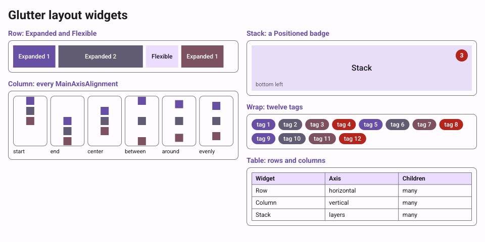 |
| [`animations`](examples/animations) | implicit and explicit animations | 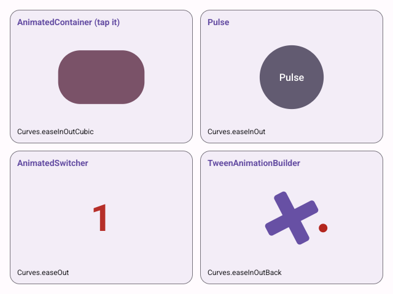 |
| [`scrolling`](examples/scrolling) | lists, grids and slivers | 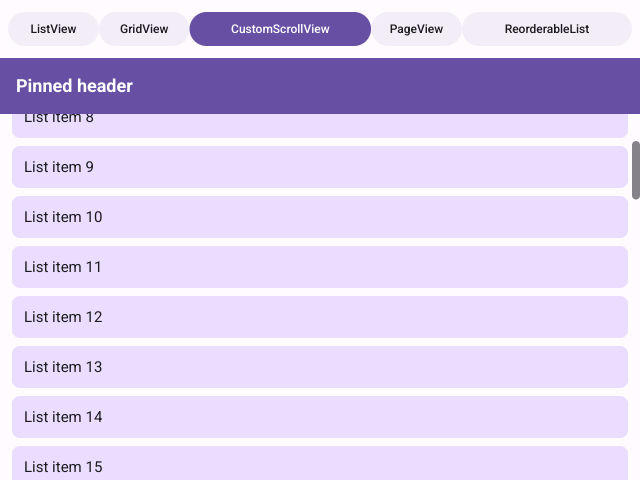 |
| [`navigation`](examples/navigation) | Navigator, routes, Hero, the Pages API | 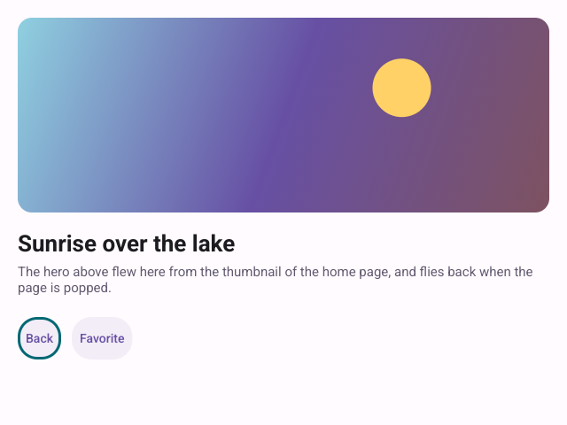 |
| [`editor`](examples/editor) | text editing, selection, clipboard, input methods | 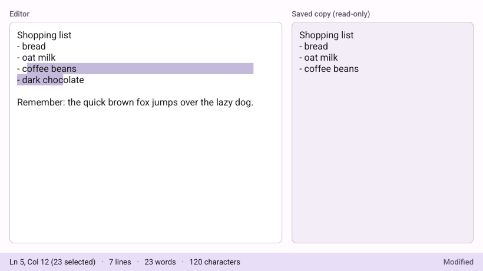 |
| [`gallery`](examples/gallery) | every Material 3 component, light and dark | 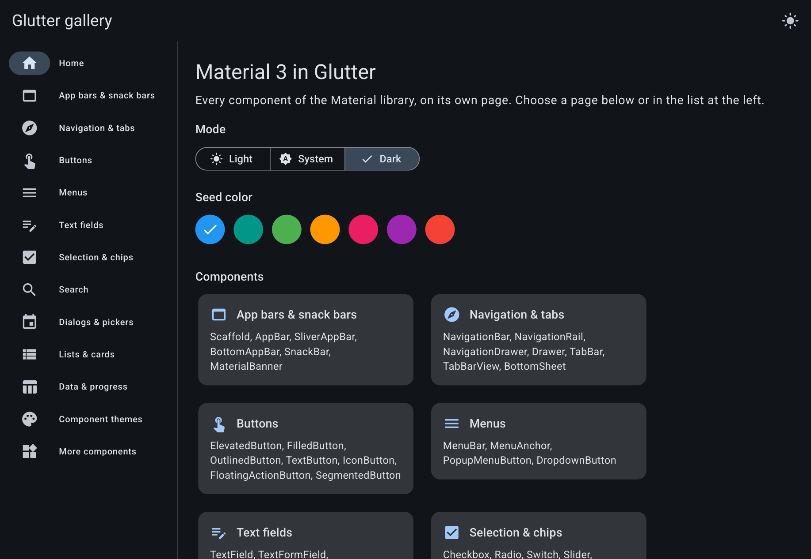 |
| [`multiwindow`](examples/multiwindow) | several windows of one app | 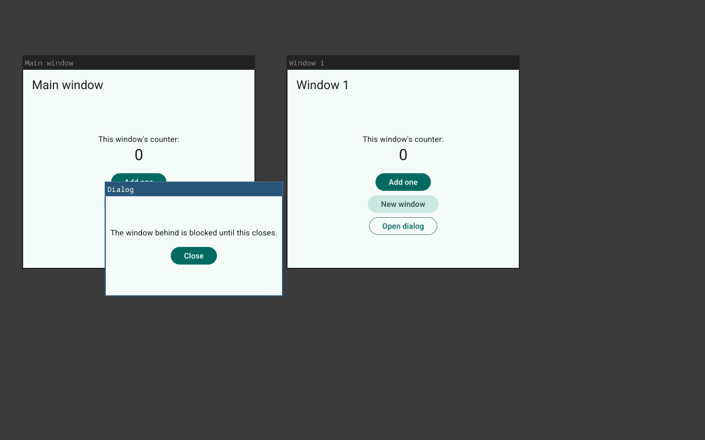 |
| [`tray`](examples/tray) | system tray, notifications, file dialog (the window alone is shown: a tray needs a desktop) | 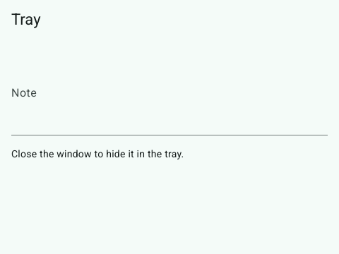 |
| [`custompaint`](examples/custompaint) | `CustomPaint` and the `Canvas` | 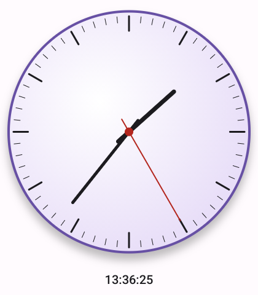 |
| [`todo`](examples/todo) | a `DataTable` of tasks; each row has a checkbox, an Edit button (a dialog) and a Delete button | 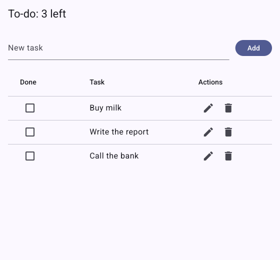 |
| [`svg`](examples/svg) | SVG pictures (package `svg`): icons with `currentColor` and a `ColorFilter`, a logo with gradients, text and a drop-shadow filter | 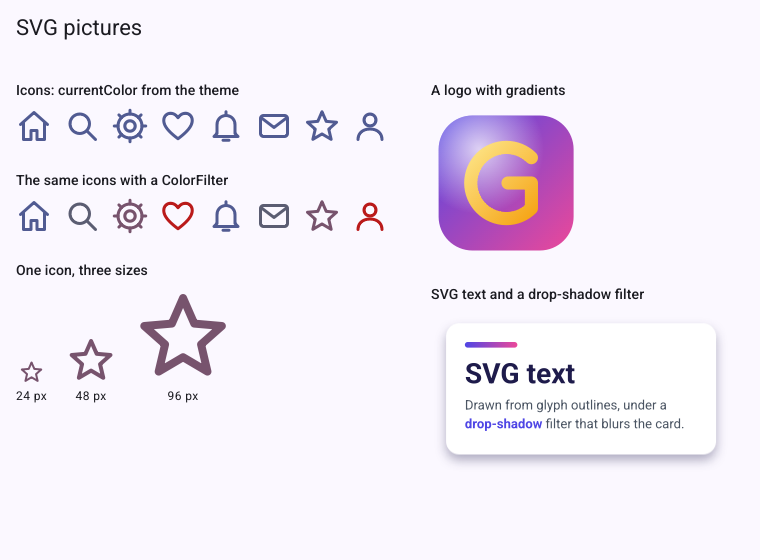 |
| [`gpu-triangle`](examples/gpu-triangle) | package `gpu` and `vecmath`: a lit cube drawn by the program's own shader into a `gpu.View`, with reversed-Z depth and 4x multisampling, a slider and a switch | 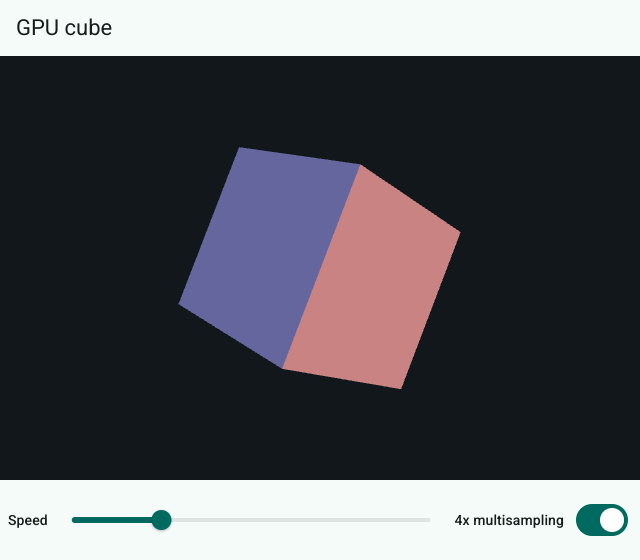 |
| [`cad`](examples/cad) | package `viewport3d` and `model`: a 3D viewer with an STL or OBJ opened from a dialog, navigation, the view cube and the grid, four display modes, a section plane on a slider, picks with a side panel, and a distance between two picks drawn as a dimension | 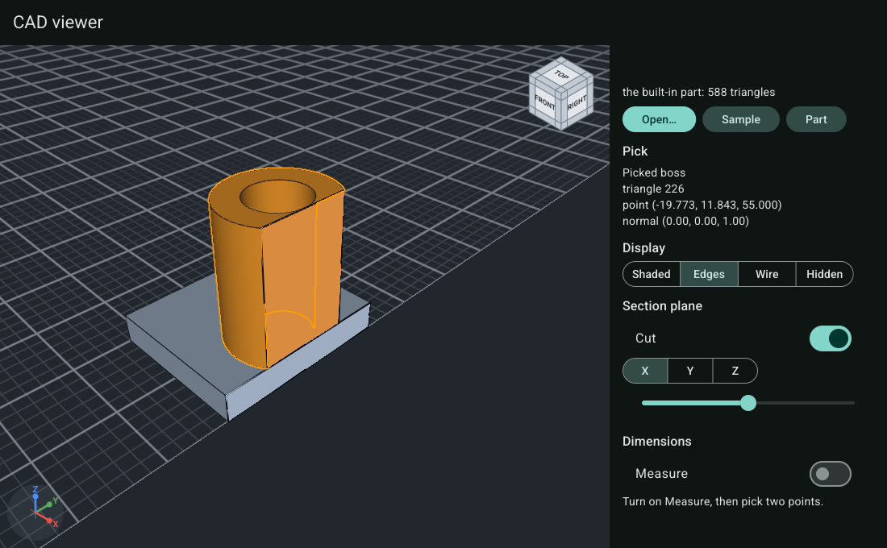 |
| [`game3d`](examples/game3d) | packages `gamepad`, `audio`, `viewport3d`, `model/gltf` and `widgets.PointerLock` together: Coin Run, a skinned character that runs and jumps through a glTF level with PBR materials and a shadow, played with a pad, the keyboard, a locked mouse or touch, with music, effects, rumble on a hit and a Material pause menu that a pad drives | 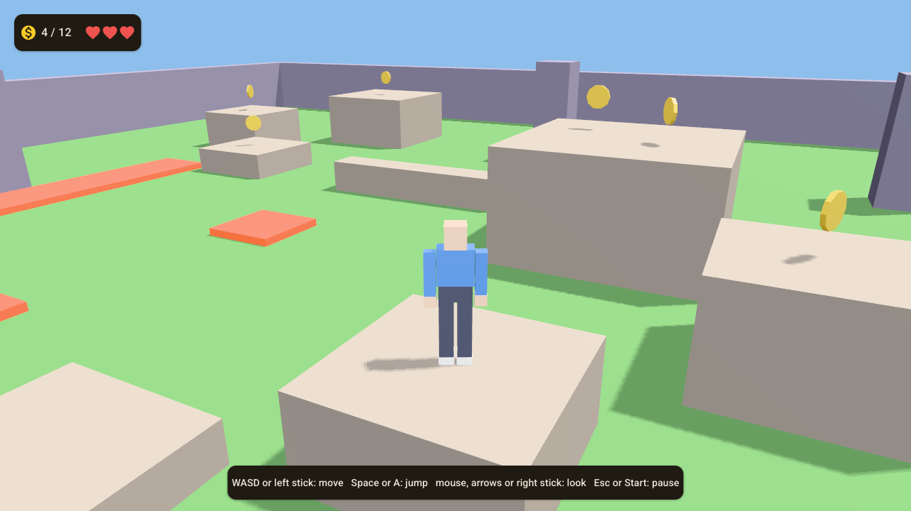 |
| [`cupertino`](examples/cupertino) | package `cupertino`: a `CupertinoApp` with a tab scaffold (a navigator per tab) whose first tab is a list under a large-title bar that collapses as it scrolls, and that pushes a page (the iOS parallax and the back swipe), presents a sheet (dragged down to dismiss it, with a drag handle) and shows a modal popup; its second tab shows the controls (switch, checkbox, radios, slider, activity indicators and the two segmented controls) and its third the text (text fields with a placeholder, prefix and clear button, the search field and the selection); it grows with each step of the Cupertino milestone | 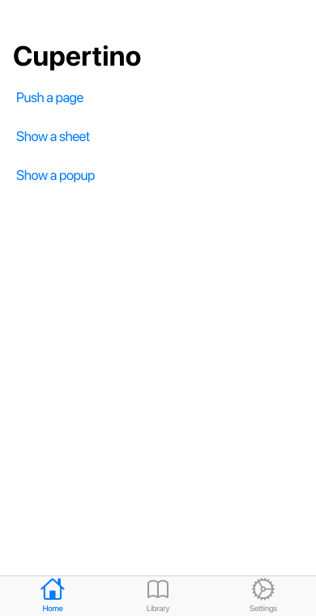 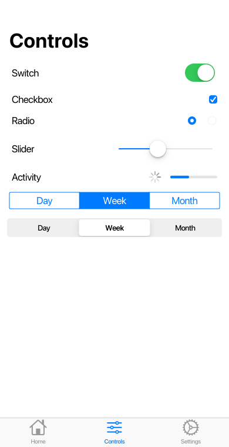 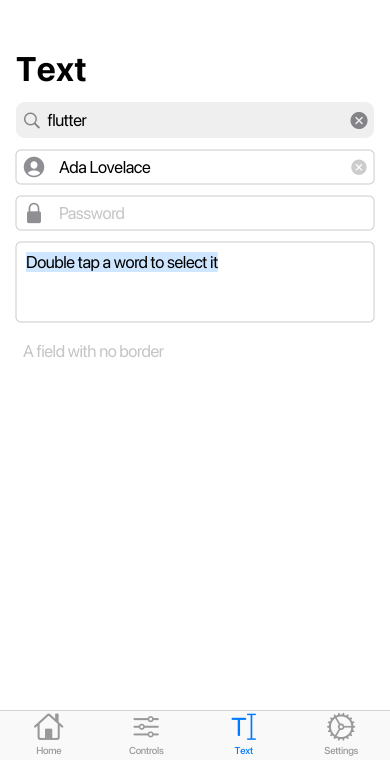 |

## Performance

On release builds (`-tags glutter_release`) an animation-only frame costs microseconds on the UI
thread, a full rebuild of the gallery page about 4 ms, and an idle app uses no CPU.
[docs/PERFORMANCE.md](docs/PERFORMANCE.md) has the numbers, the machine they were measured on and
the targets that are not met yet. On Windows the numbers under Wine (`scripts/perf-windows.sh`) are for
noticing regressions only, and the targets are proposed until the owner confirms them on a PC.

## Working on Glutter

Go 1.27 and a C compiler (only because `go test -race` needs cgo). `docs/SPEC.md` is the
source of truth, `docs/IMPLEMENTATION.md` the plan and `docs/IMPLEMENTED.md` the log of what is
done. [CLAUDE.md](CLAUDE.md) lists the commands:

```
go build ./...                  # CGO_ENABLED=0 go build ./... must always work
go test -race ./...
go vet ./... && golangci-lint run
go generate ./...
go run ./cmd/glutter-gen apicheck -allow cmd/glutter-gen/apicheck.allow
```

The web, Android and Windows have their own checks (`GOOS=js GOARCH=wasm go build ./...` and `scripts/test-wasm.sh`,
`scripts/check-android.sh`, `GOOS=windows go build ./...` and `scripts/test-windows.sh` under Wine); CLAUDE.md lists
them.

## License

BSD-3-Clause, see [LICENSE](LICENSE). Glutter is a derivative of the Flutter framework
(BSD-3-Clause, `third_party/flutter/LICENSE`); [NOTICE](NOTICE) lists the other components.
