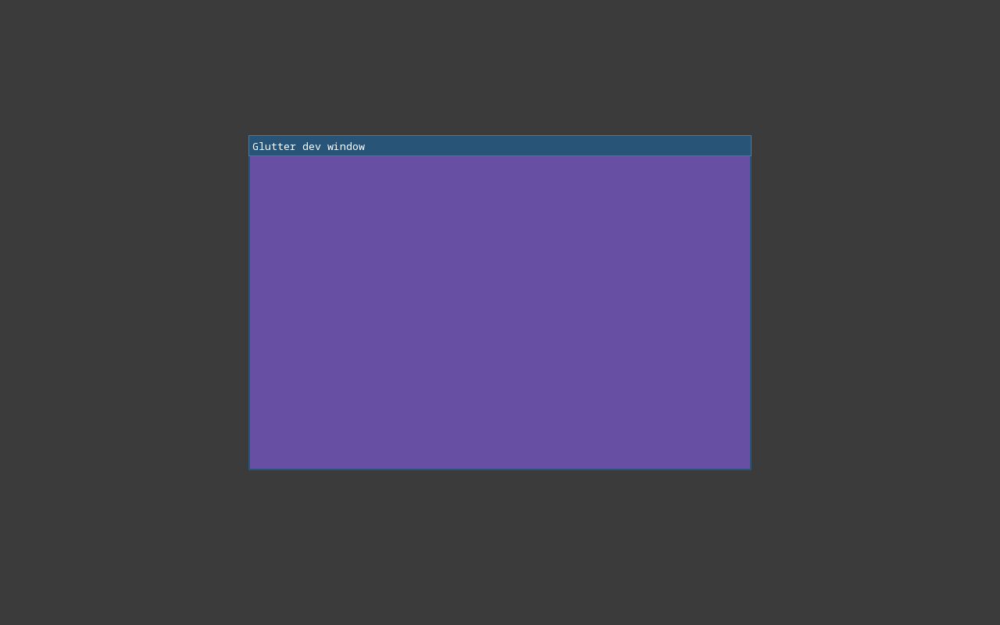

# Implemented steps

This is the log of finished steps from `docs/IMPLEMENTATION.md`, newest at the bottom. An agent adds an entry on the step's branch, as part of the step's commit (`docs/IMPLEMENTATION.md`, rules 10–12). The next step to do is the first step in `docs/IMPLEMENTATION.md` that has no entry here.

## Entry format

Copy this block, fill it in, and keep every heading. Write "none" where something doesn't apply.

```markdown
## <id> <step title>

- **Date:** YYYY-MM-DD
- **Branch:** feat/step-<id>-<slug>
- **Summary:** 2–4 sentences on what now exists and works.
- **Main files:** the packages or files created or changed.
- **Tests:** what was added; the number of Flutter test cases ported (and from which files).
- **Checks:** gofmt ✅ · go vet ✅ · golangci-lint ✅ · go test -race ✅ · CGO_ENABLED=0 build ✅ · CGO_ENABLED=0 test ✅ · display tests ✅/none
- **Proof:**
  
  One sentence describing what the image shows, as you verified it by viewing it.
- **Manual checks:** the user's answers to the step's manual checks, or "none".
- **Deviations and follow-ups:** differences from SPEC or Flutter (also recorded in SPEC §12.10), and TODOs left for later steps.
```

---

<!-- Entries start below this line. -->

## 0.1 Module and package layout

- **Date:** 2026-10-18
- **Branch:** feat/step-0.1-module-and-package-layout
- **Summary:** The Go module `github.com/rm4n0s/glutter` (go 1.27) exists with every package directory from SPEC §6.2, each with a `doc.go` stating its purpose and the Flutter library it mirrors. Flutter's LICENSE, a NOTICE covering every row of SPEC §20, the golangci-lint config and the scripts README are in place.
- **Main files:** `go.mod`, `NOTICE`, `.golangci.yml`, `third_party/flutter/LICENSE`, `scripts/README.md`, `*/doc.go` for the 14 public packages and the `internal/` packages, `cmd/glutter-gen/` (doc.go plus an empty `main`), `examples/doc.go`.
- **Tests:** none (no code yet). Checked by hand that revive flags an undocumented exported function.
- **Checks:** gofmt ✅ · go vet ✅ · golangci-lint ✅ · go test -race ✅ · CGO_ENABLED=0 build ✅ · CGO_ENABLED=0 test ✅ · display tests none
- **Proof:** none
- **Manual checks:** none
- **Deviations and follow-ups:** `cmd/glutter-gen/main.go` is an empty `main` so the package builds; step 0.3 fills it. `.golangci.yml` uses the golangci-lint v2 format and the `standard` default set plus `revive` (rules `exported`, `package-comments`); `errcheck`, `govet` and `staticcheck` are part of that set.

## 0.2 Reference sources

- **Date:** 2026-10-18
- **Branch:** feat/step-0.2-reference-sources
- **Summary:** `scripts/fetch-reference.sh` fetches shallow, blobless, sparse clones of Flutter (`stable`) and material-color-utilities into the git-ignored `reference/`, and records both commits in `reference/VERSION`. When `VERSION` exists, the script checks out exactly the recorded commits (it restores a deleted clone to the same commit). Pinned: Flutter 3.47.7 at `abaf9c52` (2026-10-08), material-color-utilities at `dd62982d` (2026-10-15).
- **Main files:** `scripts/fetch-reference.sh`, `scripts/README.md`.
- **Tests:** none (a shell script). Run by hand: first run, second run from `VERSION`, and a run after deleting `reference/flutter` (same commit restored). The script checks that every sparse path exists, and all of them did.
- **Checks:** gofmt ✅ · go vet ✅ · golangci-lint ✅ · go test -race ✅ · CGO_ENABLED=0 build ✅ · CGO_ENABLED=0 test ✅ · display tests none
- **Proof:** none
- **Manual checks:** none
- **Deviations and follow-ups:** the sparse checkout uses git's cone mode, which takes directories only and always includes root files, so `LICENSE` needs no entry. The `version` file named in the step does not exist in this checkout, so `flutter_version` comes from the release tag that points at the pinned commit (`git ls-remote --tags`). `shellcheck` is not installed, so the script was not linted.

## 0.3 Code generator skeleton

- **Date:** 2026-10-18
- **Branch:** feat/step-0.3-code-generator-skeleton
- **Summary:** `glutter-gen` dispatches on its first argument to the subcommands `wayland`, `keys`, `reexport`, `copywith` and `icons`; each returns the tagged error `NotImplemented`. A missing or unknown command gives `MissingCommand` or `UnknownCommand`. Errors are printed to stderr as `ToJson()` output and the exit code is 1. `github.com/rm4n0s/errors` is now in `go.mod`.
- **Main files:** `cmd/glutter-gen/main.go` (thin), `cmd/glutter-gen/run.go` (dispatch and error formatting), `cmd/glutter-gen/run_test.go`, `cmd/glutter-gen/internal/{wayland,keys,reexport,copywith,icons}/`.
- **Tests:** table test for the dispatch covering all seven cases (no command, unknown command, the five subcommands), each with a route assertion and the `command` metadata; a test that the JSON output replays through `errors.FromJson` with the same route; a test for non-tagged errors. No Flutter tests ported.
- **Checks:** gofmt ✅ · go vet ✅ · golangci-lint ✅ · go test -race ✅ · CGO_ENABLED=0 build ✅ · CGO_ENABLED=0 test ✅ · display tests none
- **Proof:** none (`go run ./cmd/glutter-gen wayland` prints the `NotImplemented` error and exits 1, as the step requires).
- **Manual checks:** none
- **Deviations and follow-ups:** a subcommand's route is `dispatch->Run.NotImplemented` for all five, because the errors package leaves package names out of routes; the `command` metadata tells them apart. `MissingCommand` is an addition to the step (no arguments needs some error). The subcommands' `// TODO(step X.Y)` comments point at 1.3 (wayland), 1.7 (keys), 12.2 (copywith), 12.3 (icons) and 12.4 (reexport). No `//go:generate` directives yet; they arrive with the steps that produce generated files (first 1.3).

## 1.1 Platform interfaces and the fake platform

- **Date:** 2026-10-18
- **Branch:** feat/step-1.1-platform-interfaces-and-fake
- **Summary:** `internal/platform` defines `Platform`, `Window`, `Handler`, `WindowConfig`, `WindowState`, `Display`, `Settings`, `ViewMetrics`, `Clipboard` and `Services` as sketched in SPEC §6.3. `ui` has `Offset`, `Size`, `Rect`, `ViewID`, `AppLifecycleState`, `PointerData` (all fields, plus its enums) and `KeyData` (plus its enums). `internal/platform/fake` is a scriptable platform: `Run` replays a FIFO queue of posted functions and injected events, `Post` works from any goroutine, `NewWindow` records configs and hands out view IDs, and an inspectable log records everything.
- **Main files:** `ui/{geometry,view,lifecycle,pointer,key,enum}.go`, `internal/gpu/surface.go`, `internal/platform/{platform,window,settings,placeholders}.go`, `internal/platform/fake/{fake,events,window}.go`, `docs/SPEC.md` (§7 note).
- **Tests:** `ui`: `KeyData.String` (7 cases), enum names and order, `PointerData.Respond` and `String`. `fake`: `Post` from 100 goroutines × 50 posts arrives in order per goroutine; `Run` stops on cancel (3 ways); `PlatformAlreadyRunning` route test; every event type reaches the handler, and posts and events interleave in queue order; close requests close or keep the window; window IDs, configs and recorded calls. Ported from Flutter: the `KeyData.toString` cases are written from `key.dart`; `reference/` has no engine tests for `dart:ui` data classes, so 0 Flutter test cases were ported.
- **Checks:** gofmt ✅ · go vet ✅ · golangci-lint ✅ · go test -race ✅ · CGO_ENABLED=0 build ✅ · CGO_ENABLED=0 test ✅ · display tests none
- **Proof:** none
- **Manual checks:** none
- **Deviations and follow-ups:**
  - Geometry uses `float64` (Dart's `double`); only `Matrix4` and `Color` are `float32`. SPEC §6.3's sketch has `dpr float32`, which should become `float64` at step 3.1. SPEC §7 now states the rule.
  - The step names `Offset`, `Size`, `Rect` as types only; their methods are left to 2.1.
  - Flutter's `PointerData` and `KeyData` have Dart defaults; here every enum starts with `<Enum>Unspecified` (SPEC §12.3), so `PointerData{}` has `Change == PointerChangeUnspecified` where Dart's default is `cancel`. Backends always set it. `KeyData.Character` is `""` where Dart has `null`.
  - `KeyData.String` copies Flutter's `toString`, which lacks its closing parenthesis.
  - The placeholder types the sketch calls `ui.MouseCursor`, `ui.TextInputState`, `ui.TextInputEvent` and `ui.ViewMetrics` live in `internal/platform` (`MouseCursor`, `TextInputState`, `TextInputEvent`, `ViewMetrics`), together with `DragData`, `DropEvent`, `Brightness`, `Clipboard` and `Services`, so the public `ui` package gets no stubs. Each carries a `TODO(step X.Y)` for the step that defines it.
  - `gpu.SurfaceHandle` is `any` until step 1.6. `WindowConfig.Resizable` and `.Decorated` are plain `bool`s with `DefaultWindowConfig()` giving `true`; step 5.1 turns them into `Opt[bool]`.
  - `Platform.Run` returns nil on cancel and is not reentrant. The first window gets view ID 0 (Flutter's implicit view).
  - `runtime.LockOSThread()` is not in this step; the plan assigns it to 1.4.

## 1.2 Library loader (purego)

- **Date:** 2026-10-18
- **Branch:** feat/step-1.2-library-loader
- **Summary:** `internal/platform/linux/dl` is the one way to load C libraries and call into them: `Open`, `OpenOverride`, `(*Lib).Bind` and `Has`, libc helpers (`Malloc`, `Calloc`, `Free`, `Strlen`, `CString`, `GoString`), the callback registry (`Callback`, `CallbackCount`, limit 1,500) and the layout test helper `AssertLayout`. purego v0.11.2 is pinned in `go.mod` (SPEC §22).
- **Main files:** `internal/platform/linux/dl/{doc,dl,libc,callback,layout}.go` and their tests, `go.mod`, `go.sum`.
- **Tests:** `Open` (5 cases, route test for `LibraryLoadFailed` with `names` and `dlerror` metadata); `OpenOverride` (4 cases: unset, existing absolute override, missing override with no fallback, relative override); `Bind` strlen called from Go, `Bind`/`Has` on a missing symbol (route test for `SymbolMissing`); C strings (empty, ASCII, Unicode, 100 kB); `Malloc`/`Calloc`; the callback counter and the `CallbackLimit` panic (route test); a real C→Go callback, sorting an array with libc's `qsort` and a Go comparator; `AssertLayout` (9 cases, including every kind of mismatch). No Flutter tests apply to this step.
- **Checks:** gofmt ✅ · go vet ✅ · golangci-lint ✅ · go test -race ✅ · CGO_ENABLED=0 build ✅ · CGO_ENABLED=0 test ✅ · display tests none
- **Proof:** none
- **Manual checks:** none
- **Deviations and follow-ups:**
  - Two tags beyond the step: `LibraryOverrideInvalid` (the override variable is set but not an absolute path) and `CStringAllocFailed` (a panic when `malloc` returns 0). Both are tested except `CStringAllocFailed`, which can't be triggered without exhausting memory.
  - A set override that fails to load is an error and does not fall back to the default names, because an explicit setting that is silently ignored is worse than an error.
  - libc is bound on first use (`sync.OnceValue`), not at import, and loading `libc.so.6` failing panics with `LibraryLoadFailed`. The `Callback` registry is the only package-level state; it only counts, because the purego limit is per process.
  - `AssertLayout` takes a `testing.TB` and additionally requires every named field of the struct to be listed in `offsets`, so a field added later can't escape the test. It is in a non-test file, as the step asks, so `testing` is linked into binaries that import `dl`.
  - Only `RTLD_NOW|RTLD_LOCAL` with glibc's `libc.so.6` is supported; musl is not.

## 1.3 Wayland protocol bindings generator

- **Date:** 2026-10-18
- **Branch:** feat/step-1.3-wayland-bindings-generator
- **Summary:** `glutter-gen wayland` reads the 18 protocol XML files (wayland 1.26.0, wayland-protocols 1.49, fetched by `scripts/fetch-wayland-protocols.sh`) and writes one `*_gen.go` per protocol into `internal/platform/linux/wayland/wl`: 73 interface types with typed request methods, a struct of typed event callbacks, enum types and constants, and the `wl_interface` tables built in C memory at init (about 8,500 generated lines). The hand-written runtime in the same package binds libwayland-client with purego, mirrors the C structs, installs one dispatcher for all proxies (user data is an integer handle, never a Go pointer) and provides `Conn` with the calls the event loop needs.
- **Main files:** `scripts/fetch-wayland-protocols.sh`, `internal/platform/linux/wayland/protocols/` (XML, licenses, `VERSIONS`), `cmd/glutter-gen/internal/wayland/{wayland,xml,gen,names}.go`, `internal/platform/linux/wayland/wl/{api,args,conn,doc,interface,proxy,structs}.go` and `*_gen.go`, `internal/platform/linux/dl` (new `Pointer` and `Bytes` helpers).
- **Tests:**
  - Generator: golden test on `testdata/small/small.xml` (requests and events with every argument kind, enums across interfaces, destructor, nullable, `since`, generic and typed `new_id`); determinism; a test that fails when the committed `*_gen.go` files differ from a fresh generation or lack the "Code generated … DO NOT EDIT." header; `goType` (15 cases) and naming (9 cases); 11 failure cases with route tests (`WaylandBadFlags`, `WaylandXMLReadFailed`, `WaylandXMLParseFailed`, `WaylandXMLInvalid`, `WaylandWriteFailed`); stale-file cleanup.
  - Runtime: layout tests for `wl_message`, `wl_interface`, `wl_argument` and `wl_array` (sizes and offsets from `wayland-util.h`, compiled with gcc); interface-table checks, including cross-protocol type references, `since` prefixes and nullable markers; argument and wl_fixed round trips.
  - End to end: the real libwayland-client against a hand-written fake compositor on a socket pair (it parses the wire format independently of the generated tables). It covers the registry and `bind`, `sync` callbacks, ints/uints/fixed/strings/objects/arrays in events, a file descriptor sent in a request and received in an event, a server-created object (`new_id` event) whose own events arrive in the same batch, destructors, requests on destroyed objects, handler panics re-raised outside C, protocol errors, a lost connection, and the prepare_read/read_events/dispatch_pending loop. Run 30 times under `-race` without a failure. No Flutter tests apply.
  - Cross-check (not committed): the interface tables of all 73 interfaces equal `wayland-scanner private-code` output (names, versions, signatures, type references).
- **Checks:** gofmt ✅ · go vet ✅ · golangci-lint ✅ · go test -race ✅ · CGO_ENABLED=0 build ✅ · CGO_ENABLED=0 test ✅ · display tests none (the end-to-end tests need `libwayland-client.so.0` but no display; they skip when it is missing)
- **Proof:** none
- **Manual checks:** none
- **Deviations and follow-ups:**
  - The `//go:generate` line is `go run ../../../../../cmd/glutter-gen wayland -protocols ../protocols -out .` because it sits in `wl/`; the step's relative path has the wrong depth.
  - Generated names: `Bind<Interface>(registry, name, version)` binds a global; the untyped `wl_registry.bind` is `BindRaw`. A `destroy`-type request keeps its XML name (`Destroy`, `Release`); every object also has `ProxyDestroy` for interfaces without one. An empty string for a nullable string argument is sent as NULL, and a NULL string in an event reads as `""`. The XML does not say what an array holds, so a table in the generator lists the six that hold `uint32` (`wl_keyboard.enter.keys`, `xdg_toplevel.configure.states` and `.wm_capabilities`, `zwp_tablet_pad_group_v2.buttons`, `zwp_text_input_v3.set_available_actions`); all others are `[]byte`.
  - Events of `wl_display` (`error`, `delete_id`) are handled inside libwayland and have no Go callbacks; errors surface through `Conn`.
  - `Conn` goes slightly beyond the step's function list, to make the layer testable and usable by 1.4: `ConnectFD`, `Roundtrip` and error mapping. New tags: `WaylandConnectFailed` (1.4 lists it too), `WaylandProtocolError` (interface, id, code), `WaylandConnectionLost`, `WaylandDispatcherFailed` and `WaylandObjectDestroyed` (panics, tested only for the latter). Step 1.4 still owns the event loop, the registry's required-globals check and `Run`.
  - `Flush` tells a full socket (EAGAIN) from a failure by asking libwayland whether it recorded an error, because purego does not expose `errno`.
  - The handle table behind the single dispatcher is the one piece of package-level mutable state in `wl`, like the callback counter in `dl`; both exist because the purego callback limit is per process.
  - `libwayland` logs protocol errors to stderr (the `wl_surface#N: error 2: bad scale` line in the protocol-error test output).

## 1.4 Wayland connection and event loop

- **Date:** 2026-10-18
- **Branch:** feat/step-1.4-wayland-connection-and-event-loop
- **Summary:** `internal/platform/linux` has the UI thread's event loop: epoll over sources, an eventfd for `Post` and a timerfd for timers (`syscall` only), and `internal/platform` pins the main goroutine to the main OS thread in an `init`. `internal/platform/linux/wayland` connects to a compositor, lists the registry, binds the six required globals at the SPEC §8.2 versions (capped at what the compositor offers), records the optional ones, answers `xdg_wm_base` pings, and runs the libwayland external-loop pattern (prepare_read, flush, wait, read_events, dispatch_pending). `scripts/headless-wayland.sh` runs a command inside headless sway (weston as fallback).
- **Main files:** `internal/platform/thread.go`, `internal/platform/linux/loop.go`, `internal/platform/linux/wayland/{conn,source,platform}.go`, `internal/platform/linux/wayland/fakecomp/` (the fake compositor, moved out of the `wl` tests so more packages can use it), `scripts/headless-wayland.sh`.
- **Tests:**
  - Loop: `Post` from 100 goroutines keeps order per goroutine; post before `Run` and from inside a posted function; four ways to stop; timers (deadline order, never early, cancel, nested, overdue); a source's readable, writable-interest and hang-up events; an idle loop does not spin; a source error ends `Run` and comes back unchanged; `RemoveSource`; syscall-failure route tests (`LoopSyscallFailed`).
  - Wayland, against the fake compositor (no display): required globals bound at `min(offered, ours)` including a second, older `wl_output`; optional globals recorded but not bound; each of the six required globals missing in turn gives `WaylandProtocolMissing` with the interface name and a route test; `WaylandConnectFailed`; ping answered with pong; a protocol error ends `Run` with `WaylandProtocolError` (interface, id, code); a hung-up socket ends it with `WaylandConnectionLost`; `Post` from 20 goroutines; `Run` stops on cancel; a second `Run` gives `PlatformAlreadyRunning`.
  - Display tests (`-tags glutter_display`, under `scripts/headless-wayland.sh`): connect to headless sway, list the globals, assert the required ones, `Run` and `Post` against the real compositor. They passed 15 times in a row. No Flutter tests apply.
- **Checks:** gofmt ✅ · go vet ✅ · golangci-lint ✅ · go test -race ✅ · CGO_ENABLED=0 build ✅ · CGO_ENABLED=0 test ✅ · display tests ✅ (headless sway; they also pass the lint and vet runs with `-tags glutter_display`)
- **Proof:** none
- **Manual checks:** none
- **Deviations and follow-ups:**
  - The loop is generic: a `Source` interface (`FD`, `WantsWrite`, `BeforeWait`, `AfterWait`) lets the Wayland connection do its prepare/read/cancel dance and lets X11 and D-Bus plug in later. The Wayland `Platform` implements `Run`, `Post` and `Close`; `NewWindow` returns `NotImplemented` until step 1.5, and `Displays`, `Clipboard` and `Settings` return empty values (TODOs name the steps).
  - Real sway offers `xdg_wm_base` only up to version 5, so the backend binds 5 there; the `suspended` state and `wm_capabilities` need 6 and are optional (SPEC §8.2).
  - Real sway has no `xdg_wm_dialog_v1` and no `xdg_toplevel_icon_manager_v1`; both are optional and get recorded as absent. It does offer 21 of the 23 optional globals the backend knows.
  - weston's headless backend has no `wl_seat`, so Glutter reports `WaylandProtocolMissing` there. The weston fallback of the script is therefore only useful for checks that don't start Glutter; this is documented in the script header. A seat is required by SPEC §8.2, so this is intended.
  - Timer tests use real time with coarse tolerances. The "fake clock" for key repeat (step 1.7) will need a clock the tests can control; the `Loop` has none yet.
  - `Loop.Close` and `wake` share the loop's mutex: `context.AfterFunc` can call `wake` after the loop was closed, and writing to a recycled descriptor would be a bug. The race detector found this.
  - `loop.go` is `//go:build linux`; `doc.go` of the package is not, so the package still lists on other systems.
  - `libwayland` prints protocol errors to stderr (`wl_shm#6: error 1: invalid format` in the test output).

## 1.5 First Wayland window (shared-memory buffer)

- **Date:** 2026-10-18
- **Branch:** feat/step-1.5-first-wayland-window
- **Summary:** `Platform.NewWindow` creates `wl_surface` → `xdg_surface` → `xdg_toplevel`, sets the title, app id, size limits, parent and state, and asks for server-side decorations (`zxdg_decoration_manager_v1`) when the compositor has them, all before the first commit. On each configure it draws an XRGB8888 `memfd`/`mmap` buffer filled with `#6750A4` at the new size, then sends `ack_configure`, attaches and commits; replaced buffers are freed when the compositor releases them. `xdg_toplevel.close` asks `Handler.OnCloseRequest`, and `Run` returns when the last window is closed. `scripts/screenshot-headless.sh` and the example `examples/dev/window` are in.
- **Main files:** `internal/platform/linux/wayland/{window,shm,memfd_amd64,memfd_arm64,memfd_other}.go`, `internal/platform/nop.go` (`NopHandler`), `internal/platform/linux/wayland/fakecomp/windowing.go`, `scripts/screenshot-headless.sh`, `scripts/headless-wayland.sh` (floating windows and a gray background by default), `examples/dev/window/main.go`.
- **Tests:**
  - Against the fake compositor, which now mimics the real ordering (a toplevel is configured only after its first commit; a new buffer releases the old one): the exact request order (title and app id and min/max size before the buffer-less first commit; pool, buffer, ack and the buffer commit after the configure); size from the config, the default 800×600, and the compositor's size; toplevel states (all nine decoded, a 0×0 configure keeps the size); resize draws the new buffer before the ack and frees the replaced one, with `OnMetrics`; decorations (server-side, client-side, protocol missing); close request agreed and refused; `SetTitle`/`SetState`/`SetSize`; two windows and `set_parent`; `StartDrag` `NotImplemented`; an oversized buffer ends `Run` with `ShmBufferFailed`; bad buffer sizes; `fill`; `decodeStates`. Stable over 25 runs under `-race`.
  - Display test under headless sway (`TestDisplayWindowMapsAndCloses`): the first configure arrives (640×400, activated), the window is mapped, and a close request ends `Run`. Passed 5 times in a row.
  - No Flutter tests apply.
- **Checks:** gofmt ✅ · go vet ✅ · golangci-lint ✅ · go test -race ✅ · CGO_ENABLED=0 build ✅ · CGO_ENABLED=0 test ✅ · display tests ✅ (headless sway)
- **Proof:**
  
  Headless sway's gray output with a floating window titled "Glutter dev window" (sway's server-side title bar) whose content is a solid purple 640×400 rectangle. Checked by pixel count too: exactly 256,000 pixels of `#6750A4` forming a 640×400 box.
- **Manual checks:** none
- **Deviations and follow-ups:**
  - `scripts/screenshot-headless.sh` needs `jq` besides `sway` and `grim`. It detects a mapped window as a sway tree node with a process id. The screenshot must be taken from a built binary, because the window has to appear within 10 seconds and `go run` compiles too slowly. A bug where the trap used an out-of-scope variable and never stopped the app was found by watching the app print an error at shutdown, and fixed.
  - `scripts/headless-wayland.sh` now makes windows float by default and paints the background `#3b3b3b` (`HEADLESS_FLOATING=0` tiles them). A tiled window would fill the whole output, hiding the 640×400 size.
  - `Run` returns when the last window closes, as the `Platform.Run` doc says; the engine (step 1.10) decides what that means for the app. Before `Run` starts, `NewWindow` only queues requests; the window is mapped once `Run` handles the first configure.
  - `OnMetrics` is called at the first configure and on every size change, with a device pixel ratio of 1 until step 3.7 (TODO in the code). `NativeSurface` returns nil until step 1.6; `SetCursor`, `SetTextInput` and `StartDrag` are stubs with TODOs for steps 1.8, 11.2 and 14.6. `Modal` and `Kind` are not used yet (they need `xdg_dialog_v1`, step 14.2).
  - `syscall` has no `SYS_MEMFD_CREATE`, so the number is defined per architecture (amd64 319, arm64 279; other architectures fail with `ENOSYS`).
  - The shm window draws only on configure; frame callbacks arrive with step 1.6.

## 1.6 EGL and GLES on Wayland, and self-capture

- **Date:** 2026-10-18
- **Branch:** feat/step-1.6-egl-gles-and-self-capture
- **Summary:** `internal/gpu/gles` loads `libEGL` and `libGLESv2` through purego (`GLUTTER_EGL_LIBRARY` / `GLUTTER_GLES_LIBRARY` override the paths), opens the display with `eglGetPlatformDisplay(EGL_PLATFORM_WAYLAND_KHR)`, picks an RGBA8 `EGL_OPENGL_ES3_BIT` window config, creates an ES 3 context and window surface, sets `eglSwapInterval(0)`, and offers `MakeCurrent`, `Viewport`, `Clear`, `SwapBuffers` and `ReadPixels` (rows flipped to top-first). The Wayland window creates a `wl_egl_window` through `libwayland-egl.so.1` and is paced by `wl_surface.frame` callbacks: at most one frame in flight, `Window.RequestFrame` merges requests, and a configure renders at once. `internal/engine` reads `GLUTTER_SCREENSHOT` / `GLUTTER_SCREENSHOT_AFTER` and saves the PNG. `examples/dev/window` now draws with EGL; the shm path stays behind `GLUTTER_DEV_SHM=1`.
- **Main files:** `internal/gpu/gles/{egl,gl,context}.go`, `internal/gpu/surface.go`, `internal/platform/linux/wayland/{egl,window,platform}.go`, `internal/platform/linux/wayland/fakecomp/{server,windowing}.go` (frame callbacks), `internal/engine/screenshot.go`, `examples/dev/window/main.go`.
- **Tests:**
  - `gles` against a fake EGL and GL: the success path and its call order, each failure with its route and the cleanup calls made (`EGLInitFailed`, `EGLNoConfig`, `GLES3Unsupported`, `EGLSurfaceFailed`, `EGLMakeCurrentFailed`, `EGLSwapFailed`, `GLReadPixelsFailed`); `EGLLoadFailed` through an override that points to a missing file (`Open->loadEGL->loadFailed.EGLLoadFailed`); `ReadPixels` flips rows.
  - Wayland EGL mode against the fake compositor (which now answers or holds frame callbacks): handshake order, a configure renders while a frame is in flight, one frame in flight and merged requests, close destroys the egl window before the surface, shm mode ignores `RequestFrame`, a second `Options` panics with `MultipleOptions`. Stable over 20 and then 15 runs under `-race`.
  - Screenshot: environment parsing (including bad and negative delays, route `ScreenshotAfterInvalid`), PNG round trip, write failures (`ScreenshotWriteFailed`).
  - Display test under headless sway (`TestDisplayClearsTheWindowToPurple`): context creation succeeds on Mesa (OpenGL ES 3.2), a frame is cleared to `#6750A4` and read back with every pixel exact.
  - No Flutter tests apply.
- **Checks:** gofmt ✅ · go vet ✅ · golangci-lint ✅ · go test -race ✅ · CGO_ENABLED=0 build ✅ · CGO_ENABLED=0 test ✅ · display tests ✅ (headless sway)
- **Proof:**
  
  Self-capture of the EGL window (`GLUTTER_SCREENSHOT` under `scripts/headless-wayland.sh`): a 640×400 image that is evenly purple. Checked by pixel count too: all 256,000 pixels are exactly `#6750A4`. The delayed capture (`GLUTTER_SCREENSHOT_AFTER=300ms`) and the `GLUTTER_DEV_SHM=1` path were run as well.
- **Manual checks:** none
- **Deviations and follow-ups:**
  - Task 4 said to render before `ack_configure` + commit. With EGL the swap is the commit, so the backend resizes the `wl_egl_window`, sends `ack_configure`, then renders and swaps. The first commit after the ack has the new size, which is what SPEC §8.11 wants; the sentence in §8.11 now says so.
  - The screenshot reads the pixels before the swap, because the back buffer is undefined afterwards. With a delay, it requests a new frame after the delay and captures that one. Then the app ends `Run` and exits with code 0. A bug that saved the capture twice (the flag was never cleared) was found from the log and fixed.
  - `platform.Window` gained `RequestFrame()` (the engine needs it to ask for a frame when something changed). `gpu.SurfaceHandle` is now a struct (`Kind`, `Display`, `Window`) in place of the placeholder; the fake platform returns a `SurfaceKindFake` handle.
  - `wayland.New(name, ...Options)` takes `Options{ShmFill}` to keep the 1.5 shared-memory window for tests and `GLUTTER_DEV_SHM=1`; the shm tests use it.
  - `Platform.Close` now closes windows that are still open. The renderer must destroy its surface first (the example does, in `OnCloseRequest` and after `Run`).
  - Only the functions needed now are bound in `gl.go` (`GL_VERSION`, viewport, clear, read pixels). The rest comes with step 2.x.
  - Mesa prints `MESA-EGL: warning: failed to get driver name for fd -1` on the headless compositor (no DRM device); it is harmless.
  - `suspended` and occlusion handling (SPEC §8.11) are not done here: nothing drives frames yet. They belong to the engine (step 1.10).

## 1.7 Keyboard (xkbcommon) and key tables

- **Date:** 2026-10-18
- **Branch:** feat/step-1.7-keyboard-xkbcommon
- **Summary:** `internal/platform/linux/xkb` binds `libxkbcommon.so.0` through purego (context, keymaps from names, string and a compositor's file, state, `key_get_one_sym`/`utf8`, `key_get_layout`, `update_mask`, `mod_name_is_active`, `key_repeats`, `key_get_syms_by_level`, keysym to Unicode and lower case, compose table and state) and has `Layout`, which turns an evdev key into Flutter's physical key, logical key and character. `glutter-gen keys` reads Flutter's `physical_key_data.g.json`, `logical_key_data.g.json` and `layout_goals.json` and writes `internal/platform/linux/keymap_gen.go` (217 XKB keycodes to physical ids, 171 GTK keyvals to logical ids, the 49 layout goals); `go generate ./internal/platform/linux/` runs it. The Wayland backend binds `wl_keyboard` when the seat has one (and follows capability changes): it reads the keymap from the compositor's file, tracks modifiers and the layout group, gives focus on `enter`, repeats the held key on the loop's timer, and delivers `ui.KeyData` to `Handler.OnKey`.
- **Main files:** `internal/platform/linux/xkb/{lib,xkb,layout}.go`, `cmd/glutter-gen/internal/keys/keys.go`, `internal/platform/linux/{keymap.go,keymap_gen.go,doc.go}`, `internal/platform/linux/wayland/keyboard.go`, `internal/platform/linux/wayland/fakecomp/keyboard.go` (keyboard events for tests).
- **Tests:**
  - xkb, without a display, on keymaps made from the xkb data files (`us`, `de`, `ru`, `us,ru`): `a`; `Shift+a` (character `A`, logical key still `a`); Caps Lock; `Control+a` (character `a`); `Shift+1`; Enter, Escape, F1, Shift_L, the keypad with and without Num Lock; `de` swaps y and z; `AltGr+q` on `de` is `@`; the dead key `^` alone makes no text; `^` then `e` is `ê`; `^` then space is `^`; a cancelled sequence starts over; no compose table; Cyrillic keys keep the Latin logical key for letters (mandatory goals) and the layout's own for the comma key (not mandatory); `us,ru` in the second group; repeats per key (modifiers do not repeat); unknown keycodes go to the GTK plane; keymap round trip through string and through a file with a trailing NUL; `SymAt`; `KeyUTF8` follows modifiers; keysym helpers (8 cases); locale choice; the layout test of `xkb_rule_names`; route tests `XKBKeymapFailed` (four ways), `XKBComposeFailed`, `XKBLoadFailed` (a missing override and a relative one).
  - Generator: output on a small data set, a second run leaves the file alone, route tests for `KeysBadFlags`, `KeysDataMissing` (with the hint), `KeysDataInvalid` (two ways), `KeysDuplicate` (two ways), `KeysGoalUnknown` (two ways), `KeysWriteFailed`, and a staleness test of the committed tables against the Flutter data (skipped only when `reference/` is missing). The key table lookups have their own tests.
  - Wayland backend against the fake compositor with the real `de` and `us` keymaps, and a fake clock that the tests move by hand: press and release with modifiers (the key-up reuses the ids of the key-down), dead key and compose, keys without focus are ignored, held keys at `enter` are synthesized down and released in order at `leave`, closing the focused window releases the keys, duplicate downs and unknown ups are dropped, repeat timing (nothing at 399 ms, one at 400 ms, then every 40 ms, a pause is caught up, release stops it), another key ends the repeat, modifiers and rate 0 do not repeat, the focus loss stops it, the defaults (25 per second after 600 ms), a dead key repeats without feeding the compose state, a seat without a keyboard and plugging and unplugging one (`wl_keyboard.release` is sent), and a keymap that cannot be used leaves the keyboard silent. Stable over 30 runs with `-race`.
  - No Flutter tests apply.
- **Checks:** gofmt ✅ · go vet ✅ · golangci-lint ✅ · go test -race ✅ · CGO_ENABLED=0 build ✅ · CGO_ENABLED=0 test ✅ (the step lists no display tests; the display tests of the earlier steps still pass)
- **Proof:** none
- **Manual checks:** typing on a real keyboard has not been tried: the headless sway has no keyboard, and no tool to inject keys (`wtype`) is installed. It belongs with the manual checklist.
- **Deviations and follow-ups:**
  - The step says unknown keysyms become ids of the "unprintable" plane. Flutter's GTK embedder puts them in the GTK plane (`0x15_0000_0000 | keysym`), and the plane 1 ("unprintable") holds the keys in the table (Enter, Escape, F-keys). I followed the embedder. SPEC §8.5 now spells out the whole logical-key rule.
  - `reference/` has the framework and the data files but not the engine's `fl_keyboard_manager.cc` and `fl_key_embedder_responder.cc`. The layout-goal rule (first Latin character at level 0 in any layout, current group first; mandatory goals fall back to the US key) is rebuilt from `layout_goals.json`, the README of `gen_keycodes` and my reading of the embedder. It reproduces the documented behavior (shortcuts work on non-Latin layouts, Shift does not change the logical key), but it has not been compared line by line with the engine.
  - The character comes from the keysym (Control+a is `a`, Return is `\r`), as in the GTK embedder, not from `xkb_state_key_get_utf8`, which would give `\x01`. `State.KeyUTF8` is bound as the plan asks but the backend does not use it.
  - The synthesized events for lock modes and modifier bits (the GTK embedder's checked-key tables, `gtk_modifier_bit_mapping.json`, `gtk_lock_bit_mapping.json`) are not done here: only pressed keys are synchronized. TODO(step 8.x) when `HardwareKeyboard` exists.
  - Timestamps are the time the event reached the backend (`Platform.now`), not the compositor's millisecond `time`, so key and frame times share one clock.
  - A keymap that libxkbcommon rejects (or a keymap format other than `xkb_v1`) is logged and the keyboard is then silent; it does not end `Run`, because the app can still be used with the mouse. A locale with no compose table only turns dead keys and compose sequences off.
  - `wl_keyboard.key` with state `repeated` is ignored, since the repeats are made here (compositors do not send it).
  - The fake compositor now announces `wl_seat.capabilities` (keyboard by default), sends a valid one-key keymap by default, accepts `wl_keyboard.release`, and ignores EPIPE on a client that has gone. Its `get_keyboard` answers with an `enter` only if a surface exists.
  - libxkbcommon prints its errors to stderr (in the tests for bad keymaps). `go generate ./...` now needs `reference/` (run `scripts/fetch-reference.sh`); it fails with `KeysDataMissing` and says so otherwise.

## 1.8 Pointer, touch and cursors (Wayland)

- **Date:** 2026-10-18
- **Branch:** feat/step-1.8-pointer-touch-cursors
- **Summary:** The Wayland backend now binds `wl_pointer` and `wl_touch` when the seat has them (and follows capability changes) and sends `ui.PointerData` to `Handler.OnPointer`. A `pointerBatcher` collects enter, leave, motion, button, axis, axis_value120, axis_source, axis_stop and axis_relative_direction until `frame` and emits the batch: a wheel gives scroll signals, a touchpad a pan/zoom gesture, and `zwp_pointer_gestures_v1` pinch and swipe give pan/zoom gestures too. A `touchBatcher` turns `wl_touch` into touch pointers. Cursors: `Window.SetCursor` takes the new `platform.MouseCursor` (all 36 of Flutter's system cursors plus none) and uses `wp_cursor_shape_v1` when present, else the XCursor theme through `libwayland-cursor.so.0`. `examples/dev/input` logs every key and pointer event and changes the cursor between the left and right half.
- **Main files:** `internal/platform/linux/wayland/{pointer_batch,pointer,touch,cursor,cursor_lib,seat}.go`, `internal/platform/cursor.go` (`MouseCursor`, replaces the placeholder), `internal/platform/linux/cursor_names.go` (XCursor names, for X11 too), `internal/platform/linux/wayland/wl/foreign.go` (`Conn.WrapBuffer`), `internal/platform/linux/wayland/fakecomp/input.go`, `examples/dev/input/main.go`.
- **Tests:**
  - Batcher unit tests on recorded sequences (no display): enter, motion, buttons and leave with the exact events; a second button; leave with buttons down; entering while inside; button mapping (9 cases); events outside a window; scale 2; wheel scrolling (12 cases: one notch, back, half notch, several events, both axes, tilt, old clicks, pixels only, continuous, no source, a stop, no movement); a kinetic touchpad scroll with stop (start, updates, end, a new gesture); a lone stop and a stop in the last frame; pinch (pan, scale, rotation in radians); swipe; gestures ending one another and on leave; the axis direction; half-collected axes dropped on leave.
  - Touch: sequence with pressure and buttons, two fingers as two devices, cancel in id order, cancelling the fingers of one window, a repeated down, shape and orientation, scale.
  - Through the fake compositor with real libwayland: batches arrive at `frame`; without `frame` (version 4) each event is a batch; wheel and touchpad; pinch and swipe (the gesture objects are requested); touch down, move, up, cancel; events on a surface that is not a window are ignored; closing the window releases the button and cancels the finger; pointer and touch come and go with the seat (and `wl_pointer.release`, `wl_touch.release` are sent).
  - Cursors: shapes on enter and on `SetCursor` for ten cursors, none hides the cursor with and without shapes, the XCursor theme path with a generated theme (the old X names, hotspots, the cursor surface's buffer size), a missing cursor leaves the last one, route tests `CursorNotFound`, `CursorLibraryFailed` and `CursorThemeFailed`, `XCURSOR_SIZE` and `XCURSOR_THEME`, every cursor has a shape and names, the layout test of `wl_cursor` and `wl_cursor_image`. Stable over 15 runs with `-race`.
  - No Flutter tests apply.
- **Checks:** gofmt ✅ · go vet ✅ · golangci-lint ✅ · go test -race ✅ · CGO_ENABLED=0 build ✅ · CGO_ENABLED=0 test ✅ · display tests ✅ (the earlier steps' tests; this step lists none)
- **Proof:** none
- **Manual checks:** `examples/dev/input` was run for 4 seconds in the user's Wayland session (`wayland-0`) and under headless sway: it opens the window and logs the metrics (640×400). Nobody was at the keyboard or the mouse, and headless sway has no input devices, so typing, the pointer, the wheel, touchpad gestures, touch and the cursor change are **not** checked on a real device. Pending: run `go run ./examples/dev/input` and try them.
- **Deviations and follow-ups:**
  - The task text says `Window.SetCursor` takes `basic`, `click`, `text`, `grab`, `grabbing`, `resize*`, `wait`, `forbidden` and `none`; `platform.MouseCursor` has all of Flutter's `SystemMouseCursors` (36 plus none and the unspecified zero value), each with a shape and XCursor names.
  - The touchpad pan follows the fingers, so it is the negative of the axis values. I could not compare it with the engine's `fl_scrolling_manager` (not in `reference/`), so the sign rests on reading the protocol and Flutter's pan/zoom documentation; check it against a real touchpad in the manual run.
  - 53 logical pixels per wheel notch is Flutter's Linux embedder value (`kScrollOffsetMultiplier`) from memory, also not in `reference/`.
  - `axis_relative_direction` is collected (`pointerBatcher.inverted`) and unused: the axis values already follow the user's natural-scrolling setting.
  - Animated cursors (wait, progress) show their first image: TODO in `cursor_lib.go`. Device pixel ratio and buffer scale are 1 until step 3.7 (TODOs in the batchers and the cursors).
  - Cursor failures are logged (`slog`), never fatal: the fallback cursor path reports `CursorLibraryFailed`/`CursorThemeFailed` once, and `CursorNotFound` for each cursor the theme lacks.
  - The fake compositor now sends a pointer `enter` on `get_pointer` only if a surface exists, handles `get_touch`, the pointer, touch, cursor-shape and gesture requests, `wl_shm_pool.resize`, and has senders for every pointer, touch and gesture event. `WindowSurface()` returns the newest toplevel's surface, because `ID("wl_surface")` can be the cursor's.
  - `scripts/headless-wayland.sh` has no input devices, so an end-to-end test of real input needs `wtype`-like tooling (`sudo dnf install wtype`) or a virtual-keyboard client; not added.

## 1.9 X11 backend

- **Date:** 2026-10-18
- **Branch:** feat/step-1.9-x11-backend
- **Summary:** `internal/platform/linux/x11` is the X11 backend of `platform.Platform`: Xlib, XInput2, XRandR and Xcursor through purego, EGL with `EGL_PLATFORM_X11_KHR` for drawing. It opens the display, interns the atoms, installs one error handler, and plugs the connection into the loop. A window uses the X visual that EGL wants (new `gles.X11Visual`), sets `_NET_WM_NAME`/`WM_NAME`, `WM_CLASS` (the app id), `WM_PROTOCOLS` (`WM_DELETE_WINDOW` becomes a close request, `_NET_WM_PING` is answered), size hints, `_MOTIF_WM_HINTS`, window type, `WM_TRANSIENT_FOR`, `_NET_WM_STATE` and the PID, and maps. Frames come from a timer at the refresh rate. Keyboard: `xkb_x11_keymap_new_from_device` and `xkb_x11_state_new_from_device` with the key tables of step 1.7. Pointer, scroll (smooth valuators or legacy buttons) and touch: XInput2. Cursors: Xcursor, with an empty bitmap cursor for none. `scripts/headless-x11.sh` runs a command under Xvfb. The pointer and touch batchers moved to the new shared package `internal/platform/linux/input` (Wayland uses it too), together with a `KeyTracker`. The dev examples now pick the backend (`GLUTTER_DEV_BACKEND`).
- **Main files:** `internal/platform/linux/x11/{lib,structs,platform,window,events,input,cursor,errors}.go`, `internal/platform/linux/xkb/x11.go`, `internal/platform/linux/input/{pointer,touch,keys}.go`, `internal/gpu/gles/{egl,context}.go` (X11 surfaces, `X11Visual`), `scripts/headless-x11.sh`, `examples/dev/devbackend/` (temporary; removed in step 1.10).
- **Tests:**
  - Layout tests of every Xlib, XInput2 and Xcursor struct that is mirrored (sizes and offsets printed by a C program from the headers).
  - Without a server: the XInput2 handlers fed with events built in C memory: key press, release and repeat, modifiers and group from the event (including `us,ru`), dead key and compose, keys ignored without a keymap, duplicate downs, a repeat with no down; focus loss and the pointer-follows-focus case releasing the keys; window close releasing keys, pointer and fingers; pointer enter, motion, buttons and leave with exact event sequences; grab and inferior crossings ignored; smooth scrolling from valuators (a notch, half notches, other axes, other devices); legacy wheel buttons, emulated ones ignored; touch; dispatch by event type; `xiMask`. Window helpers (size limits, Latin-1, refresh interval), the cursor cache and fallbacks with a fake libXcursor (names in order, a miss reported once, library failure once, hidden cursor made from an empty bitmap, frees), route tests `X11OpenDisplayFailed`, `X11LoadFailed`, `X11WindowFailed`, `CursorNotFound`, `CursorLibraryFailed`. `gles`: `X11Visual` (success, the display terminated again, `EGLInitFailed`, `GLES3Unsupported`, `EGLNoConfig`, `EGLConfigQueryFailed`) and X11 surfaces. `xkb`: the X11 functions with a fake library (`XKBX11SetupFailed` twice, `XKBKeymapFailed`, `XKBStateFailed`, `XKBLoadFailed`), arguments reaching the library, `UpdateMaskGroups`. The shared `KeyTracker` and `devbackend`.
  - Display tests under `scripts/headless-x11.sh` (Xvfb): the window maps at the requested size with the right properties (checked with `xprop`: names, class, protocols, PID, type) and `SetTitle` updates both names; EGL on Mesa gives OpenGL ES 3.2 and every pixel of the window clears to `#6750A4`, with the keymap read through XKB; 20 frame requests make one frame and frames stay within the refresh rate; the close request goes to the handler, a refusal keeps the window and agreeing ends `Run`, the ping is answered on the root window; resize reaches the handler and draws a frame, state requests cause no X error; every cursor loads without an X error; a dialog's properties (type, modal, no decorations, fixed size); keyboard through XTEST (key, shifted key, server repeats), pointer through XTEST (enter, hover with delta, buttons, wheel, leave), keys released when the focus moves away. Stable over 3 runs with `-race`.
  - No Flutter tests apply.
- **Checks:** gofmt ✅ · go vet ✅ · golangci-lint ✅ · go test -race ✅ · CGO_ENABLED=0 build ✅ · CGO_ENABLED=0 test ✅ · display tests ✅ (X11 under `scripts/headless-x11.sh`; the Wayland ones under `scripts/headless-wayland.sh`; the X11 ones skip when `DISPLAY` is not set)
- **Proof:**
  
  The dev window on X11 (`GLUTTER_SCREENSHOT` under `scripts/headless-x11.sh`): a 640×400 image that is evenly purple. Checked by pixel count too: all 256,000 pixels are exactly `#6750A4`. The image is the framebuffer read back through OpenGL before the swap (method B), so it proves the rendering path, not the X server's compositing of the window.
- **Manual checks:** `examples/dev/input` was run on X11 for 4 seconds against the user's XWayland server (`DISPLAY=:0`): it opens the window and logs the metrics. Nobody was typing or moving the mouse, so the keyboard, pointer, wheel and touch are only checked through XTEST under Xvfb (which has no window manager, no touchpad and no touch screen). Pending: with a real X session and a window manager, check the keyboard and scrolling on a touchpad and a wheel, touch, the cursors, `SetState` and the resize.
- **Deviations and follow-ups:**
  - The plan says to pace frames with `eglSwapInterval(0)` and a `timerfd`; the loop's timers are timerfd-based (`Loop.AfterFunc`), so each frame is a timer one refresh interval after the previous one. SPEC §8.3 said `eglSwapInterval(1)`: it now says 0, like §8.11.
  - The refresh rate comes from `XRRConfigCurrentRate`, not from mode info structures: it needs no struct mirrors. Xvfb reports none, so the tests ran at 60 Hz; a real multi-monitor setup uses the rate of the screen, not of each monitor (TODO(step 14.3)).
  - The keyboard uses XInput2 events only (no core key events, no XKB events): XI2 key events carry the modifiers and the group, so xkbcommon's state follows them, and they have auto-repeat built in. A change of keymap while running (XkbNewKeyboardNotify) is not followed yet: TODO(step 1.10 or 8.x); the keymap is read once.
  - Keys that are held when a window gains the focus are not reported (X sends no list, as Wayland's `enter` does); `XQueryKeymap` could, later.
  - On X11 a touchpad scrolls as scroll signals and there is no pinch (SPEC §8.3 now says so). Touch needs XInput 2.2.
  - Hiding the cursor uses a core bitmap cursor: the Xcursor ARGB cursor of one transparent pixel caused a `BadMatch` on Xvfb.
  - The X error handler logs and counts errors (`Platform.xErrors`); an IO error ends the process (Xlib's behavior). `eglTerminate` is called after `X11Visual`, because Mesa kept the connection of a closed Xlib display and failed `eglCreatePlatformWindowSurface` with `BAD_ALLOC` on the next display at the same address (found with `-race`, which changed the timing).
  - The window is shown with the default position; no `_NET_WM_ICON`, `_NET_WM_SYNC_REQUEST`, selections, XDND or XSETTINGS yet (TODOs belong to steps 10.4, 14.x). IME is TODO(step 11.2).
  - `internal/platform/linux/wayland` now imports `internal/platform/linux/input` for the batchers; its pointer and touch tests moved there with them. The `.golangci.yml` excludes the `unused` linter for `x11/structs.go`, whose C mirrors list every field to keep the offsets right.
  - The XTEST-driven tests need `libXtst` (they skip, saying so, when it is missing) and `xprop` for the property checks.

## 1.10 Backend selection and engine skeleton

- **Date:** 2026-10-18
- **Branch:** feat/step-1.10-backend-selection-engine-skeleton
- **Summary:** `linux.Select` chooses the backend per SPEC §6.3 rule 5: `GLUTTER_BACKEND` (or `Selection.Backend`), then Wayland when it connects (a failure to load the libraries or to connect is logged with its tag and falls through), then X11 through `DISPLAY`, then `NoDisplay` (metadata: what was tried, `WAYLAND_DISPLAY`, `DISPLAY`). It logs the backend and why. `engine.Run(ctx, cfg)` selects, opens the first window, draws it with the GLES renderer (clears to `#6750A4` until the Scene exists, step 5.2), handles `GLUTTER_SCREENSHOT`/`GLUTTER_SCREENSHOT_AFTER`, runs the loop and releases everything in order; every error comes back unchanged. `engine.Hooks` (window/stop, key, pointer, metrics) let the dev examples watch input until the framework exists. Both dev examples now go through `engine.Run`; `examples/dev/devbackend` and `GLUTTER_DEV_BACKEND` are gone (use `GLUTTER_BACKEND`).
- **Main files:** `internal/platform/linux/select.go`, `internal/engine/engine.go`, `examples/dev/{window,input}/main.go`.
- **Tests:**
  - `Select` with a fake environment and fake connectors (table): explicit choice, Wayland first, fall through to X11 when Wayland fails or `WAYLAND_DISPLAY` is unset, both fail; route tests for `NoDisplay`, `BackendUnknown`, `BackendUnavailable`, with the `tried` metadata, and that the log carries the tag.
  - `engine.Run` on the fake platform with a fake renderer: frames reach the renderer with the window handle and size, hooks see keys, pointer batches and metrics, the window config comes from `Config` (and the default), the renderer is closed on the close request, the connection is closed; the screenshot is saved as a PNG, with and without a delay (the capture frame is requested only after it); route tests for `NoDisplay`, `BackendUnknown`, the backend's own error unchanged, `ScreenshotAfterInvalid`, `ScreenshotUnsupported`, `ShmFillUnsupported`, a failing `NewWindow`, a failing renderer, a failing `Close` (reported only when nothing failed earlier); the real connectors fail with `X11OpenDisplayFailed` and a Wayland error when nothing listens.
  - No Flutter tests apply.
- **Checks:** gofmt ✅ · go vet ✅ · golangci-lint ✅ · go test -race ✅ · CGO_ENABLED=0 build ✅ · CGO_ENABLED=0 test ✅ · display tests ✅ (Wayland and X11 under their headless scripts)
- **Proof:** `examples/dev/window` built to a binary and run with `GLUTTER_SCREENSHOT` under `scripts/headless-x11.sh` (Xvfb) and `scripts/headless-wayland.sh` (sway): both give a 640×400 image with all 256,000 pixels `#6750A4`, exit status 0. With `GLUTTER_BACKEND=x11` under sway (no `DISPLAY`) it exits 1 with `X11OpenDisplayFailed`; with `GLUTTER_BACKEND=bogus` with `BackendUnknown`; with an empty environment with `NoDisplay`. The images are the same as step 1.9's, so no new proof image was added.
- **Manual checks:** none beyond the above.
- **Deviations and follow-ups:**
  - The selection lives in `internal/platform/linux` with the two connectors injected, because that package cannot import `wayland` or `x11` (they import it). `engine` passes the real ones.
  - `engine` imports the Linux backends without build tags, so it builds on Linux only for now. Splitting the backend choice per OS (`engine_linux.go`) belongs to the first non-Linux port.
  - The tag `X11OpenFailed` was renamed `X11OpenDisplayFailed` to match SPEC §14.1. SPEC §14.1 now also lists `BackendUnknown` and `BackendUnavailable`.
  - The GLES renderer is created on the first frame and destroyed on the close request, before the window goes (the surface draws into the window).

## 2.1 Geometry

- **Date:** 2026-10-18
- **Branch:** feat/step-2.1-geometry
- **Summary:** All of `dart:ui`'s geometry is in package `ui`. `Offset`, `Size`, `Rect` and `Radius` have every method of Flutter's classes: the operators (`Add`, `Sub`, `Neg`, `Mul`, `Div`, `TruncDiv`, `Mod`, `And`, `Lt`/`Le`/`Gt`/`Ge`), `Scale`/`Translate`, the corner helpers, `Intersect`, `ExpandToInclude`, `Overlaps`, `Inflate`/`Deflate`, `Contains`, `Clamp`/`ClampValues`, `String` in Dart's format (`toStringAsFixed(1)` rounding included), and the lerps in two forms: the method `a.Lerp(b, t)` and the nullable static `OffsetLerp(a, b *Offset, t)`. `RRect` and `RSuperellipse` share one implementation (`rrectLike`) and have all constructors (`NewRRectFromLTRBXY`, `...FromLTRBR`, `...FromRectXY`, `...FromRectAndRadius`, `...FromLTRBAndCorners`, `...FromRectAndCorners` with a `Corners` struct), `ScaleRadii`, `Inflate`, the inner/middle rects, the shape predicates and `Contains`. `RSTransform` is there too. `Matrix4` is float32, column-major, with the vector_math operations Flutter uses (`Translate`, `Scale`, `RotateX/Y/Z`, `Multiply`, `Invert`, `Determinant`, `Transpose`, the transforms of points) and the `MatrixUtils` helpers (`IsIdentity`, `Equals`, `AsTranslation`, `AsScale`, `TransformPoint`, `TransformRect` with its perspective and non-finite cases, `InverseTransformRect`, `MatrixMultiplyInPlace`, the cylindrical projection and `ForceToPoint`). `ClampDouble` and `LerpDouble` come with them.
- **Main files:** `ui/geometry.go`, `ui/rrect.go`, `ui/matrix4.go`, `ui/math.go`, and their tests `ui/{geometry,rrect,matrix4,geometry_fuzz}_test.go`.
- **Tests:**
  - Table tests of every method above, including the edge cases of Dart: `%` is never negative, `toStringAsFixed` rounds exact ties away from zero, NaN and infinity comparisons, a nil lerp operand counting as zero, `Overlaps` being false for touching rectangles, `AspectRatio` for a zero height, radii scaled in `Contains` and `ScaleRadii`, `Deflate` clamping radii at zero, the route test of `MultipleOptions`.
  - Ported from `packages/flutter/test/painting/matrix_utils_test.dart` (the `dart:ui` geometry tests are not in `reference/`, so the rest were written from the Dart sources and doc comments): all 10 tests, that is 4 `cylindricalProjectionTransform` cases, `forceToPoint` (6 points), `getAsTranslation` (11 matrices), `multiplyInPlace`, `transformRect` with very large values, without perspective (3 matrices) and with perspective (9,999 rectangles against a point-by-point golden in float64).
  - Property tests: a random matrix times its inverse is the identity (several hundred seeded matrices, float32 tolerance), `Rotate*`/`Translate`/`Scale` equal multiplying by the matrix, transpose twice is the original.
  - `FuzzRectIntersectExpand` (Go native fuzzing, with a seed corpus that runs in every `go test`): the bounding box contains both rectangles, the intersection is in both, both operations are commutative and idempotent, `Overlaps` agrees with the intersection of non-empty rectangles. Run for 20 s (about 18 million executions) and again for 5 s with `-race`, with no failure. Coverage of `ui` is 94%.
- **Checks:** gofmt ✅ · go vet ✅ · golangci-lint ✅ · go test -race ✅ · CGO_ENABLED=0 build ✅ · CGO_ENABLED=0 test ✅
- **Deviations and follow-ups:**
  - Recorded in SPEC §12.8 and §12.10: operator names (`Mul` for `*`, because Flutter's `Offset.scale(sx, sy)` is `Scale`), `Matrix4.Multiply` returning a new matrix and `MultiplyBy` mutating, `NewOffsetFromDirection(direction, distance)` with the distance positional (package `ui` cannot import `foundation.Opt`), `TruncDiv` not throwing, float32 `Matrix4`.
  - **`RSuperellipse.Contains` is an approximation.** Flutter calls Impeller's `RoundSuperellipse`, which is not in `reference/` (only `lib/ui` of the engine is). The corners are the curve |x|⁵ + |y|⁵ = 1 inside a box 1.2924 times the radius. It matches the shape of the iOS-style corner closely but not exactly. When the software renderer draws superellipses (step 2.7), the same approximation must be used there, or this one replaced by the real algorithm if the Impeller source is added to `reference/`.
  - The `Corners` constructors take the corners as a variadic `...Corners` (zero or one), which is the options-struct rule of CLAUDE.md. `oneOpts` panics with the tag `MultipleOptions`; step 5.1 replaces it with the shared `opts.First`.
  - `Axis` does not exist in `ui`, so the cylindrical projection takes `vertical bool`; the `painting` wrapper of step 6.x can map `Axis` to it.

## 2.2 Color, Paint, shaders and filters

- **Date:** 2026-10-18
- **Branch:** feat/step-2.2-color-paint-shaders-filters
- **Summary:** The paint-describing value types of `dart:ui`, with no drawing yet. `Color` has float32 `A`, `R`, `G`, `B` and a `ColorSpace`, and `NewColor`, `NewColorFrom`, `NewColorFromARGB`, `NewColorFromRGBO`, `ToARGB32`, `WithValues` (including the sRGB ↔ Display P3 conversions), `WithAlpha/Red/Green/Blue`, `Lerp`/`ColorLerp`, `ComputeLuminance`, `ColorAlphaBlend`, `ColorGetAlphaFromOpacity` and Dart's `String`. The enums `BlendMode` (all 29, in Skia's order), `FilterQuality`, `StrokeCap`, `StrokeJoin`, `PaintingStyle`, `Clip`, `TileMode`, `BlurStyle` and `ColorSpace` print as Dart does (`BlendMode.srcOver`). `Paint` keeps all of Flutter's properties as getter and `Set` methods, and `Paint{}` is Flutter's `Paint()`. Shaders: `Gradient` (`NewGradientLinear`, `NewGradientRadial` with the focal point and radius that make it two-point conical, `NewGradientSweep`; colors held in extended sRGB as the engine takes them) and `ImageShader` (`NewImageShader`; `Image` is a stub until 2.10). Filters: `ColorFilter` (`NewColorFilterMode`, `...Matrix`, `...LinearToSrgbGamma`, `...SrgbToLinearGamma`, and `...Saturation`), `MaskFilter` (`NewMaskFilterBlur`) and the `ImageFilter` types (`NewImageFilterBlur`, `...Dilate`, `...Erode`, `...Matrix`, `...Compose`), each with accessors for the renderers, `Equal`, and Dart's `String`/`DebugShortDescription`.
- **Main files:** `ui/color.go`, `ui/paint.go`, `ui/paint_enums.go`, `ui/shader.go`, `ui/filter.go`, `ui/image.go`, `ui/math.go` (`toStringAsFixed`, `dartDouble`), and the tests `ui/{color,paint,shader,filter}_test.go`.
- **Tests:**
  - Color: the constructors (8-bit masking, floats, spaces), `ToARGB32` rounding and clamping (and NaN), every `With*`, the color-space conversions, luminance, lerp (with nil, and between spaces), `ColorAlphaBlend` (opaque, translucent, transparent and opaque foregrounds), `String`. The expected numbers (luminance of `#6750A4`, `#808080` and `#FFEB3B`; a lerp; two alpha blends; sRGB → Display P3 and back; the saturation matrix) were computed with a Python script that repeats Dart's formulas in double precision, and compared with a 1e-6 tolerance because `Color` is float32. The dart:ui color tests are not in `reference/`, so no Flutter test cases were ported.
  - Paint: the zero value against every default, every getter against its setter, a copy being independent, setting every default giving the zero value (so `==` of two Paints is meaningful), the miter limit keeping its precision, and `String` for each branch of Dart's `toString`.
  - Gradients: the three kinds and the radial/conical choice (focal equal to the center with and without a radius, a radius without a focal point), the sweep angles, copying of colors, stops and matrix, conversion to extended sRGB, and route tests for `GradientColorCountInvalid` (one, three and no colors without stops) and `GradientStopCountMismatch` (longer and empty stops).
  - Filters: every constructor's accessors and copies, `Equal` over a matrix of all filter kinds (each equals only a fresh copy of itself), `String` and `DebugShortDescription` of each, the saturation matrix at 0, 0.5 and 1, `MaskFilter` equality with nil.
  - Formatting: `toStringAsFixed` for ties and carries, `dartDouble` (integral values, small and large exponents, NaN and infinities).
- **Checks:** gofmt ✅ · go vet ✅ · golangci-lint ✅ · go test -race ✅ · CGO_ENABLED=0 build ✅ · CGO_ENABLED=0 test ✅
- **Deviations and follow-ups:**
  - Recorded in SPEC §12.10: the zero `ColorSpace` is sRGB (no `ColorSpaceUnspecified`); `Paint` properties are accessors; nullable arguments use pointers and `ui.Ptr`; filters compare with `Equal`; gradient `ArgumentError`s are panics with tags.
  - Two quirks of Flutter's `Color.withValues` are ported as they are, because the reference does them: the identity transform returns the color with its old `ColorSpace` (so sRGB → extended sRGB changes nothing), and `_ClampTransform` takes a child transform but never calls it (so Display P3 → sRGB only clamps; Display P3 → extended sRGB does convert). These look like Flutter bugs; if Flutter fixes them, port the fix.
  - Flutter's debug-only `assert`s on NaN offsets and matrices, and the `Shader.dispose` bookkeeping, are not ported. Shaders have no `Dispose` yet; `ImageShader` and `FragmentShader` will get one when they hold GPU resources (steps 3.x).
  - `Image` is an empty stub (`TODO(step 2.10)`).
  - `ColorFilter`, `MaskFilter` and `ImageFilter` are pointers to immutable values, so `==` compares identity: use `Equal`.

## 2.3 Path and PathMetrics

- **Date:** 2026-10-18
- **Branch:** feat/step-2.3-path-pathmetrics
- **Summary:** A complete `ui.Path` that follows Skia's `SkPath`, which Flutter wraps. It stores verbs (move, line, quad, conic, cubic, close), float64 points and conic weights. `MoveTo`, `LineTo`, `QuadraticBezierTo`, `CubicTo`, `ConicTo` and the relative variants behave as in Skia: a segment with no move starts at the origin, a segment after `Close` starts at the start of the closed contour, a repeated `Close` is ignored, and a conic with weight 1 is a quad. `ArcTo`, `AddArc`, `AddOval`, `AddRRect` are ports of Skia's: conics built per quadrant (`SkConic::BuildUnitArc`), the full-turn arc that becomes an oval, the rrect start at the bottom of the left edge, ovals that start at the right. `ArcToPoint` follows the SVG elliptical arc rules (zero radii and same points make a line, radii that are too small are scaled, 8-bit-exact integer inputs are kept on integers). `AddRect`, `AddPolygon`, `AddPath`/`ExtendWithPath` (with a matrix), `Shift`, `Transform`, `AddRSuperellipse`, `FillType`, `Reset`, `Contains` (exact for curves, by winding or crossing parity), `GetBounds` and `GetTightBounds`. `Flatten(matrix, tolerance)` turns a path into polylines with a guaranteed distance to the curves, `Segments`/`ForEachSegment` give the renderers the segments with their start points. `ComputeMetrics` gives one `PathMetric` per contour with a length: `Length`, `IsClosed`, `ContourIndex`, `GetTangentForOffset` (position and unit direction, clamped, false for NaN) and `ExtractPath(start, end)` (exact sub-curves; a zero-length request gives a point with a line of no length, as in Skia).
- **Main files:** `ui/path.go`, `ui/path_arc.go`, `ui/path_curves.go`, `ui/path_contains.go`, `ui/path_flatten.go`, `ui/path_metrics.go`, and the tests `ui/path*_test.go`, plus the fuzz corpus `ui/testdata/fuzz/FuzzPathFlatten/` (two inputs that once failed).
- **Tests:**
  - Builders against exact verb and point lists (24 cases: injected moves, close rules, relative variants, the segment after a close), conic special weights, fill type and `Reset`, `AddRect`/`AddOval`/`AddPolygon`, `AddPath` and `ExtendWithPath` (offset, matrix, appending to existing contours, self-add), `Shift`/`Transform` (including the conic weight under perspective), bounds (control-point box against exact box for quads, cubics, conics, NaN and infinity) and segment iteration.
  - Arcs: `AddArc` for quarters, halves, three quarters, eighths, across quadrants, both directions, full turns (oval and not), nothing for empty ovals; `ArcTo` with `forceMoveTo`, joined by a line, contiguous arcs, lone point, tiny and nearly full sweeps; `ArcToPoint` for zero radii, same point, the quarter circle (exact control point and weight), both directions and both sizes (the end points lie on the right circle), scaled radii, a rotated ellipse, relative form; `AddRRect` for the exact outline of standard and mixed radii, the rect and oval degenerations, scaled radii, and agreement of `Contains` with `RRect.Contains` on a grid; `AddRSuperellipse` bounds and agreement with `RSuperellipse.Contains`.
  - `Contains`: rectangles with every edge and corner, triangles closed implicitly, a clockwise and a counter-clockwise rectangle, circles just inside and outside, quads, cubics, non-zero against even-odd for nested same-direction and opposite-direction rings and a pentagram; 3,000 random points against the analytic oval, 2,000 against a circle made of arcs, and 3,000 against a polyline of a cubic.
  - `Flatten`: lines, closed flags, lone moves dropped, the transform, deviation from a circle at tolerances 1, 0.25, 0.01 and 0.001 (always within the tolerance), more points at finer tolerance and larger scale, quads exactly on the curve, cubic edges within the tolerance of the curve, bounded output for huge curves and NaN.
  - Metrics: lengths and flags (open, closed, forced closed, lone moves and zero-length lines dropped, a closed square counts 40 either way), curve lengths against Simpson integration of the derivative (circle, arc, quad, cubic, conic; relative error under 2e-6), tangents along a rectangle and a circle (unit, perpendicular to the radius, clockwise, at the right angle for the distance), clamping and NaN, a degenerate cubic, `ExtractPath` (part of a line, whole, clamped, without a move, start after end, zero length, across polygon corners, a quarter and a piece of two quarters of a circle, cubic and quad parts, a closed contour).
  - `FuzzPathFlatten` (seed corpus in every run): random paths from finite numbers, with `Flatten`, `Contains`, the bounds, the metrics and `ExtractPath`: no panic, finite points, bounded counts. Run for 90 s (2.7 million executions) with no failure after the two fixes below. Coverage of `ui` is 95.7%.
  - No Flutter tests apply (the Dart tests of `Path` are in the engine's `testing/dart`, which is not in `reference/`); the cases above were written from Skia's documented behavior.
- **Checks:** gofmt ✅ · go vet ✅ · golangci-lint ✅ · go test -race ✅ · CGO_ENABLED=0 build ✅ · CGO_ENABLED=0 test ✅
- **Deviations and follow-ups:**
  - **`GetBounds` is not the tight box.** The plan says "GetBounds (tight)", but Flutter's `Path.getBounds` calls `SkPath::computeFiniteBounds`, which is the box of all points including control points. `GetBounds` follows Flutter, and `GetTightBounds` gives the exact box. Callers that need the exact one (culling is fine with the control-point box) use the second.
  - `Flatten` returns `[]FlatContour` (points and a `Closed` flag), not the plan's `[][]Offset`, because the rasterizer of step 2.6 must know which contours are closed.
  - Metrics are measured with a tolerance of 1e-4 (Skia's is 0.5), so lengths are exact to about 1e-6 relative. `PathMetrics` is a slice rather than a lazy iterable.
  - `PathCombine` and `PathOperation` are left out, as the plan says (step 17.1).
  - `AddRSuperellipse`, like `RSuperellipse.Contains`, is an approximation of Impeller's shape (SPEC §12.10); the path and `Contains` agree with each other.
  - Skia computes the arc unit vectors in float32, which makes sweeps within about 0.014° of a full turn coincide before it nudges them; with float64 points that is imitated by `sameUnitVector` (1.2e-7).
  - A bug the fuzzer found: with huge coordinates adding a closing line to a metric did not increase the float distance and its curve was dropped while its segment was kept (fixed by counting segments); and a conic could be halved 16 times (65,000 points), now at most 12 (fixed by `maxConicFlattenDepth`).

## 2.4 Canvas, PictureRecorder and Picture

- **Date:** 2026-10-18
- **Branch:** feat/step-2.4-canvas-picture
- **Summary:** `ui.Canvas` records into a display list that `PictureRecorder.EndRecording` turns into an immutable `Picture`. `NewCanvas(recorder, CanvasOpts{CullRect})` (Flutter's default cull rect is `Rect.largest`) starts the recording; `Save`, `SaveLayer`, `Restore`, `RestoreToCount`, `GetSaveCount`, `Translate`, `Scale`/`ScaleUniform`, `Rotate`, `Skew`, `Transform`, `GetTransform`, `ClipRect` (with `ClipOpDifference` and anti-alias options), `ClipRRect`, `ClipRSuperellipse`, `ClipPath`, `GetLocalClipBounds`, `GetDestinationClipBounds` and every draw call of SPEC §7: `DrawColor`, `DrawPaint`, `DrawLine`, `DrawRect`, `DrawRRect`, `DrawDRRect`, `DrawRSuperellipse`, `DrawOval`, `DrawCircle`, `DrawArc`, `DrawPath`, `DrawImage`, `DrawImageRect`, `DrawImageNine`, `DrawPicture`, `DrawParagraph`, `DrawPoints`, `DrawVertices`, `DrawAtlas`, `DrawShadow`. The canvas keeps the transform and the device clip bounds on a save stack with Skia's `DisplayListBuilder` rules (identity transforms and non-finite values are not recorded; filled empty rects and ovals are not recorded; a `SaveLayer` with bounds clips to them; a rect difference cuts a side off the clip only when the result is a rectangle). Each draw records an `Op...` struct holding copies of the paint, the path and the point lists. `Picture` has `CullRect`, `ApproximateBytesUsed`, `Dispose` and `DisplayList`; `ToImage` returns the error `NotImplemented` (or `ImageSizeInvalid`) until step 2.10. `Vertices`, `VertexMode`, `PointMode`, `ClipOp` and stubs for `Paragraph` (step 4.2) and `Image` (2.10) came with it.
- **Main files:** `ui/canvas.go`, `ui/picture.go`, `ui/display_list.go`, `ui/vertices.go`, `ui/paragraph.go`, and the tests `ui/{canvas,vertices}_test.go`.
- **Tests:**
  - Every canvas call against the exact op it records (35 cases, compared with `reflect.DeepEqual`), including default blend modes, anti-alias options and sorted rectangles.
  - Copies: the paths, paints and point lists are copied when recorded, so changing them afterwards does not change the picture.
  - Empty shapes: filled empty rects and ovals are dropped, stroked ones are kept; identity and non-finite transforms are dropped.
  - Save count semantics: `Save`, `SaveLayer`, `Restore`, `RestoreToCount` to fewer, to more, to 0 and to a negative count, a restore with nothing to restore not being recorded.
  - Transform stack: order of translate, scale, rotate and skew against points, `GetTransform` being a copy, restore restoring it.
  - Clip bounds (23 cases): rects, nested and disjoint rects, empty rects, translated and scaled coordinates in local and device terms, a rotated clip being bounded by its box and the cull rect, rrect, superellipse and path clips, an empty path, rect differences (a side, the bottom, the middle, everything, rotated), layers with and without bounds, restore, the default cull rect, a transform that cannot be inverted.
  - After `EndRecording` the canvas stops recording but keeps its state, and the recorder can be reused. Route tests for `CanvasRecorderBusy`, `PictureRecorderNotRecording` (twice), `AtlasTransformCountMismatch`, `AtlasColorCountMismatch` and `MultipleOptions`; `VerticesColorCountMismatch`, `VerticesTextureCountMismatch` and `VerticesIndexInvalid`.
  - `Picture`: cull rect, `ApproximateBytesUsed` growing with content and with nesting, `ToImage` errors.
  - No Flutter tests apply: the Dart tests of `Canvas` (`testing/dart/canvas_test.dart`) are not in `reference/`.
- **Checks:** gofmt ✅ · go vet ✅ · golangci-lint ✅ · go test -race ✅ · CGO_ENABLED=0 build ✅ · CGO_ENABLED=0 test ✅
- **Deviations and follow-ups:**
  - **There is no `internal/displaylist` package.** The operations use `ui` types (`Paint`, `Path`, `Image`, ...), so a package under `internal/` would have to import `ui` while `ui` records into it: an import cycle. The operations are exported structs of `ui` (`ui.DisplayList`, `ui.OpDrawRect`, ...), documented as being for the renderers. The same list is in SPEC §12.10.
  - The device clip bounds are kept as a rectangle without rounding for anti-aliasing. Flutter's `DisplayListBuilder` rounds some of them out and drops draws outside the clip; this one records everything and leaves clipping to the renderers. If a renderer wants culling it can use the recorded clips.
  - `DrawShadow` records the elevation in logical pixels; Flutter's engine multiplies it by the device pixel ratio of the view when it records. The renderer (step 2.9) must do that.
  - `Paint` is passed as `*Paint` (nil is the default paint) and the op holds a copy.
  - The raw typed-data variants (`drawRawPoints`, `drawRawAtlas`) are not provided.
  - `Image` and `Paragraph` are empty stubs here (`TODO(step 2.10)`, `TODO(step 4.2)`).


## 2.5 SceneBuilder and Scene

- **Date:** 2026-10-18
- **Branch:** feat/step-2.5-scenebuilder-scene
- **Summary:** `ui.SceneBuilder` builds a `ui.Scene`, an immutable tree of layers that the renderers type-switch on: `ContainerLayer` (the root), `TransformLayer` (`PushTransform` and `PushOffset`), `ClipRectLayer`, `ClipRRectLayer`, `ClipRSuperellipseLayer`, `ClipPathLayer`, `OpacityLayer`, `ColorFilterLayer`, `ImageFilterLayer`, `BackdropFilterLayer`, `ShaderMaskLayer` and `PictureLayer`. Every `Push*` returns a typed `*XEngineLayer` handle (so a layer of one kind cannot be the old layer of another) and takes `OldLayer` in its options; `AddRetained` puts the same layer, with its subtree, into another scene; `AddPicture` takes the complexity and will-change hints; `Pop` ends a push (ignored at the root); `Build` closes any open layers. Defaults follow Flutter: clip behavior antiAlias, backdrop blend mode srcOver, shader mask filter quality low. The matrix and the path of a push are copied.
- **Main files:** `ui/scene.go`, `ui/scene_test.go`.
- **Tests:**
  - Tree shape of nested pushes, every kind of push in one chain, a pop at the root, a nil picture, and open layers closed by `Build`.
  - Layer properties and defaults, and that the matrix is copied.
  - A retained layer is the same layer in the second scene, at the root and under another push; `OldLayer` is recorded.
  - Route tests for `EngineLayerDisposed`, `SceneBuilderBuilt` (push, pop and build after build), `MultipleOptions`, `ImageSizeInvalid` and `NotImplemented` (`Scene.ToImage`).
  - No Flutter tests apply: the Dart tests of `SceneBuilder` need the native engine.
- **Checks:** gofmt ✅ · go vet ✅ · golangci-lint ✅ · go test -race ✅ · CGO_ENABLED=0 build ✅ · CGO_ENABLED=0 test ✅
- **Deviations and follow-ups:**
  - The layer tree is Go types instead of the engine's C++ layers (SPEC §12.10). Texture, platform-view and performance-overlay layers are not provided; they come with the steps that need them.
  - `PushOffset` makes a `TransformLayer`, since Flutter's `OffsetEngineLayer` is a transform too.

## 2.6 Software rasterizer core, golden harness and proof tool

- **Date:** 2026-10-18
- **Branch:** feat/step-2.6-soft-core
- **Summary:** `internal/gpu/soft` draws a `ui.Scene` into a premultiplied `*image.RGBA`: `soft.Render(scene, width, height)`. `Rasterize` is a scanline rasterizer with an accumulation buffer (the signed area to the left of each edge, summed along the row), which gives exact coverage where one edge crosses a pixel, with the non-zero and even-odd rules; points outside the surface are clamped to its edges, contours with a non-finite point are skipped. `Stroke` turns flattened contours into polygons for width, butt/round/square caps, miter (with limit, falling back to bevel)/round/bevel joins, the dot of a zero-length contour, and closed contours (two loops, outer and inner); strokes are built in local space and then transformed, so a non-uniform scale stretches the stroke as it should, and a width of 0 is a hairline one pixel wide. `Render` handles container, transform (also offset) and picture layers, `OpSave`/`OpRestore`/`OpTransform`, `OpDrawColor` and `OpDrawPath` with a solid color (anti-aliased or not, filled or stroked, source-over in non-linear sRGB with colors quantized to 8 bits first). Everything else returns the error `SoftNotImplemented` naming it. `internal/goldens` has `Check`/`CheckTolerance` (default tolerance 2 per channel), `Compare`, `ReadPNG`, `WritePNG` and the `-update-goldens` flag; a mismatch writes `<name>.actual.png` and `<name>.diff.png` (red over a faded golden) beside the golden, which `.gitignore` ignores. `cmd/glutter-proof -scene <name> -o <file>` and `-list` render the scenes of `internal/proof`; `shapes-basic` is the first.
- **Main files:** `internal/gpu/soft/{raster,stroke,soft}.go`, `internal/goldens/goldens.go`, `internal/proof/{scenes,shapes_basic}.go`, `cmd/glutter-proof/main.go`, and their tests.
- **Proof:** `docs/implemented-proof-images/2.6-shapes-basic.png` (method A, viewed): the filled star, the even-odd star with its hole, the ring, three zigzag curves in butt/round/square caps and miter/round/bevel joins with a thin white line along the path, the rotated rectangle with its outline, a hairline star, and an oval stroked under a non-uniform scale. Edges are smooth.
- **Tests:**
  - Rasterizer: the area of rects (aligned and fractional), triangles, a thin sliver, overlaps with the same and the opposite winding, even-odd, against the exact value; the exact coverage of single pixels; clipping to a rect (a clipped mask equals the unclipped one inside); degenerate input (empty, one point, a line, NaN, Inf, outside the clip, huge coordinates); `fold`; `FuzzRasterize` (coverage always within 0..1; 5 million runs clean).
  - Stroker: the area of lines with every cap, diagonals, closed rings with miter/round/bevel joins, collinear and repeated points, dots of zero-length and one-point contours with each cap; the miter limit (the fallback to bevel, and a raised limit); the bounds of each cap; invalid widths; a path that retraces itself.
  - Goldens (12, all looked at): every cap, every join (and a limited miter), a stroked closed triangle, the star with both rules, the even-odd ring, a rotated rect with a stroke under a non-uniform scale, hairlines under a scale, a non-anti-aliased triangle.
  - Render: exact premultiplied pixel values, source-over on white, layers' and picture offsets, an unbalanced restore; route tests for `SoftSceneNil`, `SoftSizeInvalid` and `SoftNotImplemented` (opacity layer, `DrawRect`, clip, blend mode, color filter, invert colors, mask filter, a `DrawColor` blend mode).
  - Goldens package: comparison with tolerance, size mismatch, the diff image, the whole flow (missing golden, update, match, mismatch files, non-RGBA images), route tests for `GoldenMissing`, `GoldenReadFailed`, `GoldenWriteFailed`. Proof package: every scene renders, lookup, duplicate registration (`ProofSceneUnknown`, `ProofSceneDuplicate`). The command: `-list`, a rendered PNG, and `ProofUsage` cases.
- **Checks:** gofmt ✅ · go vet ✅ · golangci-lint ✅ · go test -race ✅ · CGO_ENABLED=0 build ✅ · CGO_ENABLED=0 test ✅
- **Deviations and follow-ups:**
  - Coverage is exact only where one edge crosses a pixel; where several do (overlaps, coincident edges) the accumulated area is folded with the fill rule, so e.g. a stroke that retraces itself is up to about 1.5% heavier along its edge (SPEC §12.10). The golden tolerance absorbs it for real scenes.
  - A hairline is a 1-pixel stroke with the paint's caps and joins (SPEC §12.10).
  - `Render` takes the size as two ints. Step 2.7 adds the shape ops, clips and images; `DrawPicture` is left for it as well.

## 2.7 Software renderer: shapes, clips and images

- **Date:** 2026-10-18
- **Branch:** feat/step-2.7-soft-shapes-clips
- **Summary:** `soft.Render` now draws every geometric operation and clip. Shapes (`DrawRect`, `DrawRRect`, `DrawRSuperellipse`, `DrawOval`, `DrawCircle`, `DrawDRRect` with the even-odd rule, `DrawArc` with Skia's `CreateDrawArcPath` rules, `DrawLine` (always stroked), `DrawPoints` in all three modes with round or square dots) become paths and go through the exact-coverage rasterizer, filled or stroked as the paint says. Clips (`ClipRect` with `ClipOpDifference`, `ClipRRect`, `ClipRSuperellipse`, `ClipPath`, each anti-aliased or not) are kept as a pixel rectangle plus an optional coverage mask (`clip.go`), intersect through `Save`/`Restore`, and follow the transform in force when they are made. Images: `DrawImage`, `DrawImageRect` (with the source clamped to the image and the destination cut to match), `DrawImageNine` (fixed corners that shrink in proportion when the destination is too small) and `DrawAtlas` (without colors) sample with `FilterQuality`: none is nearest, low is bilinear, medium is bilinear on the nearest mipmap level (a chain of 2x2 averages, cached per image), high is Mitchell bicubic on that level; the paint's alpha scales the image, the edge of the destination is anti-aliased unless the paint says otherwise. `DrawVertices` rasterizes triangles, strips, fans and indexed lists with interpolated vertex colors (blend modes `Dst` and `Src`), without anti-aliasing and with the top-left rule so that a shared edge is painted once. `DrawPaint` and nested `DrawPicture` work too. `internal/proof` has the scene `shapes-clips`.
- **ui:** the plan gives images to step 2.10, but this step cannot test image drawing without pixels, so the core of `ui.Image` came here: `Width`, `Height`, `Pixels`, `Clone`, `IsCloneOf`, `Dispose`, `IsDisposed`, `String`, `PixelFormat`, `DecodeImageFromPixels(ctx, pixels, w, h, format, opts)` (`rgba8888`, `bgra8888`, row bytes) and `NewImageFromRGBA`. Step 2.10 adds the codecs, the target size options and `Picture.ToImage`.
- **Main files:** `internal/gpu/soft/{soft,clip,shapes,image,vertices,affine}.go`, `ui/image.go`, `internal/proof/shapes_clips.go`, and their tests.
- **Proof:** `docs/implemented-proof-images/2.7-shapes-clips.png` (method A, viewed): a grid with a rect, rounded rect, superellipse, oval, circle ring, DRRect, a pie with a stroked arc, crossed lines with round and square caps and a dot, a vertex-colored fan, two nine-patches of different sizes, three image filter qualities, and an image clipped by a rotated rounded rectangle.
- **Tests:**
  - Goldens, all looked at on contact sheets: 22 shapes (fill and stroke of each, three arc kinds, round and square lines, points in each mode), 10 clips (rect, hard rect, difference, rrect, hard rrect, **rotated rrect**, superellipse, path, hard path, nested), 5 images (filter qualities, rotated, nine-patch, atlas, **image clipped by a rotated rrect**), 4 vertex lists.
  - Exact values: areas of every shape against the geometry; clip bounds and coverage (`clip` operations, thresholds, fractional edges, hard edges, nested, translated, scaled, difference, empty, restore); nearest-neighbor pixels, unscaled copies, filtering monotonicity, mip chain sizes and averaging, source clamping, a quarter-turn rotation, paint alpha, nine-patch pieces, atlas sprites, vertex coverage and shared-edge single coverage, interpolation and blend modes `Dst`/`Src`.
  - Route tests: `SoftImageDisposed` (image, rect, nine, atlas), `SoftNotImplemented` (atlas colors, image with a shader, vertex colors with `SrcOver`/`Modulate`, a shader on vertices, save layer, shadow); degenerate input (empty source or destination, source outside the image, singular transform). `ui`: `DecodeImageFromPixels` (formats, row bytes, copying) with route tests for `ImageSizeInvalid`, `ImageFormatUnsupported`, `ImagePixelsInvalid`, `ImageDecodeCanceled`; clones and disposal; `NewImageFromRGBA` panics.
- **Checks:** gofmt ✅ · go vet ✅ · golangci-lint ✅ · go test -race ✅ · CGO_ENABLED=0 build ✅ · CGO_ENABLED=0 test ✅
- **Deviations and follow-ups:**
  - Shapes are paths, not signed-distance shapes (that is the GLES plan, SPEC §9.1); the exact-coverage rasterizer gives the same result for the soft renderer. A rounded rect is as exact as its four flattened corners (`flattenTolerance` 0.05 px).
  - Clips multiply coverage and a hard clip takes pixel centers; both are in SPEC §12.10. `Picture` culling by the cull rect is not done.
  - The vertices blend modes beyond `Dst` and `Src`, shaders on vertices and images, and atlas colors wait for step 2.8 (`SoftNotImplemented` until then).
  - Perspective transforms are not supported for images (only the 2D part of the matrix is used); shapes use `TransformPoint`, which divides by w.

## 2.8 Software renderer: gradients, blend modes, filters and layers

- **Date:** 2026-10-18
- **Branch:** feat/step-2.8-soft-paint-effects
- **Summary:** paints now have their full color model. **Gradients**: linear, radial, two-point conical (a focal point and radius, with Skia's choice of the larger `t` whose circle has a non-negative radius), and sweep with start and end angles, with the four tile modes (clamp, repeated, mirror, decal), color stops (evenly spaced when none, a color added at 0 and 1 when the stops do not reach them, stops held in order), colors interpolated unpremultiplied as Flutter's are, the gradient's own matrix, and an ordered 8x8 dither so that ramps show no bands. **Image shaders** use the same tile modes and filter quality (with mipmaps) as image drawing. A shader is scaled by the alpha of the paint's color. **Blend modes**: all 29, with Skia's formulas (`blend.go`), applied as `dst + (blend(src, dst) - dst) * coverage`, so that partial edges mix with what was there. **Color filters**: mode, matrix (on unpremultiplied colors, translation in 0..255 as `ui` documents), both gamma filters, saturation (a matrix); `Paint.invertColors` runs after the color filter. **Layers**: `SaveLayer` (with bounds, a paint with alpha, blend mode and color filter; the clip in force at the save applies when the layer is composited; unrestored layers close at the end of a picture); scene layers for opacity (with offset), color filter, offset/transform and the four clips with every `Clip` behavior (`ClipAntiAliasWithSaveLayer` draws the children into a layer and clips the group). `DrawImage*` and `DrawAtlas` take the paint's blend mode, color filter and inversion; atlas colors and vertex colors blend by their modes; vertices take a shader, including an image shader at texture coordinates. The `gradients` and `blend-modes` proof scenes are registered.
- **Main files:** `internal/gpu/soft/{blend,gradient,layers}.go`, changes to `soft.go`, `image.go`, `vertices.go`, `shapes.go`, `internal/proof/{gradients,blend_modes}.go`, and their tests.
- **Proof:** `docs/implemented-proof-images/2.8-gradients.png` (method A, viewed): linear in all four tile modes, radial clamp and mirror, a focal conical gradient, a sweep, an image shader repeated and mirrored, and three long ramps with no visible banding. `docs/implemented-proof-images/2.8-blend-modes.png` (viewed): 29 visibly different cells in the order of `BlendMode`, each a gradient circle with a gradient square blended into it inside a layer, over a checkerboard that shows the transparency of each result.
- **Tests:**
  - **Blend modes against an independent implementation:** 87 cases (29 modes × 3 color pairs with translucent and opaque colors) whose expected values come from a separate Python implementation of the W3C Compositing and Blending formulas on unpremultiplied colors; every mode is covered and none gives a channel above its alpha or outside 0..1 for edge-case colors. Blend modes through real paints (srcOver, src, dst, clear, srcIn, dstOut, plus, multiply), partial coverage mixing, `DrawColor` modes, a mode on images.
  - Gradients: tile functions, wrapping of texel indices, the color ramp (stops rules, hard edges, unpremultiplied alpha), each gradient kind at known points (including degenerate, decal and sweep angles), the conical cases (focal point inside, with a radius, a cone with a gap, a cylinder), the dither (every pixel of a 256-pixel ramp within one level, a solid color untouched), matrices and transforms, image shader tile modes, scaled tiles and bilinear mixing.
  - Color filters and invert on paints, in the right order; `SaveLayer` as a group (an overlap is uniform, against separate draws that darken), bounds, clip at the save, blend mode and filter of the layer, unrestored layers; atlas colors, vertices with a gradient, with an image shader at texture coordinates, modulated with the paint; scene layers (opacity with an offset, nesting, color filter, offset, transform, all four clips and every `Clip` behavior, a clip under a transform) and grouping of children.
  - Goldens, all looked at: gradients (linear, linear with stops, radial, conical and sweep, each in four tile modes), image shader tiles, a save-layer opacity group, a scene with opacity, color filter and clip layers, the four clip behaviors, four blend modes between circles, and the two proof scenes.
  - Route tests: `SoftNotImplemented` for an image filter or mask filter on a paint, a save layer with an image filter, and the image filter, backdrop filter and shader mask layers (step 2.9); `SoftImageDisposed` for a disposed image shader.
- **Checks:** gofmt ✅ · go vet ✅ · golangci-lint ✅ · go test -race ✅ · CGO_ENABLED=0 build ✅ · CGO_ENABLED=0 test ✅
- **Deviations and follow-ups:**
  - Gradients are always dithered; Flutter's `Paint` has no dither switch (SPEC §12.10).
  - The conical gradient picks the larger root like Skia; the other tie rules of Skia's two-point conical (well-behaved vs degenerate focal cases) are not separately ported.
  - Layers are surfaces of the size of the clip, composited pixel by pixel; no pooling (the GLES renderer pools framebuffers, step 3.x).
  - `ImageFilter`/`MaskFilter` on paints, shadows, the image filter, backdrop filter and shader mask layers are step 2.9.

## 2.9 Software renderer: blur, shadows, backdrop filter and shader mask

- **Date:** 2026-10-18
- **Branch:** feat/step-2.9-soft-effects
- **Summary:** the software renderer now supports every effect of SPEC §7. **Gaussian blur** is an exact separable convolution (kernel 3 sigma wide; `blur.go`): `MaskFilter.blur` for the four styles (normal blurs inside and out; solid is the shape plus the blur outside; outer keeps only the blur outside; inner only inside), with the sigma scaled by the transform, working for shapes that are off the surface and blur onto it, and combining with strokes and clips; `ImageFilter.blur` with every tile mode (clamp, repeated, mirror, decal) and Flutter's defaults for an unspecified one (clamp for paints and save layers, decal for the image filter layer, mirror for the backdrop filter). **Image filters** also include `dilate` and `erode` (box min and max, radii scaled and rounded to pixels), `matrix` (acting in the canvas's coordinates, with the filter quality) and `compose` (inner first), and a `ColorFilter` as an image filter. A paint with an image filter draws the shape, image, points, atlas or vertices into a layer, filters it and composites it with the paint's blend mode; `SaveLayer` with an image filter filters the layer when it is restored. **Shadows**: `DrawShadow` draws an ambient and a spot shadow with Skia's constants (see below), for any path, with the elevation scaled by the transform. **Scene layers**: `PushImageFilter` (with its offset), `PushBackdropFilter` (the backdrop inside the clip is filtered and the children are drawn over it; the blend mode applies when the layer is composited) and `PushShaderMask` (the children are drawn into a layer, the shader is drawn over the mask rectangle with the blend mode, with its coordinates starting at the rectangle's top left). The `effects` proof scene is registered.
- **Main files:** `internal/gpu/soft/{blur,effects}.go`, changes to `soft.go` and `layers.go`, `internal/proof/effects.go`, and their tests.
- **Proof:** `docs/implemented-proof-images/2.9-effects.png` (method A, viewed): cards at six elevations with soft shadows that grow and drop with elevation, a star and a circle with shadows (the circle's tinted blue), the four mask-blur styles, stripes with a red circle under a frosted-glass rounded rectangle (blurred backdrop plus a translucent white panel), and circles and rounded squares fading out to the right through a gradient shader mask.
- **Tests:**
  - Blur: the kernel (size, symmetry, normalization, no blur for tiny or invalid sigma); the blur of a rectangle against the **closed-form error-function product** (within 0.01 everywhere, and the total coverage conserved); the tile modes' effect on mass at the edge.
  - Mask filters: every style at probes inside, just inside, just outside and far; the unspecified style; the sigma following a 2x transform (the profile of a sigma 2 blur at 2x equals sigma 4 at 1x); a shape that ends just off the surface blurring onto it; a stroke with a clip.
  - Image filters: blur tile modes at a layer edge (decal fades, clamp holds, mirror and repeated differ), the unspecified default equal to clamp; filters on shapes, with `dstOut` giving a soft hole and `clear` a hard hole limited to the filtered shape; images, points, vertices and nine-patches taking the filter and spreading; dilate and erode counted in pixels, an x-only radius, the radius following the transform, zero radius; matrix translate and scale (including under a 2x canvas scale); compose; a color filter as an image filter.
  - Shadows: elevation 0 draws nothing; the shadow falls below the card, symmetric left and right; the opaque occluder is clean inside and a transparent one shows its shadow; the darkest pixel stays within 0.039 + 0.25 of alpha; the reach grows with elevation (1 < 4 < 12); at a 2x scale the shadow has about four times the area; tint and alpha; a circle; clipped, off-surface, empty and too-high shadows do not fail.
  - Layers: a backdrop filter blurs inside its clip only and leaves the child unfiltered and the outside crisp; a backdrop with a color filter; a shader mask leaving the layer alone outside the mask rectangle with the gradient starting at its left; the image filter layer with an offset.
  - Goldens, all looked at: mask-filter styles, image blur in four tile modes, shadows at elevations 1, 4 and 12, shadows of a circle, a star (transparent occluder) and a tinted card, a backdrop blur over stripes, a gradient shader mask, dilate/erode/matrix/compose, and the `effects` proof scene.
  - Route tests: `SoftNotImplemented` now only for text (`DrawParagraph`, step 4.2); a nil image filter or shader (for kinds added to `ui` later) is an error.
- **Checks:** gofmt ✅ · go vet ✅ · golangci-lint ✅ · go test -race ✅ · CGO_ENABLED=0 build ✅ · CGO_ENABLED=0 test ✅
- **Deviations and follow-ups:**
  - **Shadow geometry.** Skia tessellates its shadows; this blurs the shape's coverage with Skia's blur radii, alphas and light constants (SPEC §12.10). The extent and falloff match Flutter's look; the pixels do not. Material elevation shadows are tuned in step 12.3. The elevation is scaled by the transform's scale instead of an explicit device pixel ratio.
  - Blurs are not downsampled for large sigmas, and there is no closed-form rrect shadow in the software renderer: the exact Gaussian costs O(sigma) per pixel, which is fine for goldens, and the closed form is a GPU technique (step 3.x). The tests check the blur against the closed form of a rectangle instead.
  - The image filter's `Bounds` option of the blur is ignored.
  - Backdrop filter ids (`BackdropID`) are accepted and do nothing: sharing is an optimization for the GPU renderer.
  - A bug caught on the way: an operation's paint must be read before the operation is rebuilt without the image filter (the paint pointed into the copy).

## 2.10 Images and codecs

- **Date:** 2026-10-19
- **Branch:** feat/step-2.10-images-codecs
- **Summary:** `golang.org/x/image` v0.47.0 (SPEC D12) is added to `go.mod`. `ui.InstantiateImageCodec(ctx, data, opts)` decodes PNG, JPEG and GIF from the standard library and BMP and WebP from `x/image`, into premultiplied RGBA, and returns a `Codec` with `FrameCount`, `RepetitionCount`, `GetNextFrame` (frames in turn, wrapping, as new handles on shared pixels) and `Dispose`. A GIF's frames are composited onto the canvas as the previous ones left it, with the disposal methods none, background and previous; each frame is the whole canvas; delays are in 10 ms units with 10 ms or less becoming 100 ms; Go's loop count maps to Flutter's repetition count (forever is -1, once is 0). `TargetWidth` and `TargetHeight` resize every frame with a Catmull-Rom filter, keeping the aspect ratio when one is given, and `AllowUpscaling` (default true) holds the target to the image's size when false. A header check refuses images of more than 67 million pixels before the pixels are allocated. `Image.ToByteData` gives raw premultiplied RGBA, straight RGBA or a PNG. `Picture.ToImage` and `Scene.ToImage` now work: they take a `ui.Rasterizer` in `ToImageOpts` (the `ui` package cannot import the renderers), and `soft.ImageRasterizer` is the software one. `DecodeImageFromPixels` and the `Image` core had come with step 2.7.
- **Main files:** `ui/codec.go`, `ui/picture.go`, `ui/scene.go`, `internal/gpu/soft/soft.go` (`ImageRasterizer`), `go.mod`, `go.sum`, and their tests.
- **Tests:**
  - Decoding PNG (with half transparent pixels premultiplied), JPEG, BMP, WebP and GIF, produced by the encoders of the standard library and `x/image` in the tests (a 26-byte lossless WebP is embedded); sizes, durations and pixel values.
  - GIF animation: frame count, durations (including the 100 ms rule), the three disposal methods and compositing, repetition counts for forever, a number, once, and a single frame, and the wrap-around of `GetNextFrame`.
  - Scaling: no target, both, one axis keeping the ratio, rounding, never zero, upscaling allowed and refused (both axes and one), a flat color staying flat, every frame of an animation scaled, and the limits on a huge target.
  - `ToByteData`: every format, copies rather than the image's own pixels, straight alpha restored, a PNG that decodes back to the same pixels, unknown format, disposed image. `Picture.ToImage` and `Scene.ToImage` with a fake rasterizer (the scene it gets, the size, its own error unchanged) and with the software one (exact pixels, cropping, drawing the result gives it back).
  - Route tests for `ImageDecodeFailed` (empty, not an image, truncated, too large), `ImageSizeInvalid`, `ImageDecodeCanceled`, `MultipleOptions`, `CodecDisposed`, `ImageFormatUnsupported`, `ImageDisposed`, `RasterizerMissing`.
  - `FuzzInstantiateImageCodec` (seeds of every format; 4.7 million runs clean): any input either decodes into frames of the requested width or fails with `ImageDecodeFailed`.
- **Checks:** gofmt ✅ · go vet ✅ · golangci-lint ✅ · go test -race ✅ · CGO_ENABLED=0 build ✅ · CGO_ENABLED=0 test ✅
- **Deviations and follow-ups:**
  - `ToImage` takes its rasterizer as an option instead of using a native one (SPEC §12.10). The framework will pass the binding's rasterizer (step 5.x onward); the GLES one comes in M3.
  - EXIF orientation of JPEGs is not applied, WebP is not animated, and the images are 8 bits per channel (SPEC §12.10).
  - `Milestone M2` is complete with this step: every `Canvas` operation has a golden, and the software renderer supports the whole of SPEC §7 except text (step 4.2).

## 3.1 GLES device layer

- **Date:** 2026-10-19
- **Branch:** feat/step-3.1-gles-device
- **Summary:** the infrastructure every GPU draw needs. **`gl.go`** lists the OpenGL ES 3.0 functions the renderer uses as one Go interface (`glAPI`: strings and slices instead of pointers) with one purego implementation (`glLib`) bound through `eglGetProcAddress` from a single table (`glSymbols`); a function the driver lacks is `SymbolMissing`, with the library and symbol in its metadata. Go memory never reaches the driver: data is copied to a C scratch buffer. **`glconst.go`** has the GL constants, each with its `GL_` name, checked against the system headers by a test. **`device.go`** is the `Device`: it reads the driver's capabilities (version, vendor, renderer, limits, extensions), refuses a `GL_VERSION` below 3.0 (`GLES3Unsupported`), sets the state the renderer starts from and **compiles every embedded shader program at startup** (`shaders/<name>.vert.glsl` and `.frag.glsl`, GLSL ES 3.00, found by name) so a broken shader fails at the start with `ShaderCompileFailed` and the driver's log (stage `vertex shader`, `fragment shader` or `link`). A **state cache** (viewport, scissor, blend, blend equation, color mask, stencil, program, texture units, framebuffer, vertex array, array buffer) skips calls that would set what is already set. **`pools.go`** has the pools of textures (by size and format), buffers (power-of-two capacities) and framebuffers (by size and stencil), with `Acquire…`/`Release…`, `Trim` and `EndFrame` (objects unused for 120 frames are deleted), upload helpers with checks, `FramebufferIncomplete` and `TextureSizeInvalid`. **`renderer.go`** is the `gpu.Renderer` skeleton (the interface is in `internal/gpu/renderer.go`): `Attach` opens the context on the first call, `Render` makes the surface current, clears to the background color and presents, `Close` releases everything. `Context` now owns the `Device`.
- **Main files:** `internal/gpu/renderer.go`, `internal/gpu/gles/{gl,glconst,device,pools,renderer,context}.go`, `internal/gpu/gles/shaders/{solid,blit}.{vert,frag}.glsl`, and their tests (`fakegl_test.go` is a recording fake of the whole GL interface).
- **Tests:**
  - Unit (fake GL): capabilities and extensions; every embedded program built and no shader object left behind; `Close` leaving no GL object; old GL version; vertex, fragment and link failures with route, stage and log metadata and nothing leaked; uniform and attribute location caching; every setter of the state cache called twice reaching GL once, and `ResetState`; texture, buffer and framebuffer **reuse, separation by size and format, `Trim` and `EndFrame` aging**; size limits; upload rectangle and length checks; double release panics (`TextureReleased`, `BufferReleased`, `FramebufferReleased`); failed allocations and incomplete framebuffers leaking nothing; GL error flag turned into `GLError`; the symbol table (unique, `gl` prefix, key functions) and `SymbolMissing` through `loadGL`; every constant against the headers.
  - Renderer (fake EGL and GL): clear color premultiplied, size per frame, default opaque white, a second surface sharing the context, errors by route (`RendererSizeInvalid`, `RendererSurfaceInvalid`, `GLNotImplemented`, `EGLSwapFailed`, `RendererClosed`, `MultipleOptions`), attach failure, close.
  - Display (headless sway, llvmpipe, `OpenGL ES 3.2 Mesa`), tag `glutter_display`: the device builds every program and the driver's log for a broken shader is in the error; a solid color drawn into a framebuffer and read back; a 2x2 texture uploaded and blitted to 4x4 with the right orientation; `Renderer.Render` twice, reading the window's pixels before the swap.
- **Checks:** gofmt ✅ · go vet ✅ · golangci-lint ✅ · go test -race ✅ · CGO_ENABLED=0 build ✅ · CGO_ENABLED=0 test ✅ · display tests under headless sway ✅
- **Deviations and follow-ups:**
  - `ui.Scene` has no background, so the renderer clears to its own `Background` option (SPEC §12.10). `Snapshot` is `GLNotImplemented` until step 3.6.
  - The state cache assumes only the device touches GL; code that does must call `ResetState` afterwards.
  - The display tests run under Wayland only; X11 windows are covered by the platform's own display test.

## 3.2 Draw lists, batching and analytic shapes

- **Date:** 2026-10-19
- **Branch:** feat/step-3.2-draw-lists-shapes
- **Summary:** the GPU draws solid shapes with distance-field anti-aliasing. **`internal/gpu/flatten.go`** (shared with the tests) turns a `ui.Scene` into a `DrawList`: the layer tree and the pictures' operations are walked in painting order, and every command carries its transform and its clip. Layers that need a group (opacity, filters, masks, a clip with a save layer, `SaveLayer`) become a `CommandBeginLayer`/`CommandEndLayer` pair. A clip is a rectangle in pixels (`Clip.Bounds`: whole pixels for hard clips, fractional edges for anti-aliased ones) plus `Shapes` for what is not an axis-aligned rectangle (rotated rectangles, differences, rounded rectangles, superellipses, paths); an axis-aligned rectangle clip, including a quarter turn, is folded into the bounds. **`gles/shapes.go`** makes one instance per shape: rect, rrect, oval, circle, superellipse, DRRect, lines and points with butt, round and square caps, `drawColor` and `drawPaint`, filled or stroked (miter and round joins; thin strokes become one pixel wide with less alpha, hairlines one full pixel), with `srcOver`, `dstOver` and `plus` blending. The instance holds the inverse transform, the shape's parameters, the premultiplied color and the clip rectangle; **`shaders/shape.{vert,frag}.glsl`** place a quad and compute the coverage of each pixel from a signed distance field (rounded rectangle with elliptical corners, superellipse corners, segment with caps, the outline of a rounded rectangle for round-join strokes, and an exact box area for axis-aligned rectangles and their miter strokes). Instances of a frame are uploaded once and drawn in **batches** of consecutive shapes with the same blend function and scissor box (the rectangle clips go through the scissor test). `Renderer.Render` flattens and draws the scene over the background; `RenderCapture` also reads the frame back for the self-capture. What the renderer cannot draw yet fails with `GLNotImplemented` naming the feature, before anything is drawn, or with `RendererOpts.SkipUnsupported` is left out and listed in `LastFrame`. **`internal/engine`** takes a `Scene` hook (the size and scale of the window in, a scene out) and draws it with the GLES renderer. **`examples/dev/canvas-tour`** shows the proof scenes one per page (Right, PageDown or Space for the next, Left or PageUp for the previous, Escape to quit; `GLUTTER_DEV_PAGE` is a number from 1 or a scene name).
- **Main files:** `internal/gpu/flatten.go`, `internal/gpu/gles/{shapes,scene,renderer,device}.go`, `internal/gpu/gles/shaders/shape.{vert,frag}.glsl`, `internal/engine/engine.go`, `examples/dev/canvas-tour/main.go`, and their tests.
- **Proof:** `docs/implemented-proof-images/3.2-canvas-tour-shapes.png` (method B, viewed): the shape grid of step 2.7 as drawn by the canvas tour on the GPU under headless sway: the rectangle, rounded rectangle, superellipse, oval, ring (circle stroke), DRRect, and the crossed lines with round and square caps and the white point. The cells of the arc, vertices, nine-patch and images are empty because those arrive with steps 3.3 and later.
- **Tests:**
  - Flatten: transforms and offsets of layers, pictures and the canvas; rectangle clips (anti-aliased with fractions, hard snapped to pixels, nested, translated, quarter turn, rotated as a shape, difference, rrect without radii as a rect, rrect/superellipse/path shapes, disjoint clips empty, restore); the clip shape's own transform; clip equality; layers (opacity with offset, color filter, clip with a save layer clipping the group and not its content, `ClipNone`, hard edge); `SaveLayer` including one never restored; nested pictures; the empty scene; `IsAxisAligned`; route tests `FlattenSceneNil`, `FlattenLayerUnknown`, `MultipleOptions`.
  - Shape builder (no GPU): instance contents of a filled rectangle; the shader kind and the hole of every shape and stroke (`box`, `outline`, `rrect`, `super`, `segment`, `fill`); stroke widths (wide, one pixel, hairline, thin with alpha, under a scale); lines, caps, dots and points of every mode; batching by blend and scissor, consecutive ranges; clip culling, fractional clips and the scissor box; empty clips, off-surface and empty shapes drawing nothing; `dst` drawing nothing; **every unsupported feature** failing with `GLNotImplemented` (route and feature metadata) and being listed once and counted when skipping; whole layers skipped, including nested ones; radii normalization; affine inverse and similarity.
  - Engine: the `Scene` hook gets the window's size and scale and its scene reaches the renderer; without it no scene.
  - Canvas tour: page order, `GLUTTER_DEV_PAGE` by number and name, `TourPageInvalid` route, the navigation keys (including repeats, wrapping, releases and other keys ignored, Escape), frames requested, the scene built once.
  - Display (headless sway, Mesa llvmpipe), tag `glutter_display`: the `shapes-clips` scene through the GPU against the software renderer for every shape cell, and 13 scenes of shape cases (rotated, non-uniformly scaled, skewed and mirrored shapes; fractional, hard and nested clips; translucent overlaps and the three blend modes; strokes of every width and join; strokes narrower than their corner radius; radii that do not fit; every cap, dots and points; colors, paint and tiny shapes; no anti-aliasing; superellipse corners), each within stated bounds of pixels that differ by more than 8, 32 and 96 levels. Failing comparisons can be dumped as PNGs with `GLUTTER_TEST_DUMP=<dir>`.
- **Checks:** gofmt ✅ · go vet ✅ · golangci-lint ✅ · go test -race ✅ · CGO_ENABLED=0 build ✅ · CGO_ENABLED=0 test ✅ · display tests under headless sway ✅
- **Deviations and follow-ups:**
  - Distance-field coverage versus the software renderer's exact area (SPEC §12.10): up to about 60 of 255 on isolated edge pixels, more at the corners of strokes a pixel wide or less, where the field misses the union of two strips and the software renderer counts both; the display tests keep these bounds explicit.
  - The plan's batching by "texture" waits for images (step 3.3); blend modes other than the three above wait for step 3.4; layers for 3.4; shape clips (rounded, path, rotated, difference) for 3.3.
  - Arcs, vertices, nine-patches and images are drawn from step 3.3; the tour leaves them out of the pages and logs what it skipped.

## 3.3 Paths, clips and images on the GPU

- **Date:** 2026-10-19
- **Branch:** feat/step-3.3-paths-clips-images
- **Summary:** the GPU draws everything the shapes-basic and shapes-clips scenes contain, and matches the software renderer almost exactly. **Coverage atlas** (`internal/gpu/atlas.go`, a generic `Atlas[K]` shared with glyphs later): square pages cut into slots of 32, 64, 128 or 256 pixels, one slot size per page, with a free list per page and a least-recently-used list; a tile is evicted only if the current frame did not use it (`BeginFrame`), a whole idle page can change its slot size, and `AtlasFull` says that a frame needs more than the atlas has. **Paths** (`gles/paths.go`): arcs, paths and the shapes and strokes that have no distance field (bevel joins, a miter limit below the corner's, stroked DRRects and superellipses, polygon points) are rasterized by the software rasterizer (`soft.OpMask`: the same polygons and coverage as `Render`) into 8-bit tiles of at most 256 x 256, cached in the atlas by the geometry (`Path.Fingerprint`, a new content hash in `ui`), the transform's linear part and fractional translation and the stroke; the tile grid is anchored at the origin of the transformed shape's space, so the same path at another whole-pixel offset, or partly visible, finds its tiles, and only tiles that show are made; empty tiles are cached too; the GPU composites each tile with the paint's color (`mask` shader, one instanced quad per tile). **Clips** (`gles/clipmask.go`): `gpu.Flatten` keeps rectangle clips as a scissor box plus an exact fractional rectangle, and every other clip shape as a `ClipShape`; each shape is rasterized with `soft.ClipMask`, they are multiplied (differences subtract) and cached as an 8-bit texture over the clip's bounds, which draws sample on unit 1 and multiply with their coverage. The bounds of a shape clip are whole pixels, so a shape's own anti-aliased edge is not applied twice (a bug found by the display test). **Images** (`gles/images.go`): each image is uploaded once (keyed by its pixels, so clones share it) as an RGBA texture with mipmaps; `image` shader instances map each pixel back to texels and sample with nearest, bilinear, one mip level (picked on the CPU as `soft` does) or Mitchell bicubic (in the shader), with the rectangle's coverage exact for an axis-aligned destination and from the distance for a rotated one; `drawImage`, `drawImageRect` (source cut to the image), nine-patches (nine instances, squeezing like `soft`) and atlas sprites (an instance each, with the sprite blended with its color by a Porter-Duff, plus, modulate or screen mode). **Vertices** (`gles/vertices.go`): triangles from strips, fans, lists and indices, drawn without anti-aliasing with the interpolated vertex colors blended with the paint by the same set of modes. A new **frame** (`frame.go`) holds each pipeline's data and the ordered draw calls (merged when the pipeline, blend, scissor, texture, clip mask and uniforms are the same); each pipeline's data is uploaded once per frame. Shaders can now `//#include` shared snippets (`sdf.glsl`, `clipmask.glsl`, `blendpair.glsl`). Caches are trimmed at the end of a frame (idle for 240 frames, or over 64 MB of clip masks or 256 MB of images) and released by `Renderer.Close`.
- **Main files:** `ui/path_flatten.go` (`Fingerprint`), `internal/gpu/atlas.go`, `internal/gpu/soft/masks.go` (`OpMask`, `ClipMask`), `internal/gpu/gles/{frame,resources,paths,clipmask,images,vertices,shapes,scene}.go`, `internal/gpu/gles/shaders/{mask,image,vertices}.{vert,frag}.glsl` and the shared snippets, and their tests.
- **Proof:** `docs/implemented-proof-images/3.3-canvas-tour-paths.png` (method B, viewed): page 1 of the canvas tour on the GPU: the star with the non-zero rule, the star with the even-odd rule and its hole, a ring, curves stroked with butt, round and square caps and miter, round and bevel joins, a rotated rectangle with an outline, a hairline star and an oval ring. The tour's second page (looked at too) is now the complete shape grid, including the arc, the vertices fan, the two nine-patches, the images at three filter qualities and the image clipped by the rotated rounded rectangle.
- **Tests:**
  - Atlas: slot classes and placement without overlap; pages filling before a new one; least-recently-used eviction and a touch making a tile young; never evicting a tile of the current frame; reassigning an idle page to another slot size; empty tiles; `AtlasTileInvalid`, `AtlasKeyStored`, `AtlasFull` routes; `Clear`.
  - `Path.Fingerprint` (same contents, other starts, fill type, conic weights); `soft.OpMask` equals the alpha `Render` draws for every shape operation (fills, strokes, hairlines, no anti-aliasing, arcs, lines, points, polygons, under rotation) within one level, and `soft.ClipMask` (anti-aliased, hard, transformed, outside the area).
  - Flatten: the bounds of shape clips are whole pixels.
  - Frame builder with the caches on a fake GL: a path is rasterized once and cached across frames and whole-pixel moves (and again for another fraction, a stroke, but not another color); large paths are tiled and only visible tiles made; empty tiles remembered; the atlas pages are R8 textures and released; `AtlasFull` as an error and, when skipping, as an unsupported feature; clip masks (one for many draws, reused across frames, differences, a clip that leaves nothing, idle and budget eviction); images (one upload for clones and frames, mipmaps, draw calls per texture, quality and level of detail, the box flag for axis-aligned and quarter turns, cuts of the source, empty and off-surface draws, alpha, shader and mask filter ignored for images); nine-patch pieces and squeezing; atlas sprites with and without colors; the blend index table; vertices (list, strip, fan, indices, too few, transform, call merging); the shapes that fall back to the atlas and the paint features that still stop them; mask and style keys; `GLImageDisposed` for every image operation and nil; the unsupported features by route and metadata.
  - Renderer: `Close` releases every texture, buffer and vertex array the caches made; frame statistics (tiles, clip masks, images, vertices).
  - Shaders: `#include` expansion (resolved, comments left alone, `ShaderIncludeInvalid`, `ShaderSourceMissing` with the include name), every embedded program expanded and compiled.
  - Display (headless sway, Mesa llvmpipe), tag `glutter_display`: the whole `shapes-clips` scene (every cell) and the whole `shapes-basic` scene through the GPU against the software renderer with nothing skipped (differences of at most 1 level for everything not drawn from a distance field), and 15 scenes of paths, clips, images and vertices (both fill rules, strokes of every join and cap, the atlas fallbacks, polygon points and arcs, hairlines and no anti-aliasing, a path larger than a tile and partly off the surface, transformed paths, rounded-rectangle, superellipse and path clips, rotated, difference, hard and nested clips, images of every filter quality up and down, rotated and blended images, nine-patches, atlas sprites with colors, vertices of every mode).
- **Checks:** gofmt ✅ · go vet ✅ · golangci-lint ✅ · go test -race ✅ · CGO_ENABLED=0 build ✅ · CGO_ENABLED=0 test ✅ · display tests under headless sway ✅
- **Deviations and follow-ups:**
  - Clip shapes are 8-bit textures made on the CPU, not a stencil buffer (SPEC §12.10); a clip that changes every frame (an animated rounded clip) is rasterized every frame. The raster cache and the tuning of this come with 3.7.
  - Shaders, color and image filters, mask filters and layers are still unsupported (steps 3.4 and 3.5); so are blend modes other than the ones listed in §12.10.
  - Images larger than the driver's texture size fail with `TextureSizeInvalid`; they are not tiled.
  - Bugs found by the tests along the way: `drawImage` of a nil image panicked before the check, and a shape clip's fractional bounds cut its own anti-aliased edge a second time.

## 3.4 Gradients, blend modes and layers on the GPU

- **Date:** 2026-10-19
- **Branch:** feat/step-3.4-gradients-blend-layers
- **Summary:** the GPU draws every paint effect except the image filters of step 3.5, and the `gradients` and `blend-modes` scenes match the software renderer to within one level. **Paints** (`gles/paintspec.go`, `shaders/paint.glsl`): a paint's shader, color filter, inverted colors and blend mode are the uniforms of a draw call, described by a comparable `paintSpec` that the frame builder interns, so draws with one paint still share a call. Gradients (linear, radial, two-point conical, sweep, every tile mode, up to 32 stops with Skia's ramp rules and unpremultiplied interpolation; degenerate lines are the last color or, for decal, nothing) and image shaders (`texelFetch` with the tile modes of each axis, nearest, bilinear or bicubic filtering, the mip level picked on the CPU as `soft` does) are evaluated in every fragment shader (shape, mask, image, vertices and the new layer shader); gradients are dithered with the same 8x8 ordered matrix as `soft`. Color filters (mode, matrix, both gamma curves) and `invertColors` come after the paint's alpha. Vertices with texture coordinates evaluate the shader at them. **Blend modes** (`shaders/blend.glsl`, a port of `soft/blend.go` with all 29 modes): `srcOver`, `dstOver` and `plus` still use `glBlendFunc`; every other mode (for paints, layers, color filters, vertex colors and atlas sprites) is computed in the shader from a copy of the pixels under the draw (`Device.CopyFramebuffer` into a pooled texture on unit 3); such a draw is its own call with the scissor box cut to its bounds, so that it sees the draws before it and copies only what it covers. **Layers** (`gles/layers.go`, `shaders/layer.{vert,frag}.glsl`): `SaveLayer` (alpha, bounds, color filter, inverted colors, blend mode), `OpacityLayer`, `ColorFilterLayer` and clip layers with a save layer draw into pooled RGBA8 framebuffers that cover only the part of the surface they can touch, cleared when they start, and composite into their parent through the clip they began with; layers nest, a layer that shows nothing (empty clip, bounds outside, `dst` mode) has no framebuffer, and the commands inside it count as drawn. All shaders gained a `uOrigin` so that they draw into a framebuffer that covers a rectangle of the surface. `drawFrame` became a small state machine (`drawer`) with a stack of render targets and per-target uniforms.
- **Main files:** `internal/gpu/gles/{paintspec,layers,frame,scene,shapes,images,paths,vertices,pools}.go`, `internal/gpu/gles/shaders/{common,blend,paint}.glsl` (`blendpair.glsl` is replaced by `blend.glsl`), `shaders/layer.{vert,frag}.glsl`, the other shaders, and their tests.
- **Proof:** `docs/implemented-proof-images/3.4-canvas-tour-blend.png` (method B, viewed): page 4 of the canvas tour on the GPU under headless sway: the 29 cells of `blend-modes` in the order of `BlendMode`, each a gradient circle with a gradient square blended into it inside a `SaveLayer`, over a checkerboard; clear, src, dst, srcOver, dstOver, the Porter-Duff modes, plus, modulate, screen, the separable and the four non-separable modes all look as the software renderer's.
- **Tests:**
  - Paint specs (no GPU): specs are interned and draws with one paint merge into one call; every gradient kind's geometry, tile modes, the ramp's added end stops, degenerate lines (last color, decal nothing), a matrix that cannot be inverted, the shader matrix with the canvas's transform; color filter specs (mode, the matrix by columns, both gammas, inversion); the image shader's quality, level and tile modes (and unsupported without caches); the 33-color gradient reported as unsupported; blend modes that read the destination are one call each, with the scissor cut to the draw, while the fixed-function ones merge, and a draw outside the clip has no call; `blendIndex` for all 29 modes.
  - Layers (no GPU): begin and composite calls, rectangles (clip, `SaveLayer` bounds, nesting), scissors inside the layer and in its parent, the composite instance, alpha, color filter, inverted colors and blend mode of the paint, culled layers (empty clip, outside bounds, `dst`), scene layers (opacity with offset, color filter, clip with save layer through a mask), the unsupported layers (image filter, backdrop filter, shader mask) in strict and skipping modes.
  - Renderer (fake GL): a scene with a gradient, a layer and a multiplied rectangle makes one framebuffer, clears it, copies the destination once, draws four calls, binds the window's framebuffer again, returns the framebuffer to the pool, and reuses it in the next frame.
  - Display (headless sway, Mesa llvmpipe), tag `glutter_display`: the whole `gradients` scene (at most 1 level of difference) and each of the 29 cells of `blend-modes` (only the anti-aliased edge of the circle differs, by at most 15) through the GPU against the software renderer, and 8 scenes: gradient tile modes of every kind, matrices, alpha, degenerate and 30-stop gradients, image shaders (every tile mode and quality, scaled), color filters and inverted colors on gradients, fills, rounded rectangles and images, blend modes on shapes, paths, images, vertices and a full-surface color, vertices with shaders, texture coordinates and colors, `SaveLayer`s (alpha, bounds, filters, difference, nested and rotated, under a clip) and the scene layers (opacity, color filter, rounded and path clips with a save layer).
- **Checks:** gofmt ✅ · go vet ✅ · golangci-lint ✅ · go test -race ✅ · CGO_ENABLED=0 build ✅ · CGO_ENABLED=0 test ✅ · display tests under headless sway ✅
- **Deviations and follow-ups:**
  - The advanced blend modes are always computed in the shader from a copy of the destination; `KHR_blend_equation_advanced` is not used (SPEC §12.10).
  - Gradients with more than 32 colors are `GLNotImplemented`.
  - Image filters on paints, `ImageFilterLayer`, `BackdropFilterLayer`, `ShaderMaskLayer` and mask filters stay unsupported until step 3.5.
  - Bugs found by the display tests along the way: making the copy's texture bound it to texture unit 0 and replaced the layer's texture there (the copy is now made before the draw's textures are bound), and nearest-neighbor sampling at a pixel center exactly on a texel edge rounds either way on the GPU and in `soft` (the test picks a size with no such pixel).

## 3.5 Blur, shadows, backdrop filter and shader mask on the GPU

- **Date:** 2026-10-19
- **Branch:** feat/step-3.5-blur-shadows-backdrop
- **Summary:** the GPU draws every filter the software renderer does, and the `effects` scene matches it (card shadows, mask-filter styles and the star and circle shadows to within 6 levels, the frosted glass and the gradient mask to within 14, and a handful of edge pixels). **Image filters** (`gles/filters.go`, `shaders/filter.{vert,frag}.glsl`): a filter is a list of passes over a layer's pixels, each a rectangle drawn over a pooled framebuffer that reads the pixels before it with `texelFetch`: a Gaussian blur (one pass per axis, the kernel exact to 3 sigma as in `soft`, every tile mode; when a sigma is over 8 pixels the picture is first averaged down by a power of two along that axis, blurred, and scaled up bilinearly, so a kernel never has more than 49 taps), dilate and erode, a matrix (nearest or bilinear, transparent beyond), a color filter, and compose. `ImageFilterLayer`, `SaveLayer` with an image filter and a paint with an image filter use them: the layer is filtered when it is composited, and a paint's layer composites only where it has drawn something (`drawnOnly`), as `soft` does. **Backdrop filter**: the layer starts as a copy of the pixels under it (`glCopyTexSubImage2D`), filtered (mirror tile mode by default), drawn straight into the layer's framebuffer, with the layer's blend mode when it is composited. **Shader mask**: the shader is painted over the mask rectangle into the layer with the blend mode before the layer is composited. **Mask filters and shadows** (`gles/effects.go`, `shaders/shadow.glsl`): a `MaskFilter.blur` on a filled rect, rrect, oval or circle under a transform that scales and moves is one instance of the shape shader that evaluates the closed form of the blurred rounded rectangle (normal distribution functions across the rows; down the rows the Gaussian is integrated exactly over the straight sides and by 16 samples over each corner zone), with the four blur styles and the paint's shader, filters and blend mode; any other shape is drawn white into a layer, which is blurred and whose alpha is the coverage that the paint then fills (`layer.frag` in its mask mode). `Canvas.drawShadow` is a group with an ambient and a spot layer made the same way, from which an opaque shape is cut out with `dstOut`. Shapes beyond the surface still blur onto it (the layer reaches past the surface). `dstOut` joined `srcOver`, `dstOver` and `plus` as a fixed-function blend.
- **Main files:** `internal/gpu/gles/{filters,effects,layers,frame,scene,shapes,clipmask}.go`, `internal/gpu/gles/shaders/{filter.vert,filter.frag,shadow,layer.frag,shape.frag}.glsl`, and their tests.
- **Proof:** `docs/implemented-proof-images/3.5-canvas-tour-effects.png` (method B, viewed): page 5 of the canvas tour on the GPU under headless sway: six cards with shadows at elevations 1, 2, 4, 8, 12 and 24, the four blur styles (normal, solid, outer, inner) on rounded squares, a star and a circle with shadows, a frosted-glass rounded rectangle blurring the stripes behind it, and circles and squares faded out to the right by a gradient mask; it looks as the software renderer's.
- **Tests:**
  - Filter passes (no GPU): the passes of a blur (none, one axis, both, large sigmas made on a smaller picture, their sizes, kernels that sum to 1, tile modes), of dilate, erode, matrix, compose and color filters, scaled by the transform, and of a matrix that cannot be inverted.
  - Effects (no GPU): a mask filter on a rounded rectangle is one shadow instance with the pixels, radii (also under flips) and sigma of the transform; other shapes (a path, a stroke, a rotated shape, an arc) are a layer, one pipeline draw and a composite in the style; a shape that is far from the surface draws nothing and one just off it does; a paint with an image filter, a `SaveLayer` with one, the scene's image filter and backdrop layers (rectangles, tile modes, blend), the shader mask's draw with its transform, and the two shadows' sigmas and alphas and the cut-out.
  - Renderer (fake GL): a scene with a blurred layer and a backdrop filter runs the expected number of filter passes, copies the backdrop once, returns every framebuffer to the pool and binds the window's again. The tests of unsupported features now use a blend mode that does not exist, since filters are supported.
  - Display (headless sway, Mesa llvmpipe), tag `glutter_display`: the whole `effects` scene through the GPU against the software renderer, region by region (card shadows, star and circle, mask-filter styles, frosted glass, shader mask), and 8 scenes: image filter layers with each tile mode, large blurs, dilate, erode, matrix, compose and color image filters, save layers and paints with image filters, mask filters (styles, strokes, paths, rotated, flipped and scaled shapes, a shape off the clip), shadows (elevations, shapes, a transparent occluder, a scale), backdrop filters (blur with a blend mode, a matrix, nested in clips) and shader masks (blend modes, a transformed layer).
- **Checks:** gofmt ✅ · go vet ✅ · golangci-lint ✅ · go test -race ✅ · CGO_ENABLED=0 build ✅ · CGO_ENABLED=0 test ✅ · display tests under headless sway ✅
- **Deviations and follow-ups:**
  - `Canvas.drawShadow` always uses blurred layers, not the closed form: the path is not known to be a rounded rectangle. A shortcut for rounded-rectangle paths can come with the Material shadows (step 12.3).
  - Large blurs are made on a smaller picture (SPEC §12.10); the result differs from the exact kernel by at most a few levels.
  - A filter's layer is as big as the clip's bounds, as in `soft`: a paint with a blur filter near the surface's edge costs a layer of the whole clip.
  - Bugs found by the display tests along the way: `%` on a negative number is undefined in GLSL ES, so the mirror and repeat tile modes were wrong at the left and top edges (a floor-based modulo replaces it), and the shapes inside a blur's layer were cut at the surface's edge, which dropped what lies beyond it from the blur.

## 3.6 GPU parity and the raster cache groundwork

- **Date:** 2026-10-19
- **Branch:** feat/step-3.6-gpu-parity
- **Summary:** `gles` agrees with `soft` on every registered proof scene, makes snapshots, and can keep retained layers as textures. **Parity**: `TestDisplayEveryProofSceneMatchesSoftware` draws every scene of the proof registry through both backends and compares them within a per-scene tolerance (`shapes-basic`, `shapes-clips`, `gradients`, `blend-modes`, `effects`); a scene registered without a tolerance fails the test, so a step that adds a scene states it. **Snapshots**: `Renderer.Snapshot` draws a scene over transparent pixels into a pooled framebuffer and reads it back; the context is made current with a live surface, or without one (`Context.MakeCurrentSurfaceless`); `Renderer.RasterizeScene` makes `Renderer` a `ui.Rasterizer`, so `Picture.ToImage` and `Scene.ToImage` work through the GPU. **Raster cache** (`gles/rastercache.go`, `gpu.FlattenOpts.Boundary`): with `RendererOpts.RasterCacheAfter` set, a `TransformLayer` or `ContainerLayer` that has been in that many consecutive scenes (the same layer object, which is what `AddRetained` gives) is drawn as a group into a framebuffer that the cache keeps; later frames with the same key (the layer, its contents' transform, the pixels its clip covers) draw the texture as one instance, and the commands inside count as drawn. `FrameStats` gained `CachedLayersDrawn` and `CachedLayersMade`. Entries are evicted after 120 unused frames or over 64 MiB, least recently used first; the 3-frame rule for `RepaintBoundary` stays off (default 0) until step 17.2.
- **Main files:** `internal/gpu/gles/{rastercache,renderer,context,scene,layers,frame,shapes}.go`, `internal/gpu/flatten.go`, and their tests (`rastercache_test.go`, `parity_display_test.go`).
- **Proof:** none (the step has none).
- **Tests:**
  - `gpu` (no GPU): `Flatten` with `Boundary` makes the layers it is asked about groups (their transform, the clip they are composited under, the whole-pixel clip with no shapes for the children), asks only about the folded layers, and changes nothing without the option.
  - `gles` (fake GL and EGL): the snapshot's errors and routes (`RendererSizeInvalid`, `RendererNotAttached`, `RendererClosed`, `EGLMakeCurrentSurfacelessFailed`, `EGLMakeCurrentFailed`); a snapshot clears to transparent whatever the window's background is, uses one framebuffer that goes back to the pool, makes a live surface current and, with none, the context without a surface, presents nothing, and serves `Scene.ToImage`. The raster cache: a retained layer is drawn as it is the first frame, into the cache the second, and by one instance from the third; moving it replaces the entry (the old framebuffer goes back to the pool); a scene without it restarts its run; it is off by default and for snapshots; `Close` deletes the cached framebuffers; the cache's own rules (an entry that a pending draw uses is not replaced, idle and over-budget eviction, which layers qualify).
  - Display (headless sway, Mesa llvmpipe), tag `glutter_display`: every proof scene against `soft` (and the snapshot, with and without a window, identical to the frame); `Picture.ToImage` through the GPU against `soft.ImageRasterizer`; a retained layer over five frames with the raster cache is pixel-identical to the uncached frames without a clip and under a rectangle clip, and within 4 per mille of the pixels (at most 26 levels, at the clip's anti-aliased edge) under a rounded clip, with the frame counters showing that the layer is drawn once from the second frame on.
- **Checks:** gofmt ✅ · go vet ✅ · golangci-lint ✅ · go test -race ✅ · CGO_ENABLED=0 build ✅ · CGO_ENABLED=0 test ✅ · display tests under headless sway ✅
- **Deviations and follow-ups:**
  - "Every golden scene" is the proof registry: the other goldens of `soft` are built inside its tests, and the display tests of steps 3.2 to 3.5 cover the same drawing through scenes of their own.
  - A cached group's clip applies to it as a whole (SPEC §12.10); the 3-frame rule, `RepaintBoundary` and the frame counter test of step 17.2 build on this.
  - Bug found by the display test along the way: a window of 200 x 100 pixels cannot hold a 128 x 128 frame, so the cache comparison draws into framebuffers instead.
